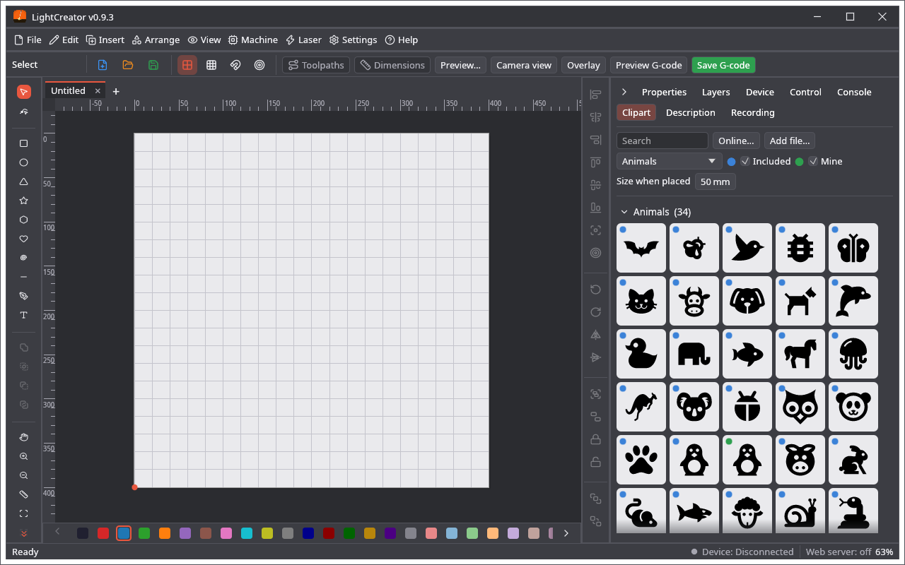
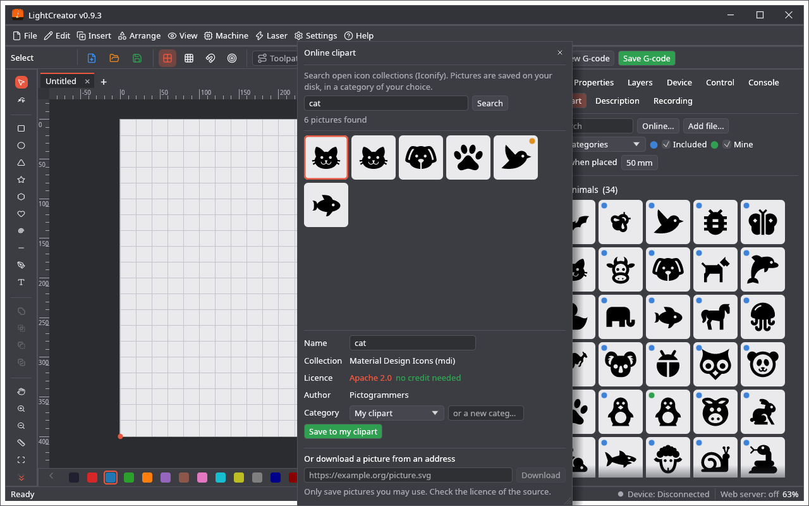

🌐 [English](Clipart-Gallery) · [Polski](Galeria-clipartow) · [简体中文](Clipart-Gallery-ZH) · **한국어**

> ⚠️ 이 페이지는 영어판을 기계 번역한 것으로, 부정확한 부분이 있을 수 있습니다. 의심스러우면 [영어판](Clipart-Gallery)을 기준으로 하십시오. 수정 제안을 환영합니다.

# 클립아트 갤러리

**9개 범주의 단색 그림 310개**(동물, 자연, 기념일, 기호, 도형, 도구, 음식, 사물, 음악과 놀이)가 있는 측면 패널 탭으로, 이름으로 검색할 수 있습니다. 하나를 클릭하면 설정한 크기로 활성 레이어에 놓입니다. 여러 부분으로 된 그림은 그룹으로 묶입니다. 그림은 일반 도형이므로 [노드 단위로](Design-Tools-KO) 편집할 수 있습니다. 범주 제목 줄의 화살표는 범주를 그 줄까지 접거나 다시 펼칩니다.

* **점:** 파란색 = 프로그램과 함께 제공, 녹색 = 사용자의 것(저장하거나 다운로드함), 주황색 = 라이선스상 출처 표시가 필요한 온라인 검색 결과.
* **온라인**(Online) (**삽입 → 온라인 클립아트…**(Insert → Online clipart…)도 가능): 프로그램 안에서 [Iconify](https://iconify.design/)의 공개 아이콘 모음을 검색하고, 모음, 라이선스, 작성자를 확인하고, 그림을 범주(기존 또는 새 범주)에 저장합니다. 웹 주소에서 다운로드하거나 SVG 파일을 추가할 수도 있습니다.
  
* 저장한 그림은 출처, 라이선스, 작성자를 보관합니다. 오른쪽 클릭 메뉴에서 이름 바꾸기, 이동, 정보 보기, 삭제를 할 수 있습니다.
* 사용자의 그림은 공유 `baseCreator` 데이터 폴더(`apps` 옆)의 `clipart` 폴더에 `index.json`과 함께 있습니다. MillCreator와 PenCreator도 같은 갤러리를 사용합니다([설정과 파일](Settings-and-Files-KO)).

## 라이선스
함께 제공되는 그림은 Pictogrammers의 [Material Design Icons](https://pictogrammers.com/library/mdi/)를 변경 없이 복사한 것입니다(Apache License 2.0, © Pictogrammers and contributors). 함께 제공되는 그림을 추가하려면 [baseCreator](https://github.com/michalsarna/baseCreator) 저장소의 `assets/clipart/`에 있는 범주 폴더에 SVG를 넣고(그림은 그 저장소의 모든 프로그램이 공유함) 다시 빌드하십시오. 재배포를 허용하는 라이선스의 파일만 추가하십시오.
