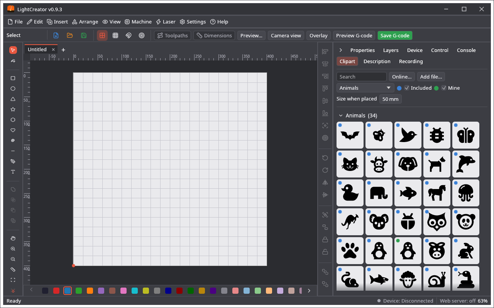
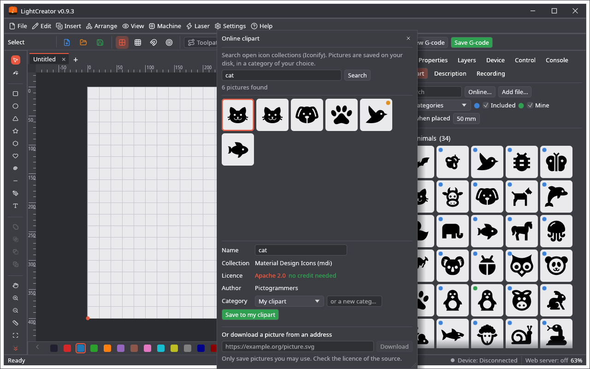

🌐 [English](Clipart-Gallery) · [Polski](Galeria-clipartow) · **简体中文** · [한국어](Clipart-Gallery-KO)

> ⚠️ 本页由英文版机器翻译而成，可能有不准确之处。如有疑问，请以[英文版](Clipart-Gallery)为准。欢迎提出修改建议。

# 剪贴画库

侧面板中的一个标签页，包含 **9 个类别中的 310 张单色图片**（动物、自然、庆祝、符号、形状、工具、食物、物品、音乐与娱乐），可按名称搜索。单击一张图片即可以你设定的尺寸将其放到当前图层上；由多部分组成的图片会被编组。图片是普通的形状，因此可以 [逐个节点](Design-Tools-ZH) 编辑。类别标题行上的箭头可将该类别折叠到标题行，或再次展开。

* **圆点：**蓝色 = 随程序附带，绿色 = 你自己的（已保存或已下载），橙色 = 许可证要求注明出处的在线结果。
* **在线**（**Online**）（也可用 **插入 → 在线剪贴画…**（**Insert → Online clipart…**））：在程序内搜索 [Iconify](https://iconify.design/) 的开放图标集，查看图标集、许可证和作者，并将图片保存到某个类别下（现有类别或新类别）。你也可以从网址下载或添加 SVG 文件。
  
* 保存的图片会保留来源、许可证和作者信息；可以通过右键菜单重命名、移动、查看或删除。
* 你的图片位于共享 `baseCreator` 数据文件夹（在 `apps` 旁边）的 `clipart` 文件夹中，并带有一个 `index.json`；MillCreator 和 PenCreator 使用同一个图库（[设置与文件](Settings-and-Files-ZH)）。

## 许可证
附带的图片是 Pictogrammers 的 [Material Design Icons](https://pictogrammers.com/library/mdi/) 的未修改副本（Apache License 2.0，© Pictogrammers and contributors）。如需添加附带的图片，请将 SVG 放入 [baseCreator](https://github.com/michalsarna/baseCreator) 仓库中 `assets/clipart/` 下的某个类别文件夹中（这些图片由其所有程序共用）并重新构建；只能添加许可证允许再分发的文件。
