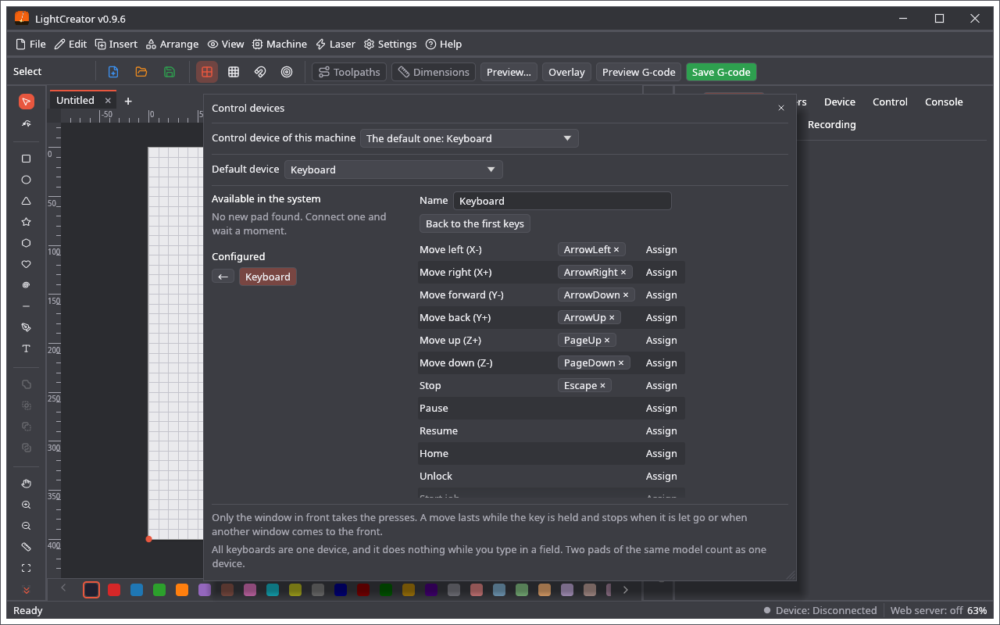

🌐 [English](Control-Devices) · [Polski](Urzadzenia-sterujace) · [简体中文](Control-Devices-ZH) · **한국어**

> ⚠️ 이 페이지는 영어판을 기계 번역한 것으로, 부정확한 부분이 있을 수 있습니다. 의심스러우면 [영어판](Control-Devices)을 기준으로 하십시오. 수정 제안을 환영합니다.

# 제어 장치

USB 패드나 키보드로 기계를 조작할 수 있습니다. **기계 → 제어 장치 ▸**(Machine → Control devices ▸)에는 두 항목이 있습니다: **제어 장치 설정…**(Control device settings…)은 장치와 그 키의 창을 열고, **이 기계의 제어 장치…**(Control device of this machine…)는 열려 있는 기계의 장치를 선택합니다.

## 장치

창에는 두 개의 목록이 있습니다. **시스템에서 사용 가능**(Available in the system)은 아직 설정되지 않은 키보드와 연결된 패드를, **구성됨**(Configured)은 설정된 장치를 보여 줍니다. 화살표는 장치를 한 목록에서 다른 목록으로 옮깁니다. 다시 되돌린 장치는 다시 돌아올 경우를 대비해 키를 유지합니다.

* 컴퓨터의 모든 키보드는 하나의 장치입니다. 시스템이 어느 키보드가 눌렸는지 창에 알려 주지 않기 때문입니다.
* 각 패드 모델은 자체 키를 가진 하나의 장치이며, 같은 모델의 패드 두 개는 하나로 셉니다.
* **기본 장치**(Default device)는 기계에 자체 장치가 없는 한 모든 기계와 프로그램이 사용하는 장치를 선택하거나, **기본 장치 없음**(No default device)을 선택합니다. 처음 구성한 장치가 기본 장치가 됩니다.

장치와 기본 장치는 LightCreator, MillCreator, PenCreator에서 공통입니다. 한 프로그램에서 바꾼 내용은 1초 안에 다른 프로그램에 반영됩니다.

## 키

동작 옆의 **할당**(Assign)은 선택한 장치에서 키가 눌리기를 기다립니다. 키나 버튼 하나는 한 가지 일만 합니다. 다른 동작에 할당하면 처음 동작에서 빠집니다. 스틱은 방향마다 하나씩, 두 개의 버튼처럼 동작합니다. 키의 **×**는 키를 제거하고, **처음 키로 돌아가기**(Back to the first keys)는 처음부터 다시 시작합니다. **마지막으로 누른 키**(Last pressed)는 장치가 보내는 내용을 보여 주므로, 버튼에 이름이 없는 패드에 도움이 됩니다.

새 장치에는 이동과 정지(Stop)만 있습니다. 무언가를 켜는 동작에는 직접 키를 할당하기 전까지 키가 없습니다. 각 장치는 세 프로그램 모두의 키를 보관합니다. 여기에는 LightCreator가 할 수 있는 동작이 표시됩니다.

X와 Y 이동(장치에 Z가 있으면 Z도), 정지(Stop), 일시 정지(Pause), 재개(Resume), 원점 복귀(Home), 잠금 해제(Unlock), 작업 시작(Start job), 프레임(Frame), **에어 켜기 / 끄기**(Air on / off) (장치의 에어 명령), **누르고 있는 동안 저출력 빔**(Low-power beam while held) (장치의 초점 빔; 키를 놓으면 꺼짐).

## 기계의 장치

**이 기계의 제어 장치…**는 열려 있는 기계의 장치를 선택합니다. 하나의 장치가 여러 기계를 담당할 수 있습니다. 자체 장치가 없거나 그 장치가 제거된 기계는 기본 장치를 사용합니다. 기본 장치가 없으면 아무 일도 일어나지 않습니다.

## 동작 방식

* 맨 앞의 창만 입력을 받으며, 입력은 그 창에 열려 있는 기계로 전달됩니다.
* 이동은 키를 누르고 있는 동안 계속됩니다(GRBL 1.1). 오래된 컨트롤러에서는 한 번 누를 때마다 한 단계입니다. 키를 놓을 때, 다른 창이 앞으로 나올 때, 패드가 분리될 때, 기계를 바꿀 때 멈춥니다.
* 작업 중에는 정지, 일시 정지, 재개만 동작합니다.
* 설정 창이 열려 있는 동안에는 기계가 반응하지 않습니다. 키를 고르는 중이기 때문입니다.
* 입력 칸에 입력하거나 Ctrl, Cmd, Alt를 누르고 있는 동안에는 키보드가 아무것도 하지 않습니다. 기계가 연결되어 있으면 키 입력은 편집기가 아니라 기계로 갑니다. 처음 키 설정에서는 연결을 해제할 때까지 화살표 키가 선택한 도형을 옮기지 않습니다.
* 장치는 비상 정지를 대신하지 않습니다. 실제 비상 정지 버튼 가까이에 손을 두십시오.

## 백업

장치, 그 키, 기본 장치는 세 프로그램 각각의 백업에 들어 있으며(`app.ron`의 `control_devices`), 기계의 선택은 기계와 함께 보관됩니다. 복원하면 공통 정의이므로 세 프로그램 모두의 정의가 대체됩니다. 이 정보가 없는 오래된 백업은 정의를 그대로 둡니다. 디스크에서는 공유 데이터 폴더의 `control_devices.json`에 있습니다.
