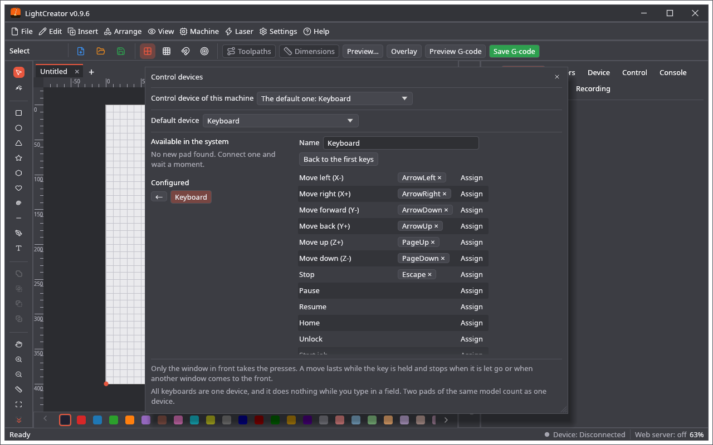

🌐 [English](Control-Devices) · [Polski](Urzadzenia-sterujace) · **简体中文** · [한국어](Control-Devices-KO)

> ⚠️ 本页由英文版机器翻译而成，可能有不准确之处。如有疑问，请以[英文版](Control-Devices)为准。欢迎提出修改建议。

# 控制设备

USB 手柄或键盘可以操控机器。**机器 → 控制设备 ▸**（**Machine → Control devices ▸**）包含两个菜单项：**控制设备设置…**（**Control device settings…**）打开设备及其按键的窗口，**本机的控制设备…**（**Control device of this machine…**）为当前打开的机器选择控制设备。

## 设备

该窗口有两个列表。**系统中可用**（**Available in the system**）显示键盘以及已连接但尚未设置的手柄，**已配置**（**Configured**）显示已设置的设备。箭头用于将设备从一个列表移到另一个列表。移回去的设备会保留其按键设置，以防它再次被使用。

* 计算机的所有键盘算作一个设备：系统不会告诉该窗口按下的是哪一个键盘。
* 每种型号的手柄是一个拥有自己按键设置的设备；两个同型号的手柄算作一个。
* **默认设备**（**Default device**）用于选择每台机器和每个程序都使用的设备（除非某台机器有自己的设备），或选择 **无默认设备**（**No default device**）。你配置的第一个设备会成为默认设备。

设备和默认设备在 LightCreator、MillCreator 和 PenCreator 之间共用。在一个程序中所做的更改会在一秒内同步到其他程序。

## 按键

动作旁边的 **分配**（**Assign**）会等待在所选设备上按下一个键。一个键或按钮只执行一件事：把它分配给另一个动作会将它从第一个动作中移除。摇杆相当于两个按钮，每个方向一个。按键上的 **×** 会移除它，**恢复初始按键**（**Back to the first keys**）会重新开始。**最后按下**（**Last pressed**）显示设备发送的内容，这对按钮没有名称的手柄很有帮助。

新设备只有移动和停止的按键。任何会开启某种功能的动作都没有按键，直到你为它分配一个。每个设备都保存三个程序的按键；这里显示的是 LightCreator 能执行的动作：

移动 X 和 Y（设备有 Z 时还包括 Z）、停止、暂停、继续、回零、解锁、开始作业、框选、**吹气开 / 关**（**Air on / off**）（设备的吹气命令）以及 **按住时低功率光束**（**Low-power beam while held**）（设备的对焦光束；松开按键时关闭）。

## 机器的控制设备

**本机的控制设备…** 为当前打开的机器选择一个设备。一个设备可以服务多台机器。没有自己设备的机器，或其设备已被移除的机器，会使用默认设备。没有默认设备时则什么也不会发生。

## 行为方式

* 只有位于最前面的窗口接收按键，按键会作用于该窗口中打开的机器。
* 移动会在按住按键期间持续进行（GRBL 1.1）；在较旧的控制器上，每按一次移动一步。当你松开按键、另一个窗口切换到最前面、手柄断开或你更换机器时，移动会停止。
* 作业期间只有停止、暂停和继续有效。
* 设置窗口打开时机器不会响应：此时你正在选择按键。
* 当你在输入框中输入，或按住 Ctrl、Cmd 或 Alt 时，键盘不起作用。连接机器后，键盘的按键会作用于机器，而不是编辑器：使用初始按键时，方向键将不再移动所选形状，直到你断开连接。
* 控制设备不能代替急停开关。请把手放在真正的急停开关附近。

## 备份

设备、其按键以及默认设备都包含在三个程序各自的备份中（`app.ron` 中的 `control_devices`），机器所选的设备随机器一起保存。由于这些定义是共用的，恢复备份会替换所有三个程序中的定义；不包含它们的较旧备份则不会改变它们。在磁盘上，它们位于共享数据文件夹中的 `control_devices.json`。
