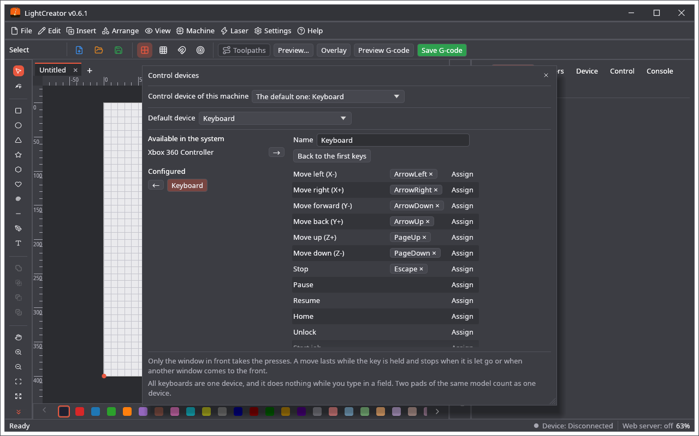

# Control Devices

A USB pad or the keyboard can drive the machine. **Machine → Control devices ▸** has the two entries: **Control device settings…** opens the window of the devices and their keys, and **Control device of this machine…** chooses the device of the machine that is open.

## Devices

The window has two lists. **Available in the system** shows the keyboard and the connected pads that are not set up yet, and **Configured** shows the ones that are. The arrow moves a device from one list to the other. A device moved back keeps its keys, in case it comes back.

* All the keyboards of the computer are one device: the system does not tell the window which one was pressed.
* Each pad model is a device with keys of its own; two pads of the same model count as one.
* **Default device** chooses the one that every machine and program uses unless a machine has its own, or **No default device**. The first device you configure becomes the default.

The devices and the default are common to LightCreator, MillCreator and PenCreator. A change in one program reaches the others within a second.

## Keys

**Assign** next to an action waits for a press on the selected device. A key or button does one thing: giving it to another action takes it from the first. A stick works like two buttons, one for each direction. **×** on a key removes it, and **Back to the first keys** starts again. **Last pressed** shows what the device sends, which helps with a pad whose buttons have no names.

A new device has the moves and Stop only. Nothing that switches something on has a key until you give it one. Each device keeps the keys of all three programs; here you see what LightCreator can do:

Move X and Y (and Z when the device has it), Stop, Pause, Resume, Home, Unlock, Start job, Frame, **Air on / off** (the air commands of the device) and **Low-power beam while held** (the focus beam of the device; it goes off when the key is let go).

## The device of a machine

**Control device of this machine…** chooses a device for the machine that is open. One device can serve many machines. A machine without its own device, or whose device was removed, uses the default one. With no default one nothing happens.

## How it behaves

* Only the window in front takes the presses, and they go to the machine that is open in it.
* A move lasts while the key is held (GRBL 1.1); on an older controller each press is one step. It stops when you let go, when another window comes to the front, when the pad goes away or when you change the machine.
* During a job only Stop, Pause and Resume work.
* While the settings window is open the machine does not react: you are choosing keys.
* The keyboard does nothing while you type in a field or hold Ctrl, Cmd or Alt. With a machine connected its keys go to the machine, not to the editor: with the first keys the arrows stop moving the selected shape until you disconnect.
* A device does not replace an emergency stop. Keep your hand near the real one.

## Backup

The devices, their keys and the default one are in the backup of each of the three programs (`control_devices` in `app.ron`), and the choice of a machine is kept with the machine. Restoring replaces the definitions in all three programs, because they are common; an older backup without them leaves them alone. On disk they are in `control_devices.json` in the shared data folder.
