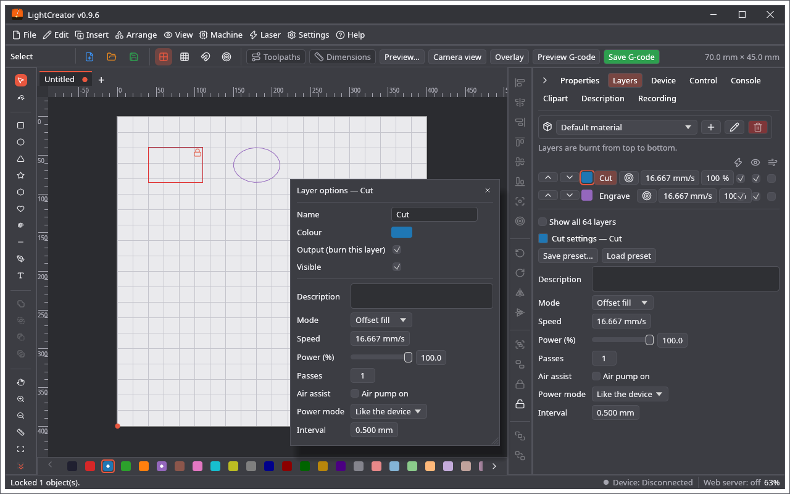
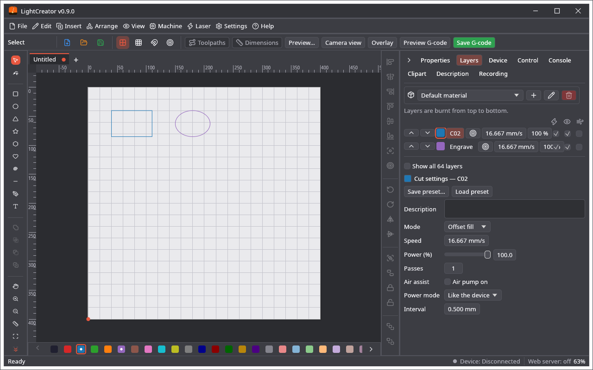
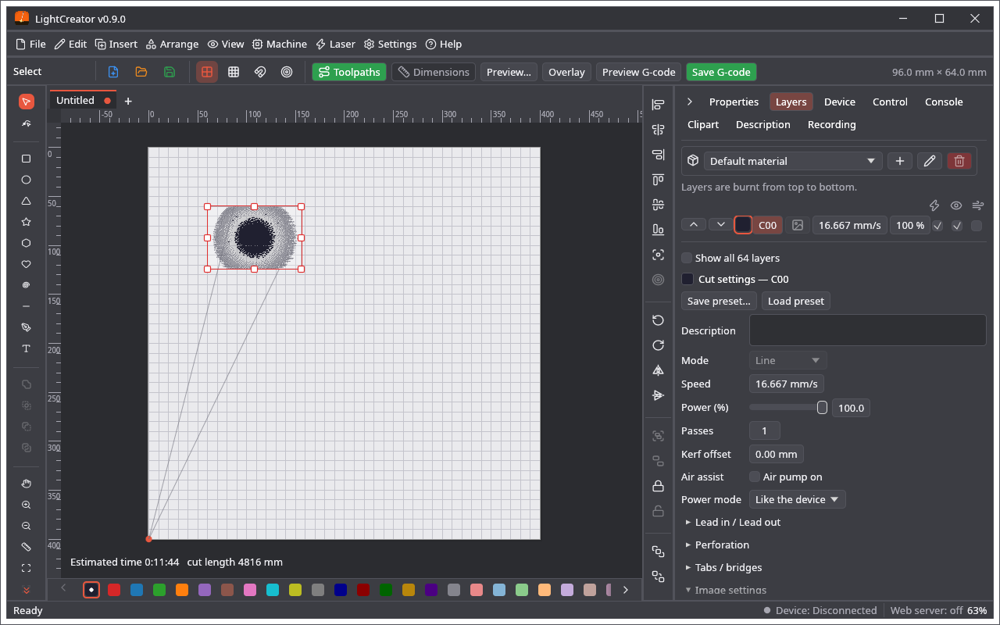
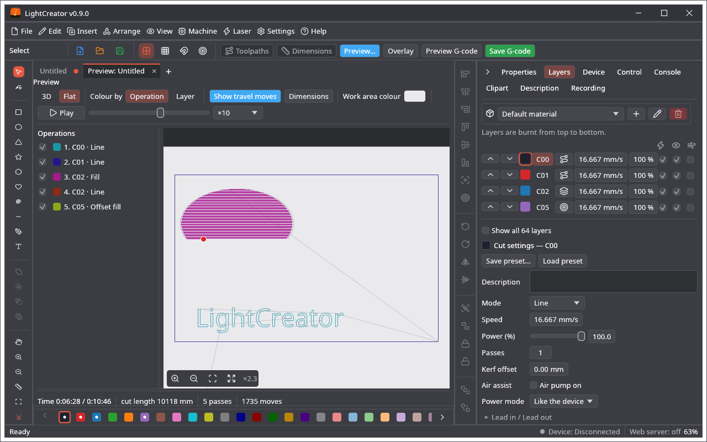
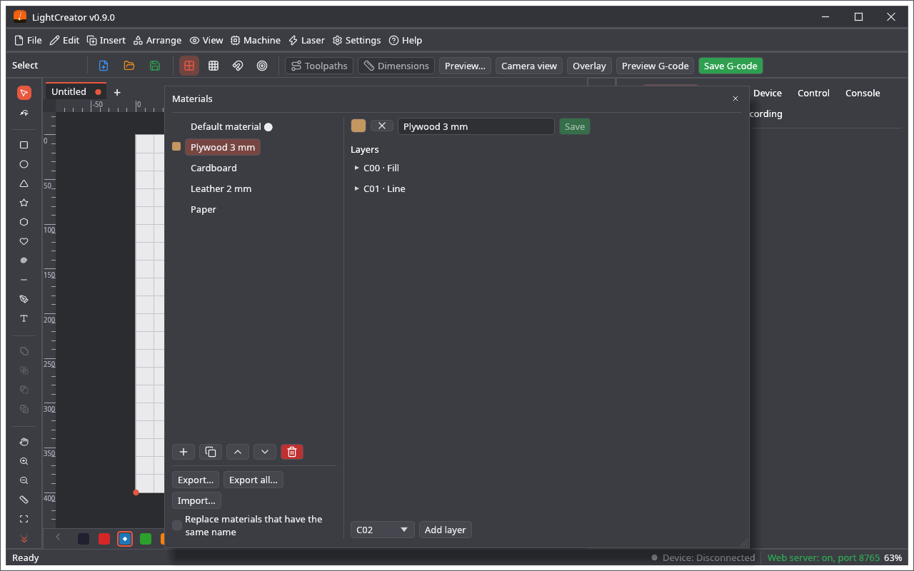

🌐 [English](Cuts-and-Layers) · [Polski](Ciecia-i-warstwy) · [简体中文](Cuts-and-Layers-ZH) · **한국어**

> ⚠️ 이 페이지는 영어판을 기계 번역한 것으로, 부정확한 부분이 있을 수 있습니다. 의심스러우면 [영어판](Cuts-and-Layers)을 기준으로 하십시오. 수정 제안을 환영합니다.

# 절단과 레이어

## 레이어
* 64개의 색상 레이어가 있습니다. 각 레이어에는 **모드**(mode) (선(Line), 채우기(Fill), 채우기 + 선(Fill + Line), 오프셋 채우기(Offset fill)), 속도, 출력, 패스 수, 간격, 스캔 각도, 오버스캔, 양방향 스캔, 출력 / 표시 스위치가 있습니다. 레이어에는 **설명**(description)도 붙일 수 있습니다(레이어 설정에서 최대 500자): 그 레이어의 용도, 예를 들어 "관통 절단, 2패스". 설명은 목록과 레이어 바에서 레이어의 도움말 풍선에 표시되고, 프로젝트와 함께 저장되며, 재료의 레이어 설정과 함께 이동합니다.
* 새 레이어는 출력 100 %, 1000 mm/min으로 시작합니다. 레이어 설정은 **프로젝트**에 속합니다. 프로젝트 파일이 장치 프로필과 함께 레이어 설정을 담고 있으며, 장치 프로필 자체는 레이어 속도를 보관하지 않습니다(오래된 프로필에는 예전 목록이 남아 있지만 무시됩니다). 속도는 초당 또는 분당(장치 옵션 *속도 단위*(Speed units)), mm 또는 인치로 표시됩니다.
* **에어 어시스트:** 각 레이어에는 *에어 펌프 켜기*(Air pump on) 스위치가 있습니다. G-code는 에어를 원하는 레이어가 시작될 때 펌프를 켜고(`M8`; Marlin에서는 팬), 원하지 않는 레이어가 시작될 때 끄며, 마지막에 끕니다.
* 작업 영역 아래의 색상 줄이 **레이어 바**(layer bar)입니다. 색을 클릭하면 선택한 도형이 그 레이어로 들어가고(아무것도 선택하지 않았으면 새 도형이 들어갈 레이어를 선택), 더블 클릭하면 **레이어 옵션**(Layer options) 창이 열립니다(**레이어**(Layers) 탭에서 레이어를 더블 클릭해도 마찬가지). **설정 → 보기 옵션… → 레이어 이름 표시**(Settings → View options… → Show layer names)를 켜면 도형이 있는 레이어의 색 옆에 이름이 표시됩니다. 레이어 목록에서 각 행은 속도 앞에 **모드**를 아이콘으로 보여 주며(이름은 도움말 풍선에 있음), 아이콘을 클릭하면 다른 모드를 선택할 수 있습니다. 단, 그림 레이어는 항상 이미지(Image) 모드입니다.
* 각 행 끝의 세 스위치는 아이콘이 머리글로 붙어 있으며, 출력(새기기), 표시, 에어 펌프입니다. *이미지 설정*(Image settings) (디더링, 최소 출력)은 비트맵이 있는 레이어에만 표시됩니다.
* **레이어** 탭은 사용 중인 레이어(그리고 활성 레이어; **64개 레이어 모두 표시**(Show all 64 layers)를 누르면 나머지도 표시)를 **새기는 순서**대로 나열합니다. 위나 아래로 옮겨 순서를 바꾸십시오. 속성(Properties) 탭은 선택 항목의 레이어 색을 보여 줍니다.

## 모드
| 모드 | 결과 |
|---|---|
| 선 (Line) | 윤곽을 따라감 |
| 채우기 (Fill) | 레이어 간격으로 스캔 라인 |
| 채우기 + 선 (Fill + Line) | 채운 다음 윤곽 |
| 오프셋 채우기 (Offset fill) | 레이어 간격으로 안쪽을 향하는 동심 고리 |

안쪽 도형이 먼저 절단되며, 순서는 최근접 이웃 방식으로 정해집니다.

## 래스터 이미지
이미지는 레이어 간격으로 한 줄씩 조각됩니다. **임계값**(threshold), **Floyd-Steinberg**, **Jarvis**, **Stucki**, **Atkinson**, **순서**(ordered) 디더링 또는 **그레이스케일 출력**(grayscale power) (최소 / 최대 출력)을 선택하십시오. 각 이미지에는 반전 옵션이 있습니다.

## 미리 보기
미리 보기는 도면 옆에 있는 **작업 영역의 탭**입니다. 작업 영역 위 바의 **미리 보기…**(Preview…) 또는 **레이저 → 미리 보기 창…**(Laser → Preview window…) (Ctrl+Shift+P)으로 엽니다(열려 있는 동안 버튼에 불이 들어오며, 다시 누르면 닫힙니다). 탭의 X 표시로 닫을 수도 있습니다. 다른 탭처럼 다른 창 영역으로 드래그할 수 있고, 오른쪽 클릭 메뉴에 **별도의 창에서 열기**(Open in a separate window)가 있습니다(**메인 창으로 돌아가기**(Back to the main window)로 되돌립니다). 새길 객체에 맞춰 확대된 상태로 열립니다. 그림 왼쪽 아래의 확대·축소 바로 확대하거나 축소하고, 보기를 작업 영역(**보기 재설정**(Reset view)) 또는 모든 객체(**모든 객체에 맞춤**(Fit all objects))에 맞출 수 있습니다. 미리 보기는 전체 작업을 보여 주며, 각 작업(레이어, 채우기, 선, 오프셋, 이미지, 패스)을 고유한 색 또는 레이어의 색으로 표시합니다(**색 기준**(Colour by): **작업**(Operation) 또는 **레이어**(Layer)). 그 밖에 **작업**(Operations) 목록의 작업별 스위치, **이동 경로 표시**(Show travel moves) (기본값 꺼짐), **작업 영역 색**(Work area colour) (미리 보기에서 작업 영역의 색, 예를 들어 재료의 색; **자동**(Automatic)은 도면의 색으로 되돌리며 보기 설정과 함께 보관됨), 그리고 재생 기능이 있습니다: **재생**(Play) / **일시 정지**(Pause), 슬라이더와 속도(**15초에 맞춤**(Fit 15 s): 전체 작업을 15초 안에, **실시간**(Real time), ×10 (기본값), ×50, ×200). 그림 아래에는 합계가 있습니다: 시간(전체 중 슬라이더가 있는 위치), 절단 길이, 패스 수, 이동 수. 바의 **툴패스**(Toolpaths)는 같은 경로를 도면 위에 직접 그립니다.

## 재료
모든 장치에는 **재료** 목록이 있습니다(최소 하나: 새 장치는 비어 있는 *기본 재료*(Default material)와 레이저 종류에 맞는 몇 가지 시작점으로 시작합니다: 합판 3 mm(Plywood 3 mm), 판지(Cardboard), 가죽 2 mm(Leather 2 mm), 종이(Paper), 그리고 CO2의 경우 아크릴 3 mm(Acrylic 3 mm). 이 이름들은 인터페이스 언어로 번역되며, 직접 지은 이름은 입력한 그대로 유지됩니다. 수치는 일반적인 다이오드(약 10 W) 또는 CO2(약 40 W) 레이저를 위한 일반적인 값이므로 항상 자투리 재료로 테스트하십시오). 재료에는 이름과 그 재료가 사용하는 레이어의 설정(모드, 속도, 출력, 패스 수, 간격, 스캔 각도, 오버스캔, 커프, 천공, 탭, 헤드, Z, 로터리...)이 있습니다. 재료에는 **색**을 지정할 수 있습니다. 재료를 추가(**+**)하거나 이름을 바꿀 때(연필) 열리는 행의 색 버튼으로 설정하며, X 표시로 지웁니다. 색은 재료를 구분하기 위해 표시만 되며(목록 앞의 아이콘에 색을 입히고 목록의 각 이름 앞에 작은 사각형으로 표시됨), 출력에는 아무 영향도 주지 않습니다. 목록은 장치의 일부이므로 장치 프로필과 함께(내보내기와 백업에서도), 그리고 저장된 모든 프로젝트와 레이어와 함께 이동합니다.

**레이어 탭**은 선택한 재료의 레이어를 편집하며, 탭 제목에 어떤 재료인지 표시됩니다. 제목에서 다른 재료를 선택하거나(레이어가 그 재료의 설정을 가져옵니다. 그 재료에 정의되지 않은 레이어는 기본값으로 돌아가며, 레이어의 이름, 색, 스위치는 유지됩니다), 비어 있는 새 재료를 추가하거나(입력한 이름으로; 레이어가 기본값으로 돌아가고 디자인이 사용하는 레이어가 그 재료에 들어갑니다), 이름을 바꾸거나 삭제할 수 있습니다(마지막 재료는 삭제할 수 없습니다). 디자인이 사용하지만 선택한 재료에 없는 레이어는 기본 설정으로 즉시 그 재료에 추가되며, 변경한 레이어는 재료에서도 변경됩니다. 프로젝트를 열면 그 재료가 장치의 목록에 들어갑니다(또는 목록에서 찾아집니다).

## 레이어 프리셋

레이어 설정 위에 있는 **프리셋 저장…**(Save preset…)과 **프리셋 불러오기**(Load preset)는 **레이어 프리셋**(Layer presets) 창을 엽니다. 이름 입력 칸과 **프리셋 저장…**은 레이어의 새기는 방식(모드, 속도, 출력, 패스 수, 채우기, 그림, 커프, 탭…)을 그 이름으로 보관합니다(같은 이름의 프리셋은 대체됩니다). 검색 입력 칸으로 목록을 좁히고, 프리셋을 클릭하면 실행 취소 단계와 함께 활성 레이어에 적용됩니다. 연필은 이름을 바꾸고 ×는 지웁니다. **내보내기…**(Export…)는 모든 프리셋을 파일에 기록하고, **가져오기…**(Import…)는 파일의 프리셋을 추가합니다(범위를 벗어난 숫자가 있는 항목은 빠집니다). 레이어의 이름, 색, 출력, 표시는 유지됩니다. 프리셋은 장치나 재료에 묶여 있지 않습니다. 같은 출력이라도 다른 레이저에서는 결과가 다르므로 자투리 재료로 프리셋을 확인하십시오. 목록은 공유 데이터 폴더의 `lc_layer_presets.json`에 있습니다.

## 커프, 천공, 탭 (선 레이어)
* **커프 오프셋**(Kerf offset): 절단 폭을 보정하기 위해 닫힌 윤곽을 지정한 거리만큼 바깥쪽으로(음수이면 안쪽으로) 옮깁니다. 구멍은 반대 방향으로 옮겨집니다. 0 = 꺼짐. G-code에서만 사용되며, HPGL / DXF 내보내기와 툴패스 미리 보기는 그린 그대로의 윤곽을 보여 줍니다.
* **리드 인 / 리드 아웃**(Lead in / Lead out): 닫힌 윤곽을 부품 바깥의 한 점에서부터 절단합니다. 새기기는 버려지는 쪽에서 **선**(Line) (*리드 각도*(Lead angle), 90°는 윤곽에 수직) 또는 **호**(Arc) (*리드 반지름*(Lead radius)의, 윤곽에 접하는 4분원)의 끝에서 시작하여 윤곽을 한 바퀴 돌고, *겹침*(Overlap)만큼 더 진행한 뒤 리드 아웃을 따라 빠져나갑니다. 버려지는 쪽은 윤곽의 바깥과 구멍(홀수 개의 다른 윤곽 안에 있는 윤곽)의 안쪽입니다. 모서리에서 시작하는 윤곽은 대신 가장 긴 변의 가운데에서 시작합니다. 리드가 윤곽을 가로지르거나 다른 윤곽에 닿게 되면 작게 만들거나 생략합니다. 열린 선은 그대로 절단됩니다. 이렇게 하면 절단이 시작되는 곳에서 가장 깊게 남는 피어싱 자국이 감춰집니다.
* **천공**(Perforation): 윤곽을 *절단 길이*(Cut length)만큼 자르고, *건너뛰기 길이*(Skip length)만큼 건너뛰고, 이를 반복합니다. 건너뛴 구간은 레이저가 꺼진 이동입니다.
* **탭 / 브리지**(Tabs / bridges): 윤곽의 짧은 구간을 자르지 않고 남기거나 레이어 출력의 일정 비율(*탭 절단 출력*(Tab cut power))로 잘라, 부품이 제자리에 남게 합니다. *탭 크기*(Tab size)는 윤곽을 따른 길이입니다. *균등 간격*(Even spacing)은 *간격*(Spacing) 밀리미터마다 탭을 놓고(최소 *최소 탭 수*(Min tabs)), *도형당 탭 수*(Tabs per shape)는 고정된 개수를 놓습니다. *최대 탭 수 제한*(Limit max tabs)은 개수의 상한을 정하고, *안쪽 도형 건너뛰기*(Skip inner shapes)는 다른 도형 안에 있는 도형에 탭을 넣지 않습니다. 탭은 윤곽을 따라 고르게 자동으로 배치되며, 아직 직접 배치할 수는 없습니다.
이 옵션들은 기본적으로 꺼져 있으며, 꺼져 있으면 G-code에 아무 변화도 주지 않습니다. 레이어와 함께, 그리고 프로젝트에 저장됩니다.

## 이미지와 이미지 모드
비트맵 이미지만 있는 레이어는 항상 **이미지**(Image) 모드입니다. 모드는 바꿀 수 없지만 속도, 출력, 패스 수, 간격, 스캔 각도, 오버스캔, 디더링 등은 바꿀 수 있습니다. 이런 레이어에 놓인 벡터 도형은 새겨지지 않습니다(이미지와 윤곽이 모두 있는 레이어는 선택한 모드를 유지합니다). **스캔 각도**는 이미지의 조각 선을 그 각도만큼 회전시킵니다.

다른 프로그램의 절단 설정 중 구현되지 않은 것: 하위 레이어(한 색에 여러 설정)와 탭 직접 배치.

**재료 창.** **레이저 → 재료…**(Laser → Materials…)는 장치의 재료를 관리하는 창을 엽니다. 왼쪽에는 목록(점은 디자인이 사용하는 재료를, 색 사각형은 그 색을 표시)과 재료를 추가(**+**), 복사, 위아래로 이동, 삭제하는 버튼이 있고, 오른쪽에는 선택한 재료의 이름과 색(**저장**(Save)으로 적용)과 모든 설정이 포함된 레이어가 있으며, 그곳에서 레이어를 변경하거나 추가(**레이어 추가**(Add layer))하거나 제거할 수 있습니다. **내보내기…**(Export…)는 선택한 재료를 파일(`.json`)에 기록하고, **모두 내보내기…**(Export all…)는 전부를 기록하며, **가져오기…**(Import…)는 그런 파일을 읽습니다. 목록에 이미 있는 이름의 재료는 다른 이름(*이름 (2)*(Name (2)))으로 보관되거나, **같은 이름의 재료 대체**(Replace materials that have the same name)를 선택하면 기존 재료를 대체합니다. 가져올 때 파일을 엄격하게 검사하며(크기, 재료 수, 모든 숫자), 더 새로운 버전에서 만든 파일은 거부됩니다.

## G-code의 주석

G-code는 모든 것이 어디서 시작하고 끝나는지 주석(`; …`)으로 알려 주므로, 파일을 읽고 그 안에서 멈춘 작업을 찾을 수 있습니다.

* 레이어와 객체의 수(그리고 **한 번에 한 요소씩**(One element at a time)일 때는 요소의 수)가 담긴 `; job: …`;
* 레이어마다 `; Layer: name (mode) speed … power …`와 `; settings: …` (작업에서의 번호, 객체, 패스 수, 에어 어시스트, Z 단계), 그리고 레이어 끝에 `; end of layer name`;
* 패스마다 `; pass 2/3`;
* 객체의 줄을 감싸는 `; object 2 of 5 start: rectangle` / `; object 2 end` (가장 가까운 경로가 레이저를 다른 객체로 갔다가 되돌아오게 하면 객체가 `(again)`과 함께 다시 시작됨), **한 번에 한 요소씩**일 때 `; element 1 of 4 start` / `; element 1 end`;
* 선마다 `; path 3 of 12 start: closed, 60.0 mm` / `; path 3 end`, `; fill start: 40 lines, 0.1 mm apart, at 0°, overscan 2 mm` / `; fill end`, 고리와 함께 `; offset fill start`, `; picture 1 of 2 start: 300 rows` / `; picture 1 end`;
* `; end of the job`.

채우기는 레이어의 모든 객체에 걸친 하나의 선 집합이므로 객체별 주석이 없습니다. 주석은 기계로 전송되지 않습니다. 장치 설정의 **주석 제거**(Remove comments)는 파일에서 주석을 뺍니다.
