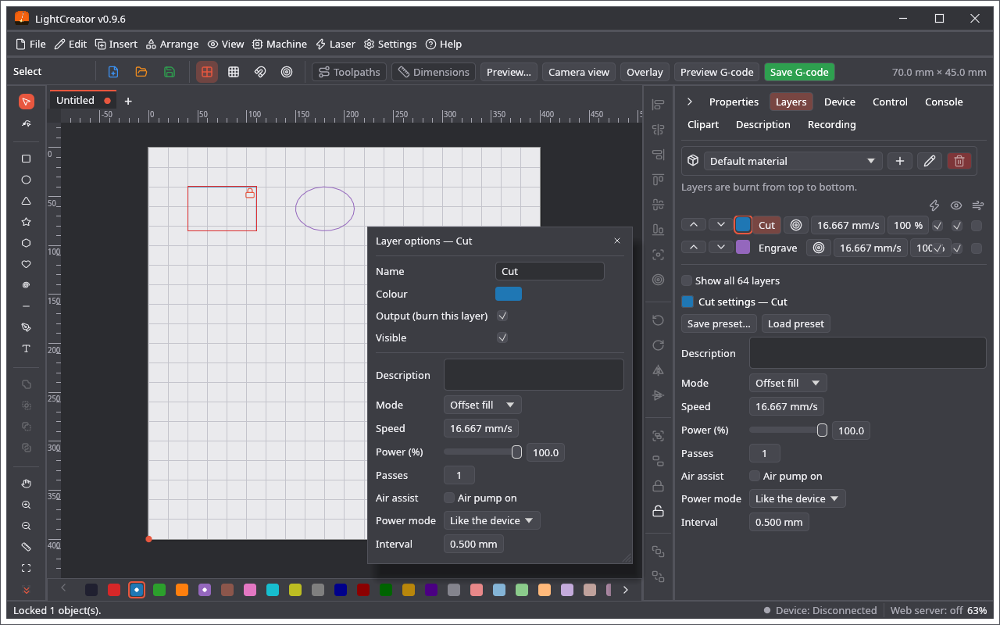
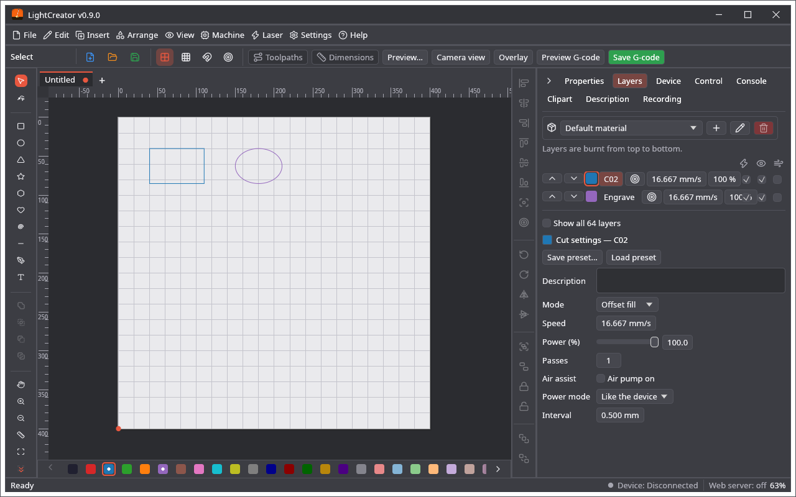
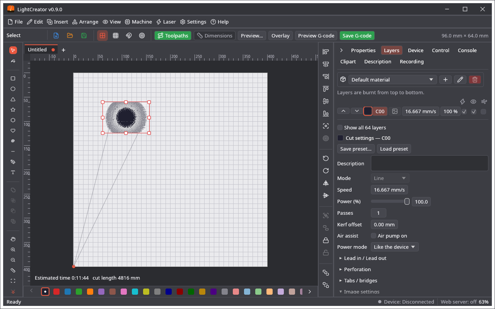
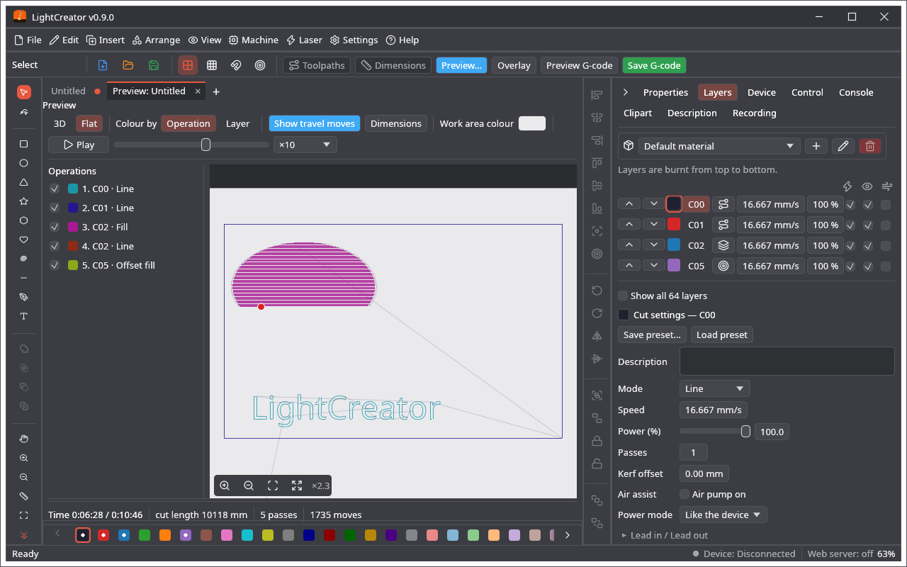
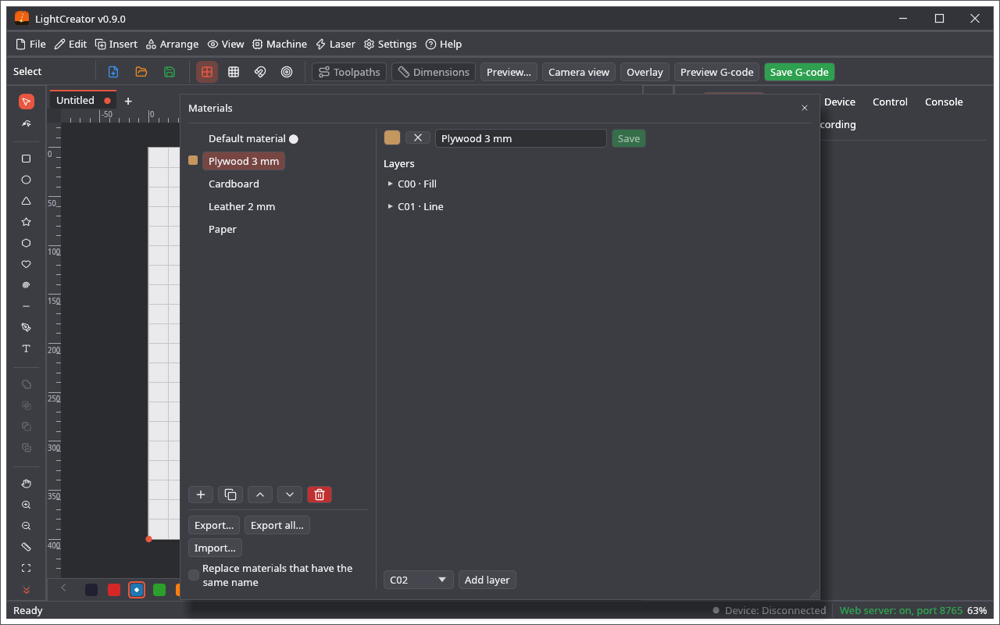

🌐 [English](Cuts-and-Layers) · [Polski](Ciecia-i-warstwy) · **简体中文** · [한국어](Cuts-and-Layers-KO)

> ⚠️ 本页由英文版机器翻译而成，可能有不准确之处。如有疑问，请以[英文版](Cuts-and-Layers)为准。欢迎提出修改建议。

# 切割与图层

## 图层
* 64 个彩色图层。每个图层都有 **模式**（**mode**）（线条、填充、填充 + 线条、偏移填充）、速度、功率、遍数、间距、扫描角度、过扫描、双向扫描，以及输出 / 可见性开关。图层还可以有一段 **描述**（**description**）（最多 500 个字符，在图层设置中填写）：说明该图层的用途，例如“切穿，两遍”。它会显示在列表和图层栏中该图层的提示里，随项目一起保存，并随材料的图层设置一起携带。
* 新图层以 100 % 功率和 1000 mm/min 开始。图层的设置属于 **项目**：项目文件将它们与设备配置文件一起携带；设备配置文件本身不保存图层速度（较旧的配置文件中仍包含旧的列表，但会被忽略）。速度按每秒或每分钟显示（设备选项 *速度单位*（*Speed units*）），单位为 mm 或英寸。
* **辅助吹气（Air assist）：**每个图层都有一个 *气泵开启*（*Air pump on*）开关。当需要气泵的图层开始时，G-code 会开启气泵（`M8`；在 Marlin 上为风扇），当不需要气泵的图层开始时关闭，并在结束时关闭。
* 工作区下方的一排颜色是 **图层栏**（**layer bar**）：单击某种颜色会将所选形状放到该图层上（未选中任何内容时，它会选择新形状所在的图层），双击会打开 **图层选项**（**Layer options**）窗口（在 **图层**（**Layers**）标签页中双击某个图层也是如此）。开启 **设置 → 视图选项… → 显示图层名称**（**Settings → View options… → Show layer names**）后，含有形状的图层会在其颜色旁显示名称。在图层列表中，每一行都会在速度前以图标显示 **模式**（名称在提示中）；单击它可以选择其他模式，但图片图层除外，它始终处于图像模式。
* 每行末尾以图标为标题的三个开关分别是输出（烧刻）、可见和气泵。*图像设置*（*Image settings*）（抖动、最小功率）只对含有位图的图层显示。
* **图层** 标签页按 **烧刻顺序**（**burn order**）列出正在使用的图层（以及当前活动图层；**显示全部 64 个图层**（**Show all 64 layers**）会显示其余图层）；上下移动它们可以改变顺序。属性（Properties）标签页显示所选内容的图层颜色。

## 模式
| 模式 | 结果 |
|---|---|
| 线条（Line） | 沿轮廓走 |
| 填充（Fill） | 按图层间距进行扫描线填充 |
| 填充 + 线条（Fill + Line） | 先填充，再走轮廓 |
| 偏移填充（Offset fill） | 按图层间距向内生成同心环 |

内部形状先切割；排序采用最近邻方式。

## 栅格图像
图像按图层间距逐行雕刻。可选择 **阈值**（**threshold**）、**Floyd-Steinberg**、**Jarvis**、**Stucki**、**Atkinson**、**有序**（**ordered**）抖动或 **灰度功率**（**grayscale power**）（最小 / 最大功率）。每张图像都有负片选项。

## 预览
预览是 **工作区的一个标签页**，与绘图并列：工作区上方工具栏中的 **预览…**（**Preview…**）或 **激光 → 预览窗口…**（**Laser → Preview window…**）（Ctrl+Shift+P）会打开它（打开时按钮会高亮，再次按下则关闭），标签页上的叉号也会关闭它。与其他标签页一样，它可以被拖到另一个窗格，其右键菜单中有 **在单独窗口中打开**（**Open in a separate window**）（**返回主窗口**（**Back to the main window**）会将其放回）。它打开时会缩放到要烧刻的对象；画面左下角的缩放栏用于放大和缩小，并可使视图适应工作区（**重置视图**（**Reset view**））或全部对象（**显示全部对象**（**Fit all objects**））。它显示整个作业，每个操作（图层、填充、线条、偏移、图像、遍）以自己的颜色或其图层的颜色显示（**着色依据**（**Colour by**）：**操作**（**Operation**）或 **图层**（**Layer**）），**操作**（**Operations**）列表中的每个操作都有一个开关，还有 **显示空移**（**Show travel moves**）（默认关闭）、**工作区颜色**（**Work area colour**）（预览中工作区的颜色，例如材料的颜色；**自动**（**Automatic**）恢复为绘图的颜色；随视图设置一起保存），以及播放功能：**播放**（**Play**）/ **暂停**（**Pause**）、一个滑块和一个速度（**适配 15 秒**（**Fit 15 s**）：在 15 秒内播放整个作业，**实时**（**Real time**），×10（默认），×50，×200）。画面下方是汇总：时间（滑块所在位置 / 总时间）、切割长度、遍数和移动次数。工具栏上的 **刀具路径**（**Toolpaths**）会在绘图上绘制同样的路径。

## 材料
每个设备都有一个 **材料**（**materials**）列表（至少一种：新设备开始时有一个空的 *默认材料*（*Default material*）以及几个适合其激光类型的起始材料：3 mm 胶合板（Plywood 3 mm）、纸板（Cardboard）、2 mm 皮革（Leather 2 mm）、纸张（Paper），CO2 激光器还有 3 mm 亚克力（Acrylic 3 mm）。它们的名称会被翻译为界面语言；你自己起的名称会按输入保留。这些数值是典型二极管激光器（约 10 W）或 CO2 激光器（约 40 W）的通用值：务必先在废料上测试）。材料有一个名称以及它所使用图层的设置（模式、速度、功率、遍数、间距、扫描角度、过扫描、切缝补偿、穿孔、连接桥、激光头、Z、旋转…）。材料可以有一种 **颜色**（**colour**）：在添加材料（**+**）或重命名材料（铅笔图标）时打开的那一行中用颜色按钮设置，用叉号清除。颜色仅用于显示，以区分不同的材料（它会给列表前面的图标着色，并在列表中每个名称前显示为一个小方块），不会改变输出中的任何内容。该列表是设备的一部分，因此会随设备配置文件（包括导出和备份）以及每个保存的项目一起携带，并与图层放在一起。

**图层标签页**（**Layers tab**）编辑所选材料的图层，其标题说明当前是哪种材料。在标题中，你可以选择其他材料（图层会采用其设置；该材料未定义的图层恢复为默认值，图层的名称、颜色和开关保持不变），添加一个新的空材料（使用你输入的名称；图层恢复为默认值，设计所用的图层会加入其中），重命名或删除材料（最后一种材料不能删除）。设计使用但所选材料缺少的图层会立即以默认设置添加到该材料中；你修改的图层会在材料中同步修改。打开的项目会将其材料带入设备的列表（或在列表中找到它）。

## 图层预设

在图层设置的上方：**保存预设…**（**Save preset…**）和 **加载预设**（**Load preset**）会打开 **图层预设**（**Layer presets**）窗口。一个名称字段和 **保存预设…** 会以该名称保存图层的烧刻方式（模式、速度、功率、遍数、填充、图片、切缝补偿、连接桥…）（同名预设会被替换）；搜索字段用于筛选列表；单击某个预设会将其应用到当前图层，并可一步撤销；铅笔图标用于重命名，× 用于删除；**导出…**（**Export…**）将所有预设写入文件，**导入…**（**Import…**）添加文件中的预设（数值超出范围的条目会被省略）。图层的名称、颜色、输出和可见性保持不变。预设不与设备或材料绑定：同样的功率在另一台激光器上会产生不同的结果，因此请在废料上检查预设。该列表保存在共享数据文件夹中的 `lc_layer_presets.json` 中。

## 切缝补偿、穿孔和连接桥（线条图层）
* **切缝补偿**（**Kerf offset**）：将闭合轮廓向外移动给定的距离（为负值时向内），以补偿切口的宽度；孔则向相反方向移动。0 = 关闭。只有 G-code 使用它；HPGL / DXF 导出和刀具路径预览按绘制的样子显示轮廓。
* **引入 / 引出**（**Lead in / Lead out**）：闭合轮廓从零件外的一点开始切割：烧刻从废料一侧的一段 **直线**（**Line**）（按 *引线角度*（*Lead angle*），90° 为垂直于轮廓）或 **圆弧**（**Arc**）（与轮廓相切的四分之一圆，半径为 *引线半径*（*Lead radius*））的末端开始，绕轮廓一圈，继续切过 *重叠*（*Overlap*）长度，然后沿引出线离开。轮廓外侧和孔（位于奇数个其他轮廓内部的轮廓）内侧是废料。从角上开始的轮廓会改为从其最长边的中点开始；会穿过轮廓或伸入另一个轮廓的引线会被缩短或省略。开放线条按原样切割。它可以隐藏穿孔的痕迹，穿孔痕迹在切割起点处最深。
* **穿孔**（**Perforation**）：轮廓切割 *切割长度*（*Cut length*），跳过 *跳过长度*（*Skip length*），如此反复。跳过的部分是激光关闭的空移。
* **连接桥 / 桥接**（**Tabs / bridges**）：轮廓上的短段不切割，或以图层功率的一定百分比切割（*连接桥切割功率*（*Tab cut power*）），使零件保持在原位。*连接桥尺寸*（*Tab size*）是沿轮廓的长度。*均匀间距*（*Even spacing*）每隔 *间距*（*Spacing*）毫米放置一个连接桥（至少 *最少连接桥数*（*Min tabs*）个），*每个形状的连接桥数*（*Tabs per shape*）为固定数量；*限制最大连接桥数*（*Limit max tabs*）设置数量上限，*跳过内部形状*（*Skip inner shapes*）使位于其他形状内部的形状不加连接桥。连接桥会沿轮廓均匀地自动放置；目前还不能手动放置。
这些选项默认关闭，关闭时不会改变 G-code 中的任何内容。它们随图层一起保存在项目中。

## 图像与图像模式
只包含位图图像的图层始终处于 **图像**（**Image**）模式；模式不能更改，但速度、功率、遍数、间距、扫描角度、过扫描、抖动等可以更改。放在这类图层上的矢量形状不会被烧刻（同时包含图像和轮廓的图层会保持你选择的模式）。**扫描角度**（**scan angle**）会将图像的雕刻线旋转该角度。

其他程序切割设置中尚未实现的功能：子图层（同一颜色上的多组设置）以及手动放置连接桥。

**材料窗口。****激光 → 材料…**（**Laser → Materials…**）会打开一个管理设备材料的窗口：左侧是列表（圆点标记设计所用的材料；彩色方块显示其颜色），带有添加材料（**+**）、复制、上移或下移以及删除的按钮；右侧是所选材料的名称和颜色（**保存**（**Save**）应用它们），以及其图层和所有设置，你可以在那里修改、添加（**添加图层**（**Add layer**））或删除图层。**导出…**（**Export…**）将所选材料写入文件（`.json`），**全部导出…**（**Export all…**）写入所有材料，**导入…**（**Import…**）读取这样的文件；名称已在列表中的材料会以另一个名称保存（*Name (2)*），或者在开启 **替换同名材料**（**Replace materials that have the same name**）时替换原有材料。导入时会严格检查文件（大小、材料数量、每个数值），较新版本生成的文件会被拒绝。

## G-code 中的注释

G-code 会在注释（`; …`）中说明每部分从哪里开始、在哪里结束，以便阅读文件并在其中找到作业停止的位置：

* `; job: …`，包含图层和对象的数量（使用 **一次一个元素**（**One element at a time**）时还包括元素数量）；
* 每个图层的 `; layer name (mode) speed … power …` 和 `; settings: …`（其在作业中的编号、对象、遍数、辅助吹气、Z 步进），以及在图层结束处的 `; end of layer name`；
* 每一遍的 `; pass 2/3`；
* 包围对象各行的 `; object 2 of 5 start: rectangle` / `; object 2 end`（当最近路径使激光移到另一个对象再返回时，该对象会以 `(again)` 重新开始），使用 **一次一个元素** 时为 `; element 1 of 4 start` / `; element 1 end`；
* 每条线的 `; path 3 of 12 start: closed, 60.0 mm` / `; path 3 end`，`; fill start: 40 lines, 0.1 mm apart, at 0°, overscan 2 mm` / `; fill end`，带有其环的 `; offset fill start`，`; picture 1 of 2 start: 300 rows` / `; picture 1 end`；
* `; end of the job`。

填充是覆盖图层所有对象的一组线条，因此没有按对象划分的注释。注释不会被发送到机器。设备设置中的 **删除注释**（**Remove comments**）会使文件中不包含这些注释。
