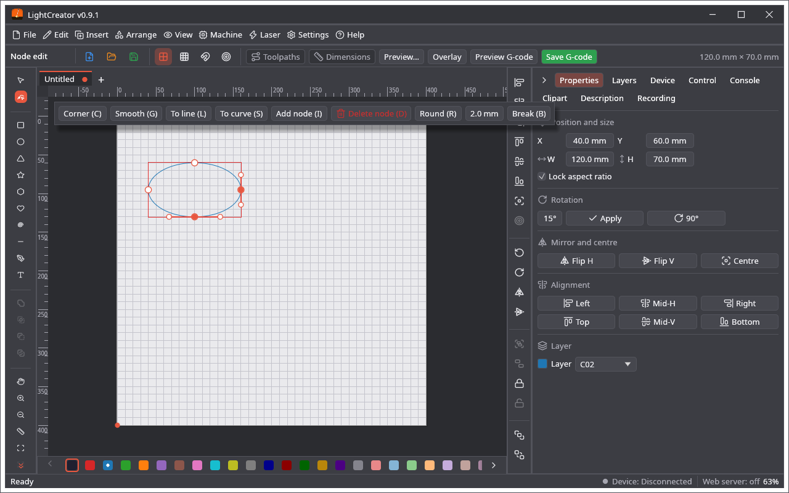
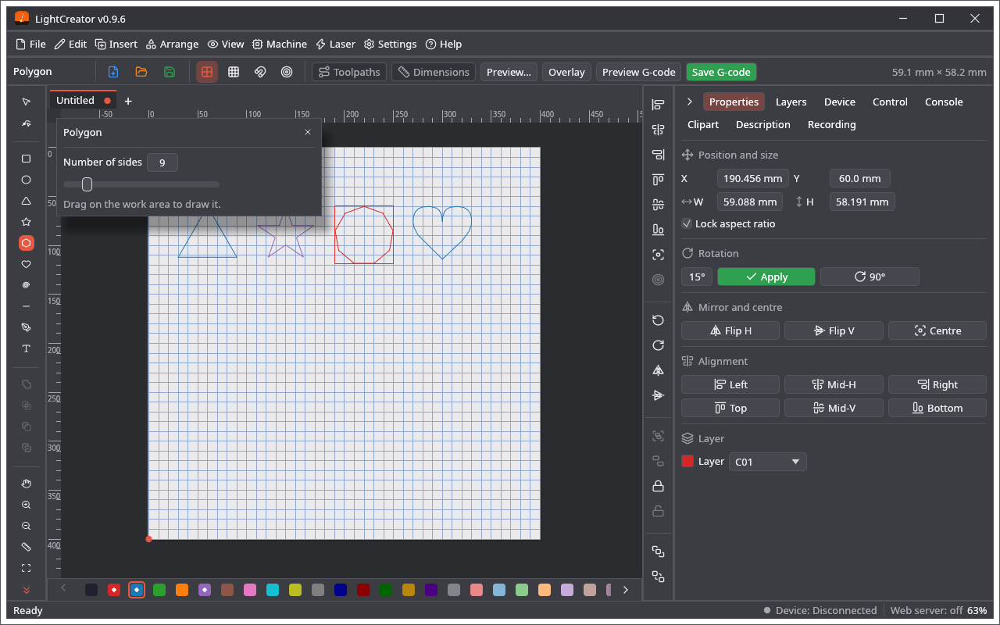
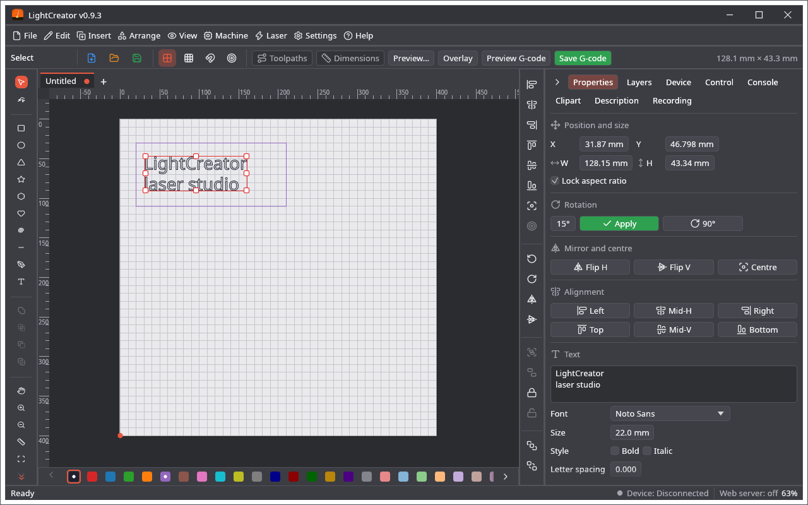
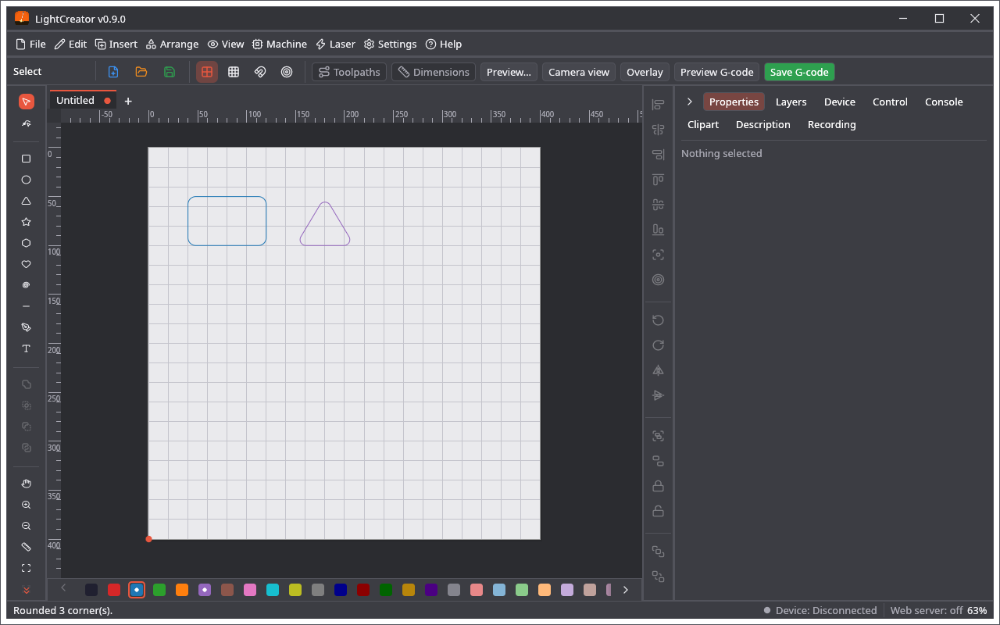
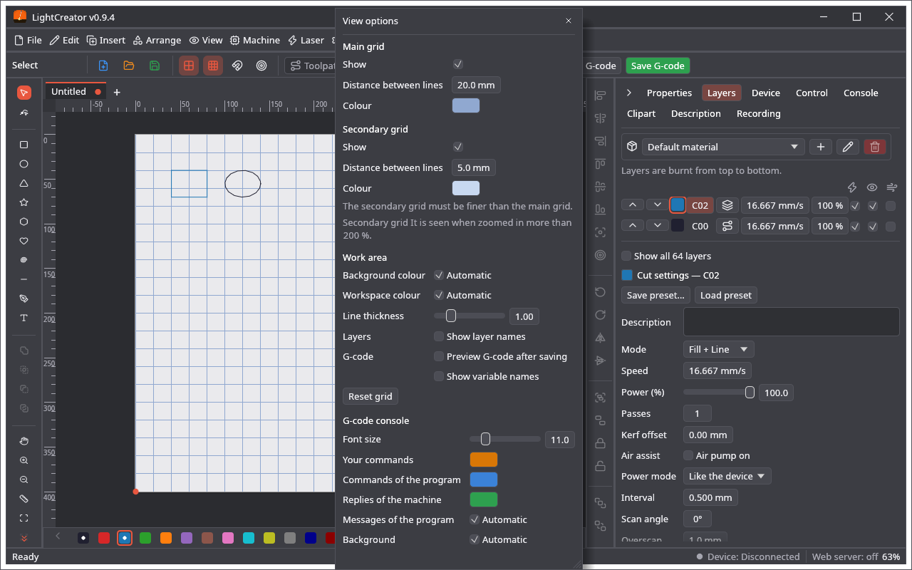
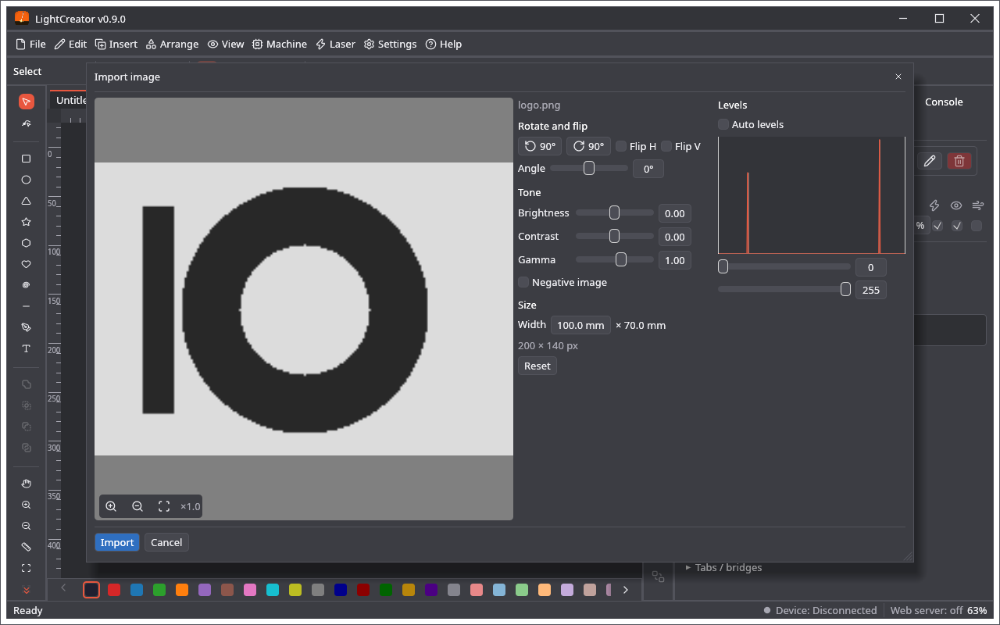
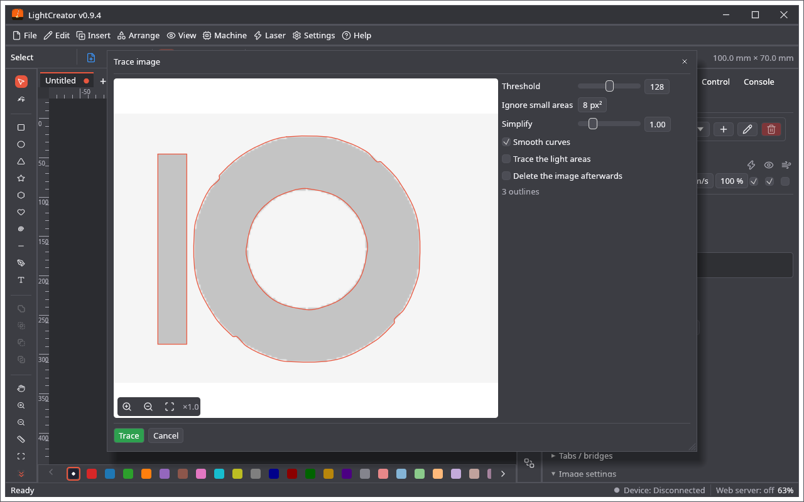
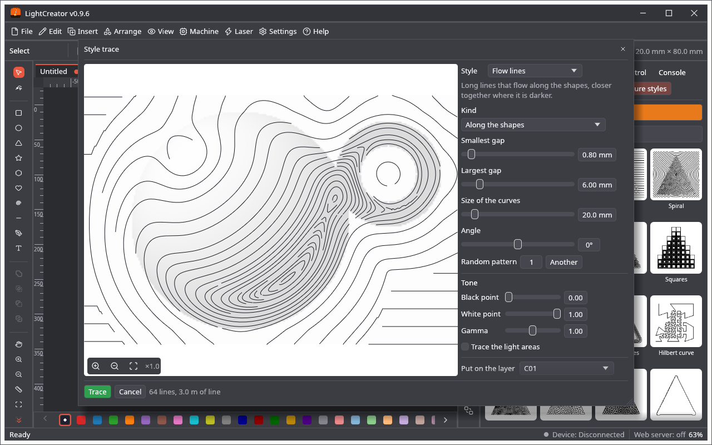

🌐 [English](Design-Tools) · [Polski](Narzedzia-projektowe) · [简体中文](Design-Tools-ZH) · **한국어**

> ⚠️ 이 페이지는 영어판을 기계 번역한 것으로, 부정확한 부분이 있을 수 있습니다. 의심스러우면 [영어판](Design-Tools)을 기준으로 하십시오. 수정 제안을 환영합니다.

# 디자인 도구

## 그리기
* 사각형, 타원, 선, 폴리라인, 텍스트 도구가 있으며, 핸들로 선택, 이동, 크기 조절을 합니다.
* **자동 도형:** 삼각형(Y), 오각별(S), 정다각형(G, 팝업에서 3~360개의 변을 선택), 하트(K), 나선(I). 상자를 드래그하면(Shift를 누르면 정사각형 비율 유지) 일반적인 편집 가능한 베지어 도형이 만들어집니다. 작업 영역 모서리의 작은 창에서 변의 개수 또는 회전 수(기본값 3)를 설정합니다. 이 창에는 확인 버튼이 없고 도구가 활성화된 동안 계속 표시됩니다. 다각형에는 숫자 입력 칸(3~360) 옆에 5~36개 변의 슬라이더가, 나선에는 숫자 입력 칸(1~30) 옆에 1~24회전의 슬라이더가 있으며, 값을 바꾸면 마지막으로 그린 도형의 모양도 바뀝니다.
  
* **도구 바 그룹:** 선택 / 노드 편집, 그다음 삽입 도구, 그다음 도형 연산(합집합, 교집합, 빼기, 배타적 논리합), 그다음 탐색 도구가 선으로 구분되어 있습니다. 바 가장자리의 이중 화살표는 보이지 않는 아이콘이 더 있다는 뜻이므로 스크롤하여 찾으십시오.

## 노드 편집 (N)
노드와 핸들을 드래그하고, 모서리 / 부드러운 점을 전환하고, 노드를 삽입(구간을 더블 클릭)하거나 삭제하고, 구간을 직선이나 곡선으로 바꾸고, 경로를 열고 닫습니다. 두 번째 도구, **배치 → 노드 편집**(Arrange → Edit nodes) (N), 오른쪽 클릭 메뉴 또는 도형을 더블 클릭하여 엽니다. 클립아트도 같은 방식으로 편집할 수 있습니다. 텍스트는 자동으로 변환되지 않으므로 먼저 **배치 → 곡선으로 변환**(Arrange → Convert to curves)을 사용하십시오.

## 텍스트 (T)
시스템 글꼴을 사용하는 실시간 텍스트(글꼴 패밀리 검색, 굵게, 기울임꼴, 크기, 자간과 행간, 정렬)이며 곡선으로 변환할 수 있습니다. 데바나가리 문자와 아랍 문자는 글자 모양 조합(shaping)이 되지 않습니다.

## 도형 연산
* **불리언:** 합집합, 교집합, 빼기, 배타적 논리합.
* **오프셋:** 원본을 유지하거나 대체하면서 윤곽을 키우거나 줄입니다.
* **모서리 둥글리기:** **배치 → 모서리 둥글리기…**(Arrange → Round corners…)는 뾰족한 직선 모서리를 지정한 반지름으로 둥글게 합니다. 직선 두 개를 선택하면 호로 연결합니다. 노드 도구에서는 바가 선택한 모서리만 둥글게 합니다.
  
* 숫자로 입력하는 위치와 크기, 회전, 뒤집기, 정렬, 베드 가운데에 놓기, **서로 중심 맞추기**(centre on each other) (선택한 객체들의 중심이 한 점으로 모이며, 그룹은 하나로 셉니다), 격자 배열, 복사 / 붙여넣기 / 복제.
* **배치 바:** 작업 영역과 측면 패널 사이에 있는 좁은 아이콘 띠로, 선택 항목에 대한 정렬, 가운데 맞춤, 회전, 대칭, 그룹, 잠금, 순서 명령이 있습니다(마우스를 올리면 이름이 보입니다). **배치**(Arrange) 메뉴에는 같은 명령과 그 이상이 있으며([메뉴](Menus-KO#배치-arrange) 참고), 도형 연산이 함께 모여 있고 끝에 **이미지 조정…**(Adjust image…) / **이미지 트레이스…**(Trace image…)가 있습니다.
* **그룹**(Group) (Ctrl+G)과 **잠금**(lock) (Ctrl+L). 잠긴 객체는 이동, 편집, 삭제할 수 없지만 선택과 복사는 할 수 있습니다(사본은 잠기지 않습니다).

## 선택
선택 항목 둘레의 사각형 핸들로 크기를 조절합니다. 드래그하지 않고 **핸들을 클릭**하면, 선택 항목을 중심을 기준으로 회전시키는 둥근 모서리 핸들(Shift를 누르면 15° 단위로 맞춤)과 해당 가장자리를 따라 기울이는 마름모 가장자리 핸들로 바뀝니다. 핸들을 다시 클릭하면 크기 조절로 돌아갑니다.

**객체에 맞춤**(Snap to objects) (작업 영역 위 바에서 자석 옆의 과녁 아이콘, 그리고 **보기 → 객체에 맞춤**(View → Snap to objects); 설정과 함께 저장됨): 선택 항목을 옮기는 동안 그 왼쪽, 가운데, 오른쪽 선(위, 가운데, 아래)이 근처에 보이는 객체의 같은 선과 화면상 약 8픽셀 이내로 가까워지면 그 선에 맞춰지고, 자홍색 안내선이 맞춰진 위치를 보여 줍니다. 이 기능은 **격자에 맞춤**(Snap to grid)과 독립적으로 동작하며, 숨겨진 레이어의 객체는 맞춤 대상이 아닙니다.

왼쪽 → 오른쪽으로 드래그: 완전히 안에 들어간 객체만 선택됩니다. 오른쪽 → 왼쪽: 닿은 객체가 모두 선택됩니다. Shift+클릭 또는 Ctrl+클릭은 선택 항목에 추가합니다(이미 선택된 것은 뺍니다). 모서리 핸들은 비율을 유지하며, Shift를 누르면 자유롭게 크기가 조절됩니다. Escape를 두 번 누르면 선택 도구로 돌아갑니다. 오른쪽 클릭 메뉴에 자주 쓰는 명령이 있습니다.

## 보기와 탐색
* **탭과 창 영역:** 열려 있는 모든 도면, 미리 보기, 프로젝트의 G-code 텍스트, G-code 파일 분석, 카메라 보기(작업 영역에 탭으로 표시될 때)는 모두 **탭**입니다. **보기 → 분할 보기: 나란히**(View → Split view: side by side) 또는 **분할 보기: 위아래로**(Split view: one above the other)는 작업 영역을 최대 세 개의 창 영역으로 나누고(첫 번째 창 영역에 탭이 두 개 이상 있으면 두 번째 창 영역이 만들어지며, 메뉴로 기존 창 영역의 방향도 바꿀 수 있습니다), **보기 → 단일 보기**(View → Single view)는 모든 탭을 다시 하나로 모읍니다. 모든 창 영역에는 자체 탭 바가 있고 선택 목록은 없습니다. 바 끝의 **+** (**새 탭**(New tab))는 새 도면을 만듭니다. **탭을 드래그**하여 다른 창 영역(또는 같은 바의 다른 위치)으로 옮기거나, 탭의 메뉴(오른쪽 클릭)를 사용하십시오: **창 영역 N으로 이동**(Move to pane N) (다른 창 영역, 그리고 공간이 있으면 새 창 영역), **별도의 창에서 열기**(Open in a separate window) (미리 보기, G-code 텍스트, 카메라; 창은 위치를 기억하며, **메인 창으로 돌아가기**(Back to the main window)를 누르거나 창을 닫으면 탭이 돌아옵니다), **탭 닫기**(Close tab). 창 영역의 마지막 탭을 닫으면 창 영역이 닫히고 나머지가 그 자리를 채웁니다. 아무것도 두 번 열리지 않습니다. 이미 열려 있는 프로젝트를 열면 그 탭이 표시되고, 프로젝트마다 미리 보기, 카메라 보기, G-code 텍스트는 하나씩입니다. 다른 창 영역의 도면은 보기용으로 표시되며 자체 확대·축소 배율을 가집니다. 그 도면을 클릭하면 활성 도면(도구, 메뉴, 단축키가 적용되는 도면)이 됩니다. 레이아웃은 기억됩니다. 단계별 안내: [창 영역과 탭](Panes-and-Tabs-KO).
* **변수 이름:** **설정 → 보기 옵션… → 변수 이름 표시**(Settings → View options… → Show variable names) (기본값 꺼짐)는 사용자 G-code에서 쓸 수 있는 변수가 있는 모든 필드의 레이블 옆에 변수 이름을 기울임꼴과 괄호로, 예를 들어 *(machine_name)*처럼 표시합니다. 이를 클릭하면 `{machine_name}`이 클립보드에 복사되어 사용자 G-code 입력 칸에 바로 붙여 넣을 수 있습니다.
* **레이어 이름:** **설정 → 보기 옵션… → 레이어 이름 표시**(Settings → View options… → Show layer names) (기본값 꺼짐)는 작업 영역 아래의 레이어 줄에서 도형이 있는 레이어의 색 옆에 레이어 이름을 씁니다(긴 이름은 잘리고 전체 이름은 도움말 풍선에 나옵니다. 줄이 가득 차면 옆으로 스크롤됩니다).
* **G-code 미리 보기:** 작업 영역 위 바에서 **G-code 저장**(Save G-code) 옆에 있는 버튼은 켜 둔 포스트프로세서를 적용해 프로젝트의 프로그램을 만들고 **탭에 텍스트로** 보여 줍니다(**G-code 미리 보기: name.gcode**(Preview G-code: name.gcode), 이름은 프로젝트 파일 이름 또는 `job`). 디스크에는 아무것도 기록되지 않습니다. 텍스트에는 색이 입혀지며(G 및 M 워드, 축, 속도와 공구, 줄 번호; 주석은 흐리게) 편집할 수 있습니다. 그 위에 줄 수와, 편집한 뒤에는 **직접 변경됨**(Changed by hand)이 표시됩니다.
  * 탭의 **G-code 저장**은 텍스트를 그대로 파일에 기록합니다.
  * **다시 만들기**(Make again)는 프로젝트에서 다시 만듭니다. 편집한 내용이 있으면 첫 번째 클릭에서 버튼이 **편집 내용을 버릴까요?**(Lose the edits?)로 바뀌고, 두 번째 클릭에서 편집 내용을 버립니다.
  * **분석**(Analyse)은 텍스트의 툴패스를 G-code 분석(다른 탭)에서 보여 줍니다.
  * **줄 번호와 단계(Stages):** 왼쪽에 줄 번호가 표시되고(화면에만 표시되며 파일에는 들어가지 않음), 각 도형의 첫 줄 옆에 이름(**도형 1**, **도형 2**…)이 표시됩니다. 오른쪽 **단계** 목록에는 시작, A면과 B면, 각 레이어, 요소와 도형, 각 정지(M0), 작업 끝마다 작은 상자가 있으며, 클릭하면 그 줄이 텍스트 맨 위로 옵니다. 보기의 첫 줄이 속한 단계가 강조 표시됩니다.
  * 편집하지 않은 동안 텍스트는 프로젝트를 따라갑니다. 프로젝트를 저장하거나, 메모(**설명**(Description) 탭)를 바꾸거나, 장치(예: 그 G-code 설정)를 바꾸거나, 포스트프로세서를 전환하면 잠시 후 자동으로 다시 만들어집니다. 도면만 바뀌어서는 다시 만들어지지 않습니다(**다시 만들기**를 누르십시오). 편집 내용은 절대 저절로 버려지지 않습니다.
  * 편집 내용이 있는 탭에는 점이 표시되며, 닫을 때 저장할지 묻습니다. 프로젝트의 G-code 텍스트는 프로젝트와 함께 닫힙니다.
  * **G-code 미리 보기**는 작업 전 검사를 실행하지 않으며(바의 **G-code 저장** 버튼은 실행합니다), **START**로 시작한 작업은 편집 내용과 포스트프로세서 없이 프로그램이 만든 그대로 전송됩니다.
* **G-code의 메모:** 프로젝트의 메모(**설명** 탭, 프로젝트 파일에 저장됨)는 모든 G-code 파일 맨 위의 `; LightCreator job — <device>` 줄 다음에 주석으로 기록됩니다. 메모의 각 줄마다 `; Note: …` 줄이 하나씩 들어갑니다. 주석이 일찍 끝나지 않도록 괄호는 `<` `>`로, `;` `%`는 쉼표로 바뀝니다. 빈 줄은 빠지고, 긴 줄은 100자 단위로 나뉘며, 최대 60줄까지 기록됩니다.
* **저장 후 G-code 미리 보기:** **설정 → 보기 옵션… → 저장 후 G-code 미리 보기**(Settings → View options… → Preview G-code after saving) (기본값 꺼짐)는 **G-code 저장**을 할 때마다 저장된 파일을 G-code 분석으로 엽니다.

이동(H), 확대(Z), 축소(X), **작업 영역 맞춤**(Fit work area) (Ctrl+Shift+0), **모든 객체에 맞춤**(Fit all objects) (Ctrl+Shift+9). **Space**를 누르고 있으면 어떤 도구에서든 화면을 이동할 수 있습니다. 직접 확대·축소하기 전까지 작업 영역은 창에 자동으로 맞춰집니다. **설정 → 보기 옵션…**(Settings → View options…): 주 격자와 보조 격자(표시, 선 간격, 색), 작업 영역의 배경색과 그 주변 공간의 색, 선 두께, 그리고 위의 스위치들이 있습니다. **격자 재설정**(Reset grid)은 기본값으로 되돌립니다.

## 가져오기
* **SVG:** 곡선은 베지어로 유지되고, 색상은 레이어에 대응됩니다.
* **비트맵:** PNG, JPEG, BMP, GIF, WebP를 회전, 뒤집기, 밝기, 대비, 감마, 자동 레벨, 반전과 함께 가져옵니다.
  
* **Illustrator / PDF / EPS / VectorCraft:** PDF 호환 Illustrator 파일 또는 오래된 PostScript 방식 파일의 첫 페이지 벡터 경로를 가져옵니다.
* **SVG:** SVG 안의 그림은 경로와 함께 활성 레이어로 들어옵니다.
* **DXF (`.dxf`):** **파일 → 가져오기 → DXF 가져오기…**(File → Import → Import DXF…) (**열기…**와 끌어다 놓기도 가능)는 ASCII DXF(R12 이상)를 읽습니다. 선, 볼록(bulge)이 있는 폴리라인, 호, 원, 타원, 스플라인, 블록(배율과 회전 포함)을 밀리미터 단위의 윤곽으로 읽으며(파일의 단위를 읽습니다), 호와 원은 곡선이 됩니다. 0.01 mm 이내에서 만나는 선은 하나의 경로가 됩니다. DXF의 레이어는 순서대로 프로그램의 레이어로 들어갑니다(첫 번째는 레이어 1로, 이런 식으로 계속; 나머지는 마지막 레이어로). 선이 아닌 것(텍스트, 해치, 치수)은 빠지며 상태 표시줄에 그 이름이 표시됩니다. **배치 → 경로 자동 연결…**(Arrange → Auto-join paths…) / **허용 오차로 경로 닫기…**(Close path with tolerance…)는 원하는 허용 오차로 경로를 연결하고 닫으며, **파일 → 내보내기 → 선택 항목을 SVG로 내보내기…**(File → Export → Export selection as SVG…) / **선택 항목을 DXF로 내보내기…**(Export selection as DXF…)는 선택한 도형을 기록합니다.
* **LightBurn 및 MillMage 프로젝트 (`.lbrn2`, `.lbrn`, `.mage`):** **파일 → 가져오기 → LightBurn / MillMage 프로젝트 가져오기…**(File → Import → Import LightBurn / MillMage project…) (또는 끌어다 놓기)는 사각형, 타원, 다각형, 별, 곡선이 있는 경로, 그룹, 텍스트(윤곽으로 읽으므로 글꼴 없이도 똑같이 보임), 비트맵을 회전과 대칭 반전을 포함해 읽습니다. 레이어는 종류(선, 채우기, 오프셋 채우기, 이미지), 속도, 출력, 패스 수, 간격과 함께 들어오며, 도면은 선택한 장치의 작업 영역 높이를 사용해 이 프로그램의 Y축에 맞게 뒤집힙니다. 도형은 열린 도면에 추가되며(실행 취소 한 번으로 되돌릴 수 있음), 파일의 레이어 설정은 아직 도형이 없는 레이어에 사용됩니다. LightBurn에 있지만 아직 읽지 않는 것(예: 공구 레이어 T1/T2, 변수 텍스트, QR 코드)은 빠지며 메시지에 그 이름이 표시됩니다. MillMage 프로젝트(`.mage`)도 같은 도형을 가지며, 그 레이어는 기본 설정의 *선*(Line) 레이어로 들어옵니다. LightBurn 2.1.04 및 2.2, MillMage 0.9에서 저장한 프로젝트로 테스트했습니다.
* **다른 프로그램의 파일, 양방향:** DXF(현재 방식과 R12, *legacy*), Illustrator(오래된 PostScript 방식 포함), 그림이 포함된 SVG, LightBurn(`.lbrn2`, `.lbrn`) 및 MillMage(`.mage`) 프로젝트를 읽고, 같은 형식으로 다시 기록할 수 있습니다. **파일 → 내보내기**(File → Export)가 이를 기록합니다: **SVG 내보내기…**(Export SVG…) 외에 **DXF 내보내기…**(Export DXF…) (현재 방식), **DXF R12 내보내기 (legacy)…**(Export DXF R12 (legacy)…), **Adobe Illustrator 내보내기…**(Export Adobe Illustrator…), **LightBurn 프로젝트 내보내기…**(Export LightBurn project…) (`.lbrn2`, 또는 파일 이름을 그렇게 지으면 `.lbrn`), **MillMage 프로젝트 내보내기…**(Export MillMage project…). 곡선은 유지되며(DXF는 0.01 mm로 평탄화), 그림은 SVG, LightBurn, MillMage 파일에 들어가고 DXF와 Illustrator 파일에서는 빠집니다(프로그램이 몇 개인지 알려 줍니다).
* **UGS Designer 파일 (`.ugsd`):** **파일 → 가져오기 → UGS 디자인 가져오기…**(File → Import → Import UGS design…) (또는 끌어다 놓기)는 곡선이 있는 경로, 사각형(둥근 모서리 포함), 타원, 점, 텍스트, 그림, 그룹을 읽으며 숨겨진 객체도 그립니다. 모든 절삭 방식은 레이어가 됩니다: 포켓과 채우기는 *채우기*(Fill)로, 나머지는 *선*(Line)으로. UGS는 밀링 프로그램이므로 이송 속도와 깊이는 레이저용으로 가져오지 않습니다. V-카빙, 평면 가공, 높이 맵, 탭, 시작 깊이는 지원하지 않으며 메시지에 그 이름이 표시됩니다.
* **이미지 트레이스:** **배치 → 이미지 트레이스…**(Arrange → Trace image…) (그림이 선택된 상태에서)는 어두운 영역 또는 밝은 영역을 임계값, 작은 점 필터, 단순화, 부드럽게 하기를 적용해 베지어로 바꿉니다.
* **이미지 편집…**(Edit image…) (**배치** 메뉴, 마우스 오른쪽 버튼 메뉴, 또는 **그림 스타일**(Picture styles) 탭의 주황색 버튼)은 선택한 그림의 사진 편집기를 엽니다. **브러시**(brush), **지우개**(eraser) (흰색으로 칠합니다), **복제 도장**(clone stamp) (Ctrl+클릭, Mac에서는 Cmd+클릭으로 복사할 위치를 지정한 다음 칠합니다), 클릭한 지점 주변의 비슷한 회색 영역을 채우는 **채우기**(fill)가 있으며, 회색조로만 동작하고 크기, 경도, 불투명도, 허용 오차, 실행 취소와 다시 실행을 지원합니다. 휠로 확대·축소하고, 오른쪽 또는 가운데 버튼으로 그림을 이동합니다. 도면은 **적용**(Apply)을 눌러야 바뀝니다.
* **이미지로 변환…**(Convert to image…) (도형이 선택되어 있고 그중에 그림이 없을 때)은 도형을 하나의 그림으로 바꿉니다: 미리 보기, 해상도(DPI), 크기, 채워진 닫힌 도형, 선 너비. **변환 후 객체 삭제**(Delete the objects afterwards)는 도형을 제거하고, **객체 숨기기**(Hide the objects)는 미리 보기에서만 도형의 윤곽을 뺍니다.
* **이미지 트레이스**(Trace image)와 **스타일 트레이스**(Style trace) 창의 **그림 숨기기**(Hide the picture)는 미리 보기에서 결과만 보여 줍니다.
  
* **스타일 트레이스:** **배치 → 스타일 트레이스…**(Arrange → Style trace…)는 그림을 21가지 스타일(구불구불한 선, 나선, 점묘, 해칭, 흐름선, 하나로 이어진 선…) 중 하나의 선으로 다시 그립니다. [스타일 트레이스](Style-Trace-KO)를 참고하십시오.
  

## 저장과 내보내기
**파일 → 저장**(File → Save) / **다른 이름으로 저장…**(Save as…)으로 기본 형식인 `.cre` 프로젝트(이미지, 메모, 오버레이 그림 포함)를 저장합니다. **파일 → 내보내기**(File → Export): G-code, SVG, Ruida 및 Trocen용 HPGL(`.plt`) / DXF, 그리고 선택 항목을 SVG 또는 DXF로. [메뉴](Menus-KO#파일-file)를 참고하십시오.

## 배치, 복사, 생성

**삽입**(Insert) 메뉴에는 객체를 삽입하는 왼쪽 팔레트의 도구들(**사각형 (R)**(Rectangle (R)), **타원 (E)**(Ellipse (E)), **삼각형 (Y)**(Triangle (Y)), **별 (S)**(Star (S)), **다각형 (G)**(Polygon (G)), **하트 (K)**(Heart (K)), **나선 (I)**(Spiral (I)), **선 (L)**(Line (L)), **폴리라인 / 펜 (P)**(Polyline / pen (P)), **텍스트 (T)**(Text (T)); 사용 중인 도구에 체크 표시)이 있고, 그다음 **도형 생성…**(Generate shape…) (플러그인의 생성기)과 **온라인 클립아트…**(Online clipart…)가 있습니다.

아래의 **배치**(Arrange) 메뉴 명령은 LightCreator, MillCreator, PenCreator에서 동일합니다.

* **경로 자동 연결…**(Auto-join paths…)은 끝점이 허용 오차보다 가까운 열린 경로를 연결하고, **허용 오차로 경로 닫기…**(Close path with tolerance…)는 두 끝점이 그만큼 가까운 경로를 닫습니다. **도그본 / T-본 모서리…**(Dogbone / T-bone corners…)는 둥근 비트가 닿을 수 있도록 모든 뾰족한 모서리에 홈을 추가합니다(밀링). (**파일 → 내보내기 → 선택 항목을 SVG로 내보내기…** / **선택 항목을 DXF로 내보내기…**는 선택한 도형을, 아무것도 선택하지 않으면 전부를 기록합니다.)
* **격자 배열…**(Grid array…)은 선택 항목의 사본을 행과 열로 배치합니다. **원형 배열…**(Circular array…)은 선택 항목의 중심 둘레에 **전체 각도**(Total angle) (360°는 한 바퀴 전체)에 걸쳐 사본을 놓으며, 위치에 따라 회전시키거나 이동만 합니다. 사본은 최대 2000개까지 만들어집니다.
* **경로를 따라 복사…**(Copy along path…): 도형을 선택한 다음 경로를 **마지막에** 선택합니다. 경로를 따라 **거리**(Distance)마다 사본이 놓이며 경로에 맞춰 회전시킬 수 있습니다. **경로 위의 텍스트…**(Text on path…): 텍스트를 선택한 다음 경로를 마지막에 선택합니다. 텍스트의 윤곽이 **시작**(Start) 지점부터 경로를 따라 구부러집니다(이후에는 텍스트가 아니라 윤곽입니다).
* **도형으로 자르기…**(Trim by shape…): 선을 선택한 다음 닫힌 도형을 **마지막에** 선택합니다. 안쪽(또는 바깥쪽) 부분이 남으며, 선이 도형의 윤곽과 교차하는 곳에서 잘립니다. **중복 제거**(Remove duplicates)는 같은 레이어에서 윤곽이 같은 도형을 삭제합니다(선택 항목 또는 도면 전체). **분해**(Break apart)는 윤곽마다 하나의 도형을 만듭니다. **단순화…**(Simplify…)는 선에서 **허용 오차**(Tolerance) 이내의 점을 제거합니다.
* **일련번호 텍스트…**(Serial text…): 텍스트를 선택합니다. 텍스트가 격자 형태로 복사되면서 `{n}`이 하나씩 증가하거나, **CSV 파일 읽기…**(Read a CSV file…)를 사용하면 행마다 한 번씩 복사되며 `{1}`, `{2}`…가 각 열이 됩니다. **바코드 / QR 코드…**(Barcode / QR code…)는 QR 코드 또는 Code 39 바코드를 활성 레이어에 윤곽으로 놓습니다(작업에 충분할 만큼 크게 만드십시오).
* **도형 네스팅…**(Nest shapes…)은 선택한 도형을 페이지 모서리에서부터 *영역 너비*(Area width) × *영역 높이*(Area height)의 영역 안에 도형 사이 *거리*(Distance)를 두고 배치합니다. **실제 윤곽 기준**(By the real outlines) (기본값 켜짐)을 사용하면 실제 모양에 따라 배치합니다. 작은 부품은 큰 부품의 구멍 안으로, L자 부품은 다른 부품의 모서리로 들어가며, 그룹은 하나의 부품으로 유지되고, **회전**(Turning)을 켜면 부품이 반 바퀴, 4분의 1 바퀴, 8분의 1 바퀴 단위로 회전할 수 있습니다. **들어가지 않는 것은 새 시트로**(What does not fit goes on new sheets)를 켜면 나머지를 새 시트에 놓습니다. 각 시트는 같은 레이어와 재료를 가진 새 탭이 됩니다(저장한 뒤 이 작업 다음에 실행하십시오). 끄면 들어가지 않는 도형은 원래 자리에 남습니다. 실제 윤곽 기준을 끄면 도형은 경계 상자 기준으로 행에 맞춰 배치됩니다(*회전 허용*(Allow turning)은 세로로 긴 도형을 눕힙니다). **측정…**(Measure…)은 선택 항목의 크기, 위치, 면적, 길이와, 도형이 두 개일 때는 그 사이의 거리를 보여 줍니다.

**이미지 트레이스**(Trace image) 대화 상자에서는 스크롤 휠이나 **확대**(Zoom in), **축소**(Zoom out), **보기 재설정**(Reset view) 버튼으로 그림을 확대·축소하고, 드래그하고, 더블 클릭으로 전체를 다시 볼 수 있습니다. **밝은 영역 트레이스**(Trace the light areas)는 어두운 부분 대신 밝은 부분을 트레이스하며, 녹색 **트레이스**(Trace) 버튼이 윤곽을 만듭니다. (파일이나 카메라에서 가져와 도면 아래에 깔린 그림은 카메라 오버레이입니다: **보기 → 오버레이 가져오기…**(View → Overlay from…), [장치와 컨트롤러](Devices-and-Controllers-KO#카메라) 참고.)

## 자, 선택, 노드 바

* **자 (M)**(Ruler (M)): 팔레트에서 **축소 (X)**(Zoom out (X)) 다음에 있는 도구입니다. 한 점에서 다른 점으로 드래그하거나 두 점을 클릭하면, 도면 위의 선이 길이, ΔX, ΔY, 각도를 프로그램의 단위로 보여 줍니다. 도형의 노드 근처의 점은 노드 자체를 잡습니다(그렇지 않으면 맞춤이 켜져 있을 때 격자를 잡습니다). 도형의 직선 구간(사각형의 변, 선)을 클릭하면 그 구간을 측정합니다. 측정 결과는 다음 측정, **Esc** 또는 다른 도구로 바꿀 때까지 남아 있으며, 도면은 전혀 바뀌지 않습니다.
* **도구 사용 중 오른쪽 클릭** (도형, 펜, 노드 도구, 자…)은 **Esc**를 두 번 누른 것처럼 동작합니다: 아무것도 선택되지 않은 **선택 (V)**(Select (V))로 돌아갑니다. 펜으로 그리던 선은 먼저 마무리됩니다. 선택 도구에서는 오른쪽 클릭이 전과 같이 컨텍스트 메뉴를 엽니다.
* **여러 객체를 선택한 경우:** 전체 선택 항목의 테두리 외에도 각 객체마다 얇은 점선 테두리가 있습니다.
* **노드 바**는 이름 뒤에 단축키를 표시합니다: **모서리 (C)**(Corner (C)), **직선으로 (L)**(To line (L)), **곡선으로 (S)**(To curve (S)), **노드 추가 (I)**(Add node (I)), **노드 삭제 (D)**(Delete node (D)), **둥글게 (R)**(Round (R)), **끊기 (B)**(Break (B)). **열기 / 닫기**(Open / close)는 없어졌습니다. **끊기 (B)**로 경로를 열고, 경로의 한쪽 끝을 다른 쪽 끝에 놓으면 경로가 닫힙니다.
* **만들어지지 않는 레이어**(출력이 꺼진 레이어)의 객체는 작업 영역 색 쪽으로 흐리게 표시됩니다.

## 미리 보기: 버튼과 치수

* 미리 보기 바의 옵션은 **버튼**입니다. 켜져 있는 동안 연한 파란색이며(카메라 보기 버튼처럼), 클릭하면 켜지거나 꺼집니다.
* **치수**(Dimensions)는 기술 도면처럼 작업의 크기를 보여 줍니다: 전체의 너비와 높이, 각 부분의 너비와 높이(부분이 몇 개 있을 때), 그리고 기계 원점이 화면 안에 있을 때 전체가 원점에서 얼마나 떨어져 있는지.

* **그림:** PNG, JPEG, BMP, GIF, WebP와 마찬가지로 TIFF(`.tif`, `.tiff`)도 읽습니다.

## 작업 영역의 치수, 자, 노드 메뉴

* **치수**(Dimensions) (작업 영역 위 바에서 **툴패스**(Toolpaths) 옆의 버튼)는 도면을 기술 도면처럼 보여 줍니다: 전체와 모든 윤곽(도형의 바깥 윤곽과 구멍은 각각 따로)의 너비와 높이, 그리고 둥근 윤곽의 지름을 보여 주며, 같은 것은 한 번만 표시합니다(**4 × Ø 6**). 도면은 전혀 바뀌지 않습니다.
* **자 (M)**는 도형의 노드(사각형으로 표시), 구간의 중점(마름모), 원이나 타원의 중심(원)을 잡습니다. 원을 클릭하면 중심에서 클릭한 점까지의 반지름과 지름을, 타원에서는 두 반지름과 클릭한 점까지의 반지름을, 곡선에서는 그 길이를 보여 주며, 곡선이 원호일 때는 중심에서 클릭한 점까지 그린 반지름과 그 길이를 보여 줍니다.
* **노드 편집:** 노드나 구간을 오른쪽 클릭하면 노드 바의 메뉴가 열립니다. **부드럽게**(Smooth)의 단축키는 **G**이며, **둥글게 (R)**의 반지름은 그 버튼 뒤에 있습니다.

## 단위

* **설정 → 프로그램 옵션… → 단위**(Settings → Program options… → Units)는 프로그램이 길이를 표시하는 단위를 선택합니다: 밀리미터, 센티미터, 미터, 인치, 피트, 또는 **장치와 같게**(As the device). 이 단위는 **속성**(Properties)의 크기, 자, 도면 위와 미리 보기의 **치수**, 기술 도면에 사용됩니다.
* **장치의 단위** (장치 창에서 밀리미터 또는 인치)는 기계의 단위이며, G-code는 이 단위로 작성됩니다. 인치 장치는 **G20**과 함께 모든 길이와 이송 속도를 인치로, 밀리미터 장치는 **G21**과 함께 밀리미터로 받습니다. 컨트롤러가 사용하는 단위인지 확인하십시오.
* 장치가 프로그램과 다른 단위계(인치 대 밀리미터)를 사용하면 치수와 자는 둘 다 표시합니다: 프로그램의 단위를 먼저, 기계의 단위를 괄호 안에, 예를 들어 **25.4 mm [1.000"]**처럼 표시합니다.
