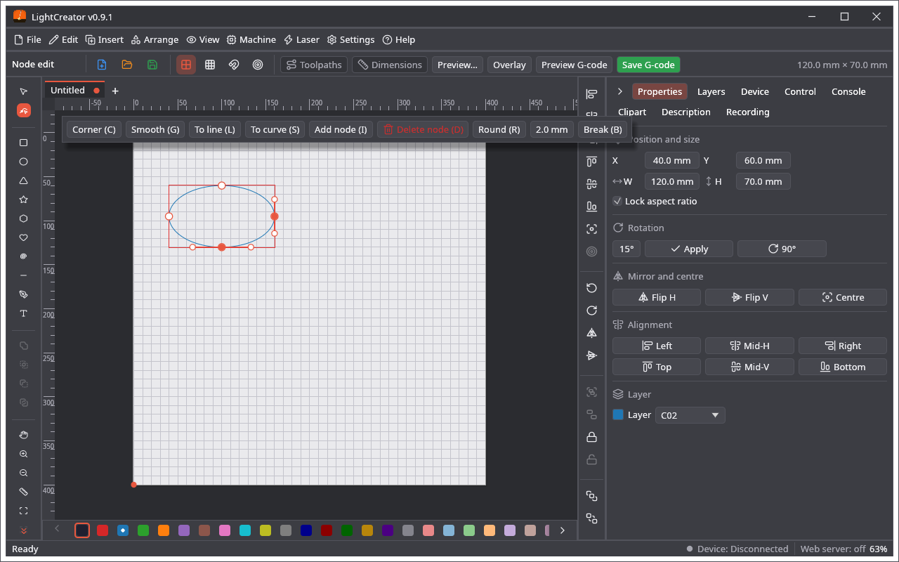
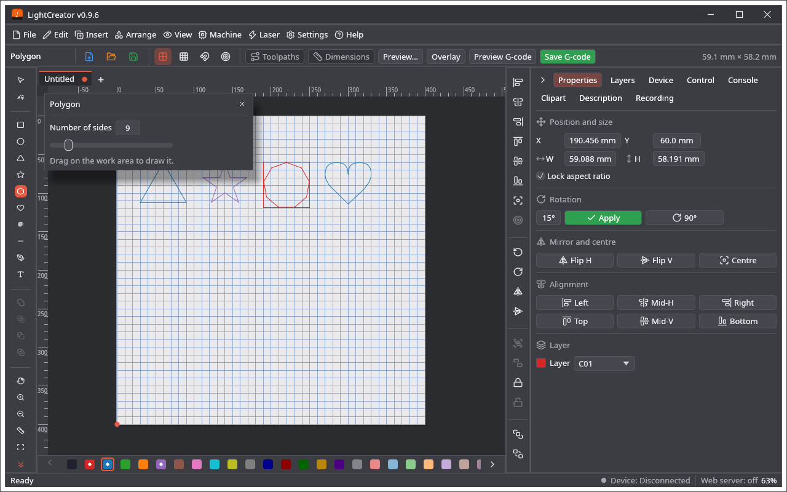
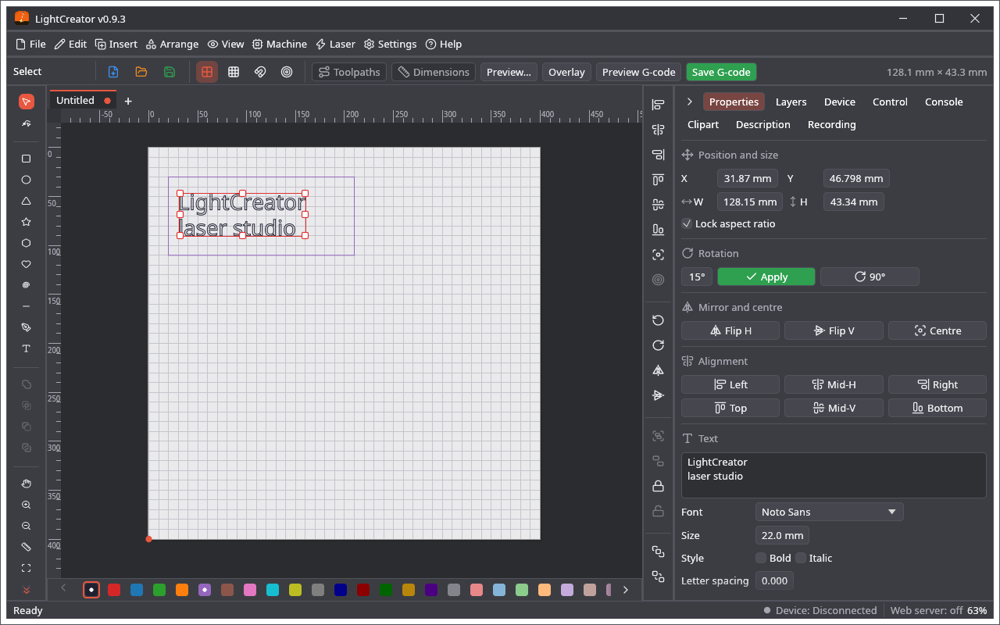
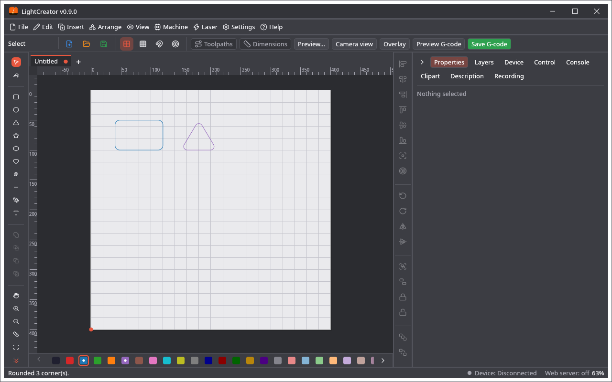
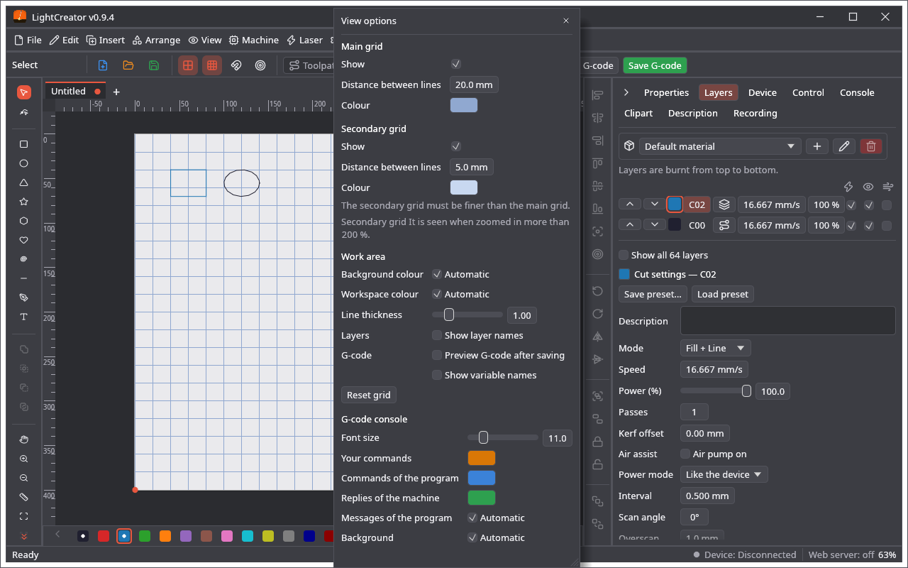
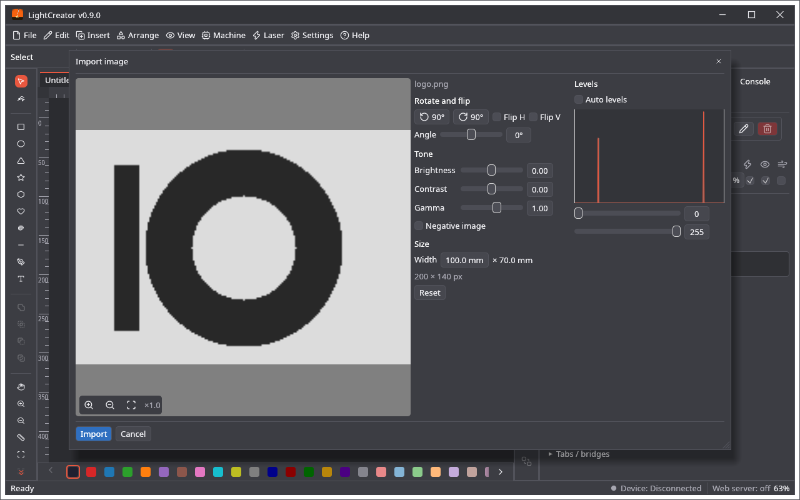
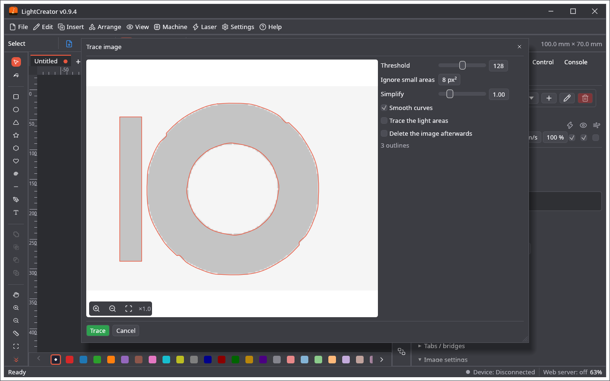
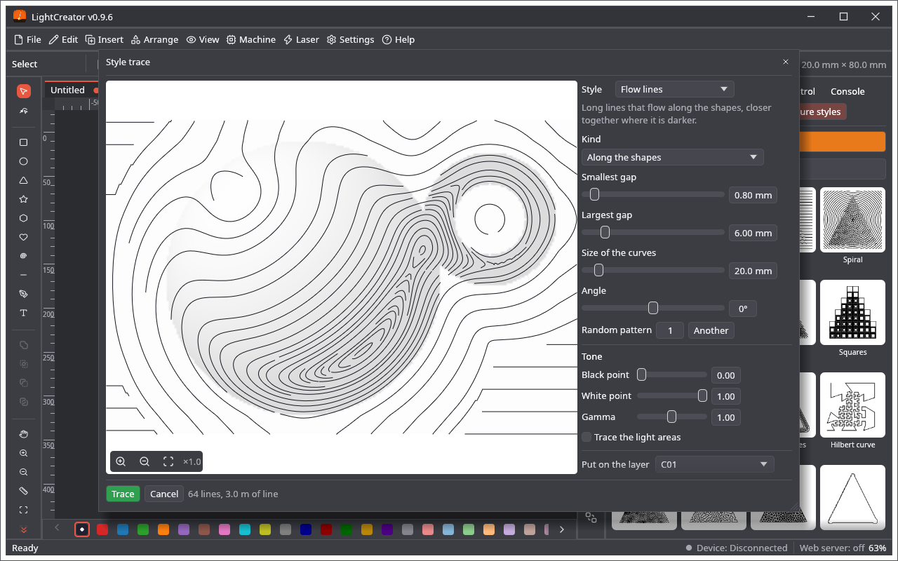

🌐 [English](Design-Tools) · [Polski](Narzedzia-projektowe) · **简体中文** · [한국어](Design-Tools-KO)

> ⚠️ 本页由英文版机器翻译而成，可能有不准确之处。如有疑问，请以[英文版](Design-Tools)为准。欢迎提出修改建议。

# 设计工具

## 绘制
* 矩形、椭圆、直线、折线和文字工具；用控制柄进行选择、移动和缩放。
* **自动形状：**三角形（Y）、五角星（S）、正多边形（G，3 到 360 条边，在弹出窗口中选择）、心形（K）和螺旋线（I）。拖出一个框（按住 Shift 保持正方形）；结果是一个普通的、可编辑的贝塞尔形状。工作区角落的一个小窗口用于设置边数或圈数（默认为 3）；它没有“确定”按钮，并在工具处于活动状态期间一直显示；多边形在数字框旁有一个 5 到 36 条边的滑块，螺旋线有一个 1 到 24 圈的滑块（数字框范围分别为 3 到 360 和 1 到 30），修改数值也会改变最后绘制的形状。
  
* **工具栏分组：**选择 / 节点编辑，然后是插入工具，然后是形状运算（合并、相交、减去、异或），然后是导航，各组之间用线分隔。工具栏边缘的双箭头表示还有图标不在视野内：滚动即可看到。

## 节点编辑（N）
拖动节点和控制柄，在尖角 / 平滑之间切换，插入节点（双击线段）和删除节点，将线段转换为直线或曲线，打开和闭合路径。可以通过第二个工具、**排列 → 编辑节点**（**Arrange → Edit nodes**）（N）、右键菜单或双击形状来打开它。剪贴画也可以用同样的方式编辑。文字不会自动转换：请先使用 **排列 → 转换为曲线**（**Arrange → Convert to curves**）。

## 文字（T）
使用系统字体的实时文字（字体族搜索、粗体、斜体、字号、字间距和行间距、对齐方式），可转换为曲线。天城文和阿拉伯文不进行字形塑形（shaping）。

## 形状运算
* **布尔运算：**合并、相交、减去、异或。
* **偏移：**扩大或缩小轮廓，保留或替换原始形状。
* **圆角：****排列 → 圆角…**（**Arrange → Round corners…**）以给定半径将尖锐的直角倒圆；选中两条直线时，会用一段圆弧将它们连接起来。在节点工具中，工具栏只对所选的角倒圆。
  
* 数值方式设置位置和尺寸、旋转、翻转、对齐、在工作台上居中、**相互居中**（**centre on each other**）（所选对象的中心移到同一点，编组算作一个对象）、网格阵列、复制 / 粘贴 / 再制。
* **排列工具栏：**工作区与侧面板之间的一条窄图标栏，包含针对所选内容的对齐、居中、旋转、镜像、编组、锁定和顺序命令（鼠标悬停可显示名称）。**排列**（**Arrange**）菜单包含相同的命令以及更多命令（参见 [菜单](Menus-ZH)），其中形状运算集中在一起，**调整图像…**（**Adjust image…**）/ **描摹图像…**（**Trace image…**）位于末尾。
* **编组**（**Group**）（Ctrl+G）和 **锁定**（**lock**）（Ctrl+L）。已锁定的对象不能移动、编辑或删除，但可以选中和复制（副本是未锁定的）。

## 选择
所选内容周围的方形控制柄用于缩放。**单击控制柄**（不拖动）后，它们会变成圆形的角控制柄，用于绕中心旋转所选内容（按住 Shift 以 15° 为步进），以及菱形的边控制柄，用于沿该边倾斜所选内容；再次单击控制柄即可回到缩放模式。

**吸附到对象**（**Snap to objects**）（工作区上方工具栏中磁铁旁边的靶心图标，以及 **视图 → 吸附到对象**（**View → Snap to objects**）；随设置一起保存）：移动所选内容时，当其左、中、右线（上、中、下线）距离附近某个可见对象的同类线约 8 个屏幕像素以内时，会跳到该线上，并显示一条品红色参考线表示吸附位置。它与 **吸附到网格**（**Snap to grid**）相互独立；隐藏图层上的对象不作为吸附目标。

从左向右拖动：只选中完全位于框内的对象。从右向左拖动：选中所有被触及的对象。Shift+单击或 Ctrl+单击会将对象添加到所选内容中（或将已选中的对象移出）。角控制柄会保持比例；按住 Shift 则自由缩放。按两次 Escape 返回选择工具。右键菜单包含常用命令。

## 视图与导航
* **标签页和窗格：**每个打开的绘图、预览、项目的 G-code 文本、G-code 文件的分析以及摄像头视图（当它以标签页形式显示在工作区中时）都是 **标签页**（**tabs**）。**视图 → 拆分视图：并排**（**View → Split view: side by side**）或 **拆分视图：上下排列**（**Split view: one above the other**）将工作区分成最多三个窗格（当第一个窗格中有两个或更多标签页时会创建第二个窗格；该菜单也会改变现有窗格的排列方向），**视图 → 单一视图**（**View → Single view**）会将所有标签页重新合并。每个窗格都有自己的标签栏，没有可供选择的列表；标签栏末尾的 **+**（**新建标签页**（**New tab**））会新建一个绘图。**拖动标签页** 到另一个窗格（或在其标签栏内拖到另一个位置），或使用其菜单（右键单击）：**移到窗格 N**（**Move to pane N**）（其他窗格，以及在还有空间时的一个新窗格）、**在单独窗口中打开**（**Open in a separate window**）（预览、G-code 文本和摄像头；窗口会记住其位置，**返回主窗口**（**Back to the main window**）或关闭该窗口会将标签页放回）和 **关闭标签页**（**Close tab**）。关闭窗格中的最后一个标签页会关闭该窗格，其他窗格随之合拢。任何内容都不会被打开两次：打开一个已经打开的项目会显示其标签页，每个项目只有一个预览、一个摄像头视图和一个 G-code 文本。另一个窗格中的绘图仅供查看，有自己的缩放比例；单击它会使其成为活动绘图（工具、菜单和快捷键作用的对象）。布局会被记住。分步说明：[窗格与标签页](Panes-and-Tabs-ZH)。
* **变量名称：****设置 → 视图选项… → 显示变量名称**（**Settings → View options… → Show variable names**）（默认关闭）会在每个可用于自定义 G-code 的字段标签旁，以斜体加括号显示变量名称，例如 *(machine_name)*；单击它会将 `{machine_name}` 复制到剪贴板，可直接粘贴到自定义 G-code 框中。
* **图层名称：****设置 → 视图选项… → 显示图层名称**（**Settings → View options… → Show layer names**）（默认关闭）会在工作区下方的图层行中，在含有形状的图层颜色旁写出该图层的名称（过长的名称会被截断，完整名称显示在提示中；行满时可以横向滚动）。
* **预览 G-code：**工作区上方工具栏中 **保存 G-code**（**Save G-code**）旁边的按钮会使用已启用的后处理器生成项目的程序，并 **以文本形式显示在标签页中**（**预览 G-code: name.gcode**（**Preview G-code: name.gcode**），名称为项目文件名或 `job`）；不会向磁盘写入任何内容。文本会着色（G 和 M 字、轴、速度和刀具、行号；注释显示为暗色），并可以编辑；上方显示行数，编辑后还会显示 **已手动更改**（**Changed by hand**）。
  * 标签页中的 **保存 G-code** 会将文本原样写入文件。
  * **重新生成**（**Make again**）会根据项目重新生成。如有编辑，第一次单击会将按钮变为 **放弃编辑？**（**Lose the edits?**），第二次单击才会丢弃编辑。
  * **分析**（**Analyse**）在 G-code 分析（另一个标签页）中显示文本的刀具路径。
  * 只要没有编辑，文本就会跟随项目：在你保存项目、修改其备注（**描述**（**Description**）标签页）、更换设备（例如其 G-code 设置）或切换后处理器后，文本会在片刻后自动重新生成。仅修改绘图不会使其重新生成（请按 **重新生成**）。编辑内容永远不会被自动丢弃。
  * 有编辑的标签页会标有一个圆点，关闭时会询问是否保存。项目的 G-code 文本会随项目一起关闭。
  * **预览 G-code** 不会运行作业前的检查（工具栏上的 **保存 G-code** 按钮会运行），而用 **START** 启动的作业会按程序生成的内容发送，不包含编辑内容和后处理器的处理。
* **G-code 中的备注：**项目的备注（**描述** 标签页，保存在项目文件中）会以注释形式写在每个 G-code 文件的开头，位于 `; LightCreator job — <device>` 这一行之后：备注的每一行对应一行 `; Note: …`。括号会变为 `<` `>`，`;` 和 `%` 会变为逗号，以免注释提前结束；空行会被省略，长行会被切分为每段 100 个字符，最多写入 60 行。
* **保存后预览 G-code：****设置 → 视图选项… → 保存后预览 G-code**（**Settings → View options… → Preview G-code after saving**）（默认关闭）会在每次 **保存 G-code** 后在 G-code 分析中打开保存的文件。

平移（H）、放大（Z）、缩小（X）、**适应工作区**（**Fit work area**）（Ctrl+Shift+0）、**显示全部对象**（**Fit all objects**）（Ctrl+Shift+9）。按住 **Space** 可以在使用任何工具时平移。在你手动缩放之前，工作区会自动适应窗口。**设置 → 视图选项…**（**Settings → View options…**）：主网格和次网格（显示、线间距、颜色）、工作区的背景色及其周围空间的颜色、线条粗细，以及上述开关；**重置网格**（**Reset grid**）恢复默认值。

## 导入
* **SVG：**曲线保持为贝塞尔曲线；颜色映射到图层。
* **位图：**PNG、JPEG、BMP、GIF、WebP，可进行旋转、翻转、亮度、对比度、伽马、自动色阶、负片处理。
  
* **Illustrator / PDF / EPS / VectorCraft：**第一页的矢量路径，来自兼容 PDF 的 Illustrator 文件或旧式 PostScript 类型的文件。
* **SVG：**SVG 中的图片会与其路径一起导入，放在当前图层上。
* **DXF（`.dxf`）：****文件 → 导入 → 导入 DXF…**（**File → Import → Import DXF…**）（也可用 **打开…**（**Open…**）以及拖放）读取 ASCII DXF（R12 及更新版本）：直线、带凸度的多段线、圆弧、圆、椭圆、样条曲线和块（包括其缩放和旋转）作为轮廓，以毫米为单位（会读取文件的单位），圆弧和圆作为曲线。相接（在 0.01 mm 以内）的线条会成为一条路径。DXF 的图层会依次进入程序的图层（第一个进入图层 1，依此类推；其余的进入最后一个图层）。非线条的内容（文字、填充图案、尺寸标注）会被省略，并在状态栏中列出。**排列 → 自动连接路径…**（**Arrange → Auto-join paths…**）/ **按容差闭合路径…**（**Close path with tolerance…**）按你自己设定的容差连接和闭合路径，**文件 → 导出 → 将所选内容导出为 SVG…**（**File → Export → Export selection as SVG…**）/ **将所选内容导出为 DXF…**（**Export selection as DXF…**）写入所选形状。
* **LightBurn 和 MillMage 项目（`.lbrn2`、`.lbrn`、`.mage`）：****文件 → 导入 → 导入 LightBurn / MillMage 项目…**（**File → Import → Import LightBurn / MillMage project…**）（或拖放）读取矩形、椭圆、多边形、星形、带曲线的路径、编组、文字（作为轮廓，因此没有该字体也能保持相同外观）以及位图，包括其旋转和镜像。图层连同其类型（线条、填充、偏移填充、图像）、速度、功率、遍数和间距一起导入，绘图会根据所选设备工作区的高度翻转到本程序的 Y 轴方向。形状会被添加到打开的绘图中（一次撤销即可全部撤回）；文件中的图层只用于尚无形状的图层。LightBurn 中尚不能读取的内容（例如刀具图层 T1/T2、变量文字、二维码）会被省略，并在消息中列出。MillMage 项目（`.mage`）包含相同的形状；其图层以默认设置的 *Line* 图层导入。已针对 LightBurn 2.1.04 和 2.2 以及 MillMage 0.9 保存的项目进行测试。
* **其他程序的文件，双向支持：**DXF（当前格式和 R12，*legacy*）、Illustrator（也包括旧式 PostScript 类型）、带图片的 SVG，以及 LightBurn（`.lbrn2`、`.lbrn`）和 MillMage（`.mage`）项目都可以读取，也可以以相同格式写回。**文件 → 导出**（**File → Export**）负责写回：除 **导出 SVG…**（**Export SVG…**）外，还有 **导出 DXF…**（**Export DXF…**）（当前格式）、**导出 DXF R12（旧版）…**（**Export DXF R12 (legacy)…**）、**导出 Adobe Illustrator…**（**Export Adobe Illustrator…**）、**导出 LightBurn 项目…**（**Export LightBurn project…**）（`.lbrn2`，如果你将文件命名为 `.lbrn` 则为该格式）和 **导出 MillMage 项目…**（**Export MillMage project…**）。曲线会被保留（DXF 会以 0.01 mm 将其展平）；图片会写入 SVG、LightBurn 和 MillMage 文件，但不会写入 DXF 和 Illustrator 文件（程序会提示省略了多少张）。
* **UGS Designer 文件（`.ugsd`）：****文件 → 导入 → 导入 UGS 设计…**（**File → Import → Import UGS design…**）（或拖放）读取带曲线的路径、矩形（包括圆角矩形）、椭圆、点、文字、图片和编组；隐藏的对象也会被绘制。每种切削方式都会成为一个图层：型腔和填充作为 *Fill*，其余作为 *Line*。UGS 是一个铣削程序，因此其进给和深度不会用于激光。V 形雕刻、表面铣平、高度图、连接桥（tabs）和起始深度不受支持，会在消息中列出。
* **描摹图像：****排列 → 描摹图像…**（**Arrange → Trace image…**）（选中一张图片时）将暗区或亮区转换为贝塞尔曲线，可设置阈值、斑点过滤、简化和平滑。
* **编辑图像…**（**Edit image…**）（**排列** 菜单、鼠标右键菜单，或 **图片风格**（**Picture styles**）标签页中的橙色按钮）会打开所选图片的照片编辑器：**画笔**（**brush**）、**橡皮擦**（**eraser**）（涂成白色）、**仿制图章**（**clone stamp**）（Ctrl+单击，在 Mac 上为 Cmd+单击，指定复制源，然后涂抹）以及对单击处周围相似灰度区域的 **填充**（**fill**），仅限灰度，可设置大小、硬度、不透明度和容差，并支持撤销和重做。滚轮用于缩放，右键或中键用于移动图片；只有在按 **应用**（**Apply**）后绘图才会改变。
* **转换为图像…**（**Convert to image…**）（已选中形状，且其中没有图片）将它们转换为一张图片：预览、分辨率（DPI）、尺寸、填充闭合形状以及线宽。**之后删除这些对象**（**Delete the objects afterwards**）会删除这些形状；**隐藏这些对象**（**Hide the objects**）仅在预览中不显示它们的轮廓。
* **描摹图像**（**Trace image**）和 **风格描摹**（**Style trace**）窗口中的 **隐藏图片**（**Hide the picture**）会在预览中只显示结果。
  
* **风格描摹：****排列 → 风格描摹…**（**Arrange → Style trace…**）以 21 种风格之一（波浪线、螺旋线、点画、排线、流线、一笔画…）将图片重新绘制为线条：参见 [风格描摹](Style-Trace-ZH)。
  

## 保存与导出
使用 **文件 → 保存**（**File → Save**）/ **另存为…**（**Save as…**）保存原生 `.cre` 项目（内嵌图像、备注和叠加图片）；**文件 → 导出**：G-code、SVG、用于 Ruida 和 Trocen 的 HPGL（`.plt`）/ DXF，以及将所选内容导出为 SVG 或 DXF。参见 [菜单](Menus-ZH)。

## 排列、复制和生成

**插入**（**Insert**）菜单包含左侧工具面板中用于插入对象的工具（**矩形 (R)**（**Rectangle (R)**）、**椭圆 (E)**（**Ellipse (E)**）、**三角形 (Y)**（**Triangle (Y)**）、**星形 (S)**（**Star (S)**）、**多边形 (G)**（**Polygon (G)**）、**心形 (K)**（**Heart (K)**）、**螺旋线 (I)**（**Spiral (I)**）、**直线 (L)**（**Line (L)**）、**折线 / 钢笔 (P)**（**Polyline / pen (P)**）和 **文字 (T)**（**Text (T)**）；当前使用的工具会打勾），然后是 **生成形状…**（**Generate shape…**）（插件的生成器）和 **在线剪贴画…**（**Online clipart…**）。

下面这些 **排列** 菜单中的命令在 LightCreator、MillCreator 和 PenCreator 中都相同：

* **自动连接路径…** 连接端点距离小于容差的开放路径；**按容差闭合路径…** 闭合两个端点距离在该范围内的路径。**狗骨 / T 骨角…**（**Dogbone / T-bone corners…**）在每个尖角处添加一个缺口，使圆形铣刀能够到达（铣削用）。（**文件 → 导出 → 将所选内容导出为 SVG…** / **将所选内容导出为 DXF…** 写入所选形状，未选中任何内容时写入全部形状。）
* **网格阵列…**（**Grid array…**）按行和列放置所选内容的副本。**环形阵列…**（**Circular array…**）在 **总角度**（**Total angle**）范围内围绕所选内容的中心放置副本（360° 为整圈），副本可随位置旋转或仅移动。最多生成 2000 个副本。
* **沿路径复制…**（**Copy along path…**）：先选择形状，**最后** 选择路径；副本会沿路径每隔 **距离**（**Distance**）放置一个，并可随路径旋转。**路径文字…**（**Text on path…**）：先选择文字，最后选择路径；文字的轮廓会从 **起点**（**Start**）开始沿路径弯曲（之后它们是轮廓，而不再是文字）。
* **按形状修剪…**（**Trim by shape…**）：先选择线条，**最后** 选择一个闭合形状；保留内部（或外部）的部分，在线条与其轮廓相交处切断。**删除重复项**（**Remove duplicates**）删除同一图层上轮廓相同的形状（在所选内容或整个绘图中）。**拆分**（**Break apart**）将每个轮廓变成一个单独的形状。**简化…**（**Simplify…**）删除距离线条在 **容差**（**Tolerance**）范围内的点。
* **序列文字…**（**Serial text…**）：选择一段文字；它会以网格形式复制，其中的 `{n}` 依次递增；或者通过 **读取 CSV 文件…**（**Read a CSV file…**），为每一行复制一次，`{1}`、`{2}`… 表示各列。**条形码 / 二维码…**（**Barcode / QR code…**）将二维码或 Code 39 条形码以轮廓形式放在当前图层上（请将其做得足够大以适合作业）。
* **排样形状…**（**Nest shapes…**）将所选形状从页面角落开始紧凑地排列在 *区域宽度*（*Area width*）× *区域高度*（*Area height*）的区域中，形状之间留有 *距离*（*Distance*）。开启 **按实际轮廓**（**By the real outlines**）（默认开启）时，会按真实形状进行排列：小零件可以放进大零件的孔中，L 形可以放进另一个零件的角落，编组保持为一个零件，**旋转**（**Turning**）允许零件旋转半圈、四分之一圈或八分之一圈。**放不下的放到新板材上**（**What does not fit goes on new sheets**）会将其余部分放到新的板材上：每张板材都是一个具有相同图层和材料的新标签页（保存后在这一张之后运行）；不开启时，放不下的形状保持原位。关闭“按实际轮廓”时，形状会按其外框逐行排列（*允许旋转*（*Allow turning*）会将较高的形状横放）。**测量…**（**Measure…**）显示所选内容的尺寸、位置、面积和长度，选中两个形状时还会显示它们之间的距离。

在 **描摹图像**（**Trace image**）对话框中，可以用滚轮或 **放大**（**Zoom in**）、**缩小**（**Zoom out**）和 **重置视图**（**Reset view**）按钮缩放图片，可以拖动图片，双击可重新显示整张图片；**描摹亮区**（**Trace the light areas**）描摹亮的部分而不是暗的部分，绿色的 **描摹**（**Trace**）按钮生成轮廓。（位于绘图下方、来自文件或摄像头的图片是摄像头叠加层：**视图 → 叠加来源…**（**View → Overlay from…**），参见 [设备与控制器](Devices-and-Controllers-ZH)。）

## 标尺、选择和节点工具栏

* **标尺 (M)**（**Ruler (M)**）：工具面板中位于 **缩小 (X)**（**Zoom out (X)**）之后的工具。从一点拖到另一点，或单击两个点：绘图上方的一条线会以程序的单位显示长度、ΔX、ΔY 和角度。靠近形状节点的点会取节点本身（否则在开启吸附时取网格点）。单击形状的一条直线段（矩形的一条边、一条直线）会测量该线段。测量结果会一直保留，直到下一次测量、按 **Esc** 或切换到其他工具；绘图中的任何内容都不会改变。
* **使用工具时右键单击**（形状、钢笔、节点工具、标尺…）的作用相当于按两次 **Esc**：返回 **选择 (V)**（**Select (V)**），且不选中任何内容；正在用钢笔绘制的线条会先被完成。使用选择工具时，右键单击仍然像以前一样打开上下文菜单。
* **选中多个对象时：**除了整个所选内容的边框外，每个对象还有一个自己的细虚线边框。
* **节点工具栏** 在名称后显示快捷键：**尖角 (C)**（**Corner (C)**）、**转为直线 (L)**（**To line (L)**）、**转为曲线 (S)**（**To curve (S)**）、**添加节点 (I)**（**Add node (I)**）、**删除节点 (D)**（**Delete node (D)**）、**倒圆 (R)**（**Round (R)**）、**断开 (B)**（**Break (B)**）。**打开 / 闭合**（**Open / close**）已移除：**断开 (B)** 用于打开路径，将路径的一个端点拖放到另一个端点上即可闭合路径。
* **不输出的图层**（其输出已关闭）中的对象会以淡出到工作区颜色的方式显示。

## 预览：按钮和尺寸

* 预览工具栏上的选项是 **按钮**：开启时为浅蓝色（与摄像头视图的按钮相同），单击可开启或关闭。
* **尺寸**（**Dimensions**）像技术图纸一样显示作业的尺寸：整体的宽度和高度、每个部分的宽度和高度（当有几个部分时），以及当机器零点在画面中时整体与机器零点的距离。

* **图片：**TIFF（`.tif`、`.tiff`）也可以读取，与 PNG、JPEG、BMP、GIF 和 WebP 一样。

## 工作区上的尺寸、标尺和节点菜单

* **尺寸**（**Dimensions**）（工作区上方工具栏中 **刀具路径**（**Toolpaths**）旁边的按钮）像技术图纸一样显示绘图：整体以及每个轮廓的宽度和高度（形状的外轮廓和孔各自单独标注），以及圆形的直径，相同的直径只标注一次（**4 × Ø 6**）。它不会改变绘图中的任何内容。
* **标尺 (M)** 会捕捉形状的节点（以方块标记）、线段的中点（以菱形标记）或圆或椭圆的圆心（以圆圈标记）。单击圆时会显示从圆心到单击点的半径及其直径；单击椭圆时会显示两个半径以及到单击点的半径；单击曲线时会显示其长度，如果该曲线是一段圆弧，还会显示从圆心到单击点所画的半径及其长度。
* **节点编辑：**在节点或线段上右键单击会打开节点工具栏的菜单；**平滑**（**Smooth**）的快捷键为 **G**，**倒圆 (R)** 的半径显示在其按钮后面。

## 单位

* **设置 → 程序选项… → 单位**（**Settings → Program options… → Units**）选择程序显示长度所用的单位：毫米、厘米、米、英寸或英尺，或者 **与设备相同**（**As the device**）。它们用于 **属性**（**Properties**）中的尺寸、标尺、绘图上方和预览中的 **尺寸**，以及技术图纸。
* **设备的单位**（毫米或英寸，在设备窗口中设置）是机器的单位：G-code 以这些单位写入。英寸单位的设备会得到 **G20**，所有长度和进给都以英寸表示；毫米单位的设备得到 **G21** 和毫米。请确保它们是控制器所使用的单位。
* 当设备与程序使用不同的单位制（英寸与毫米）时，尺寸和标尺会同时显示两者：先显示程序的单位，再在方括号中显示机器的单位，例如 **25.4 mm [1.000"]**。
