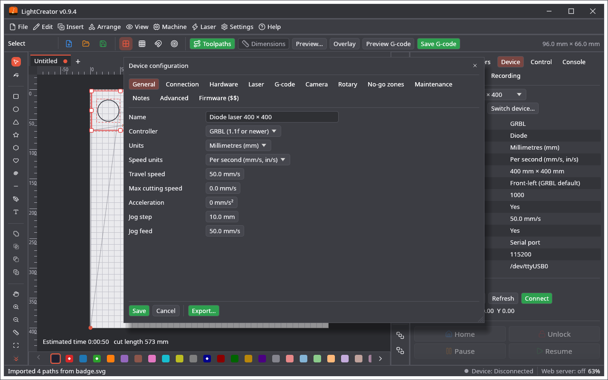
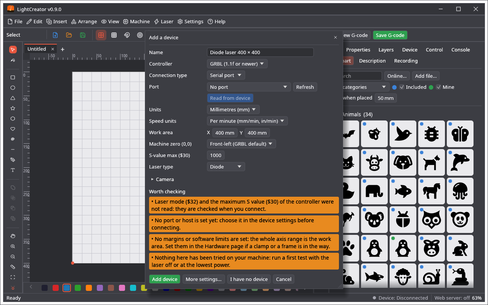
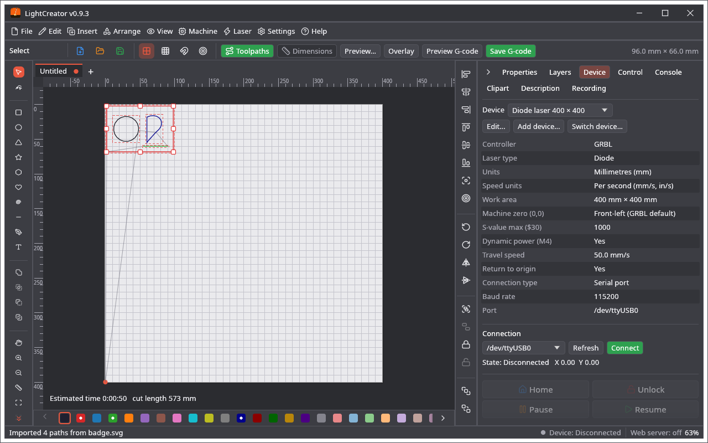
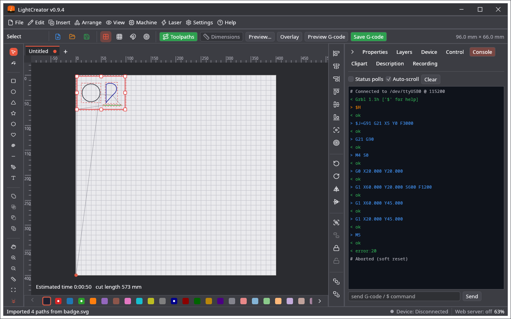
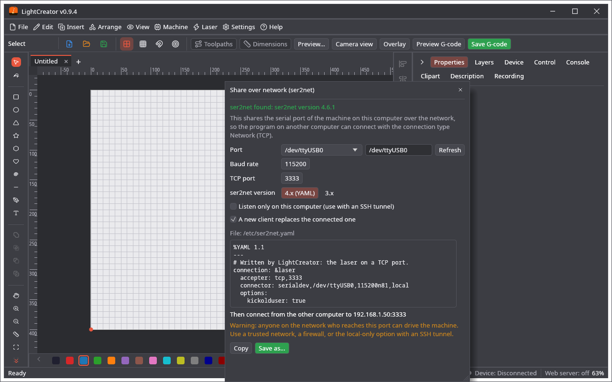
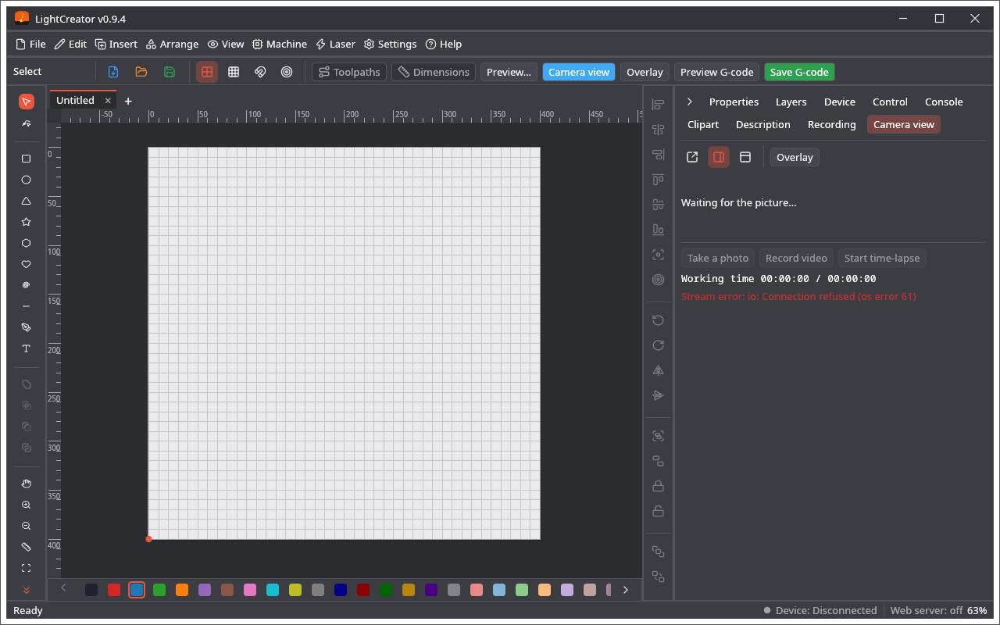
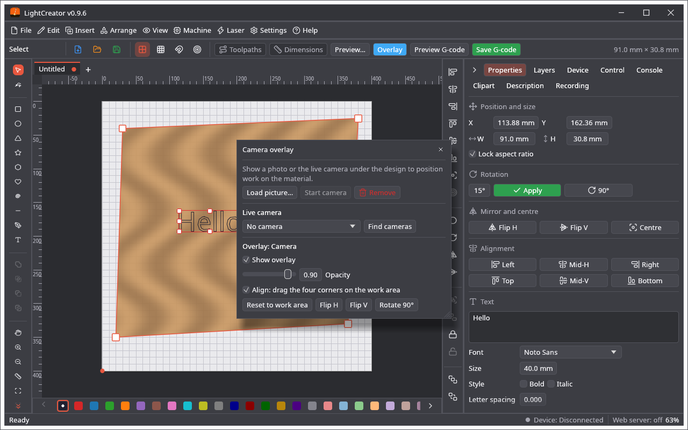

🌐 [English](Devices-and-Controllers) · [Polski](Urzadzenia-i-sterowniki) · [简体中文](Devices-and-Controllers-ZH) · **한국어**

> ⚠️ 이 페이지는 영어판을 기계 번역한 것으로, 부정확한 부분이 있을 수 있습니다. 의심스러우면 [영어판](Devices-and-Controllers)을 기준으로 하십시오. 수정 제안을 환영합니다.

# 장치와 컨트롤러

> LightCreator가 동작하는 것으로 확인된 기계와 사용 중인 기계를 추가하는 방법: [TESTS_ON_DEVICES.md](https://github.com/michalsarna/LightCreator/blob/main/TESTS_ON_DEVICES.md).





## 축, 작업 영역, 작업 전 검사
* **기계 원점**(Machine zero)은 네 모서리 중 어디에나 있을 수 있습니다. **축 반전**(Invert axes)은 X 및/또는 Y를 뒤집고, **패널 방향**(Panel orientation) (기본, 왼쪽으로 회전, 오른쪽으로 회전)은 패널이 사용자 앞에 놓인 방향대로 작업 영역을 돌립니다(작업 영역이 회전된 상태로 표시되고 G-code도 그에 맞게 변환됩니다). 모든 것이 하나의 디자인-기계 변환을 거치므로 조그 화살표, 원점 표시, 프레임, G-code, HPGL, DXF가 서로 일치합니다.
* **여백**(Margins)은 기계가 사용할 수 없는 가장자리를 따라 난 띠(클램프, 프레임)이며, 캔버스에 빗금으로 표시됩니다. **소프트웨어 한계**(Software limits)는 사용 가능한 영역 안의 선택적인 사용자 지정 사각형입니다(주황색 윤곽). 조그 버튼은 허용 영역의 가장자리에서 멈추며, 영역 밖에 있는 헤드는 언제든지 안으로 돌아올 수 있습니다.
* **작업 전 검사:** 시작(Start), 프레임(Frame), G-code 저장(Save G-code), 파일 내보내기는 먼저 작업을 검사합니다. 사용 가능한 영역이나 소프트웨어 한계 밖에 있는 객체 또는 툴패스(오버스캔 포함)는 **오류**입니다. 아무것도 전송, 프레이밍, 내보내기 되지 않으며, 창에서 *객체 선택*(Select objects)을 제안합니다. 출력 0 %로 새기는 레이어나 툴패스를 만들지 않는 객체를 가진 레이어는 확인 후 진행할 수 있는 **경고**입니다. G-code 작성기는 더 이상 좌표를 조용히 잘라 내지 않습니다.
* GRBL 컨트롤러는 **연결 후** 한 번 읽힙니다(`$$`). 레이저 모드(`$32`)가 꺼져 있으면 급속 이동 중에 레이저가 발사될 수 있다고 창이 경고하고, 확인 후 *레이저 모드 켜기 ($32=1)*(Enable laser mode ($32=1))를 제안합니다. 컨트롤러의 `$30`이 프로필의 S 최대값과 다르면 *컨트롤러의 값 사용*(Use the value from the controller)을 선택할 수 있습니다.

## 장치의 G-code 설정
* **속도:** 이동 속도 옆에 *최대 절단 속도*(Max cutting speed)와 *가속도*(Acceleration) (0 = 알 수 없음)가 있습니다. 가속도가 있으면 시간 예측이 컨트롤러와 같은 방식으로 이동을 계획합니다. 모든 이동은 가속하고 감속하며, 모서리는 GRBL의 접합 편차(junction deviation)가 허용하는 속도로 지나가고(뾰족한 모서리와 지그재그 채우기는 시간이 더 걸림), 한 번에 다음 15개 이동만 알려지므로(Smoothieware는 31개) 아주 작은 빠른 이동이 길게 이어지면 속도가 억제됩니다. G-code 뷰어도 같은 방식으로 파일의 시간을 계산합니다. 절단 속도는 최대값으로 제한되며, 최대값보다 빠른 레이어는 작업 전에 경고를 받고, 레이어 패널은 제동 거리와 같은 오버스캔을 제안합니다.
* **방언**(Dialect): 컨트롤러에서 자동 선택, 또는 GRBL(`M3`), GRBL 동적(`M4`), GRBL-M3(1.1e 이하), Marlin, Snapmaker (Marlin), Smoothieware, LinuxCNC (M67), **사용자 명령**(Own commands) (`{power}` 또는 `{percent}`를 쓰는 레이저 켜기 명령과 레이저 끄기 명령). GRBL-M3, Snapmaker, LinuxCNC, 사용자 명령은 해당 컨트롤러가 스스로 하지 않으므로 모든 이동 전에 레이저를 끕니다. Smoothieware도 컨트롤러로 지원되며(GRBL처럼 스트리밍, 조그와 설정은 Marlin처럼), S를 최대 출력에 대한 비율로 씁니다(*S값 최대*(S-value max)를 1로 설정). 세부 사항은 문서를 바탕으로 한 가정이며 실제 하드웨어에서 시험하지 않았습니다.
* **고급 페이지**(Advanced page) (경고 포함): 사용자 지정 작업 시작(단위, 절대 모드, 평면, 레이저 모드 줄을 대체), 사용자 지정 작업 끝(마지막 `M2`를 대체; 그 전에 레이저는 항상 꺼지고 헤드는 원점으로 보내짐), 에어 어시스트 명령. 비어 있으면 = 내장값; 제어 문자와 너무 긴 텍스트는 거부되며, *기본값 복원*(Restore defaults)으로 지웁니다.
* **레이어별 출력 모드:** 장치와 마찬가지로 일정(`M3`) 또는 동적(`M4`); G-code가 레이어 사이에 전환 명령을 넣습니다(GRBL 방언만).
* **호 (G2 / G3):** 기본값 꺼짐. 켜면 윤곽과 고리가 *호 허용 오차*(Arc tolerance) 이내에서 호로 맞춰지며, 스캔 라인과 이미지는 직선으로 남습니다. *곡선 허용 오차*(Curve tolerance)는 베지어와 텍스트를 얼마나 세밀하게 평탄화할지 정합니다(기본값 0.05 mm). 모든 펌웨어가 호를 잘 처리하지는 않으므로(Marlin은 ARC_SUPPORT 필요) 레이저를 끈 상태로 테스트하십시오.

## 연결 동작과 컨트롤러 설정
* **스트리밍:** *버퍼 계산*(Count the buffer) (기본값, 빠름: 여러 줄이 컨트롤러의 버퍼에 들어감) 또는 *단순*(Simple) (한 줄 보내고 그 `ok`를 기다림; 느림, 잘못 응답하는 펌웨어용). 기계가 멈춘 상태에서 실행 중인 작업이 10초 동안 응답을 기다리면 콘솔과 창에 보고됩니다(*계속 기다리기*(Keep waiting) / *작업 중지*(Stop the job)). 저절로 재개되거나 전송되는 것은 없습니다.
* **USB 바인딩:** 포트 필드에는 포트 이름 또는 `VID:PID`를 입력합니다. *이 포트에 바인딩*(Bind to this port)은 선택한 포트의 USB ID를 기억하므로 포트 이름이 바뀌어도 다시 찾을 수 있습니다. *자동으로 다시 연결*(Connect again automatically)은 연결이 끊긴 뒤 연결 해제(Disconnect)를 누를 때까지 몇 초마다 재시도합니다.
* **연결 후:** 선택적으로 기계를 원점 복귀시키거나(`$H`, `G28`) 알람을 해제합니다(`$X`, `M999`; 원점 복귀를 건너뛰므로 헤드가 안전하다는 것을 알 때만). 펌웨어가 단일 축 원점 복귀로 빌드되었다고 보고하면(`$I`의 `H` 옵션), **제어**(Control) 탭에 **X 원점 복귀**(Home X) / **Y 원점 복귀**(Home Y)가 나타납니다.
* **펌웨어 ($$) 페이지**(Firmware ($$) page) (GRBL): 모든 설정을 의미, 단위, 일반적인 값과 함께 읽습니다. 중요한 설정(`$30`, `$31`, `$32`, `$130`–`$132`)은 강조 표시됩니다. 값은 검사(범위, 마스크, 0/1)한 뒤 확인을 거쳐서만 기록되고, 다시 읽어 들입니다. *파일로 백업*(Back up to a file)은 날짜와 펌웨어의 `$I`와 함께 `$n=value` 줄을 기록합니다. *파일에서 복원*(Restore from a file)은 모든 줄을 검사하고, 다른 점을 보여 주고, 확인 후 기록하며, 응답을 비교합니다. *공장 설정 ($RST=$)*(Factory settings ($RST=$))은 확인과 `RESET` 입력이 필요합니다. Marlin에서는 이 페이지가 `M503`의 보고를 보여 줍니다.

## 보정

**기계 → 보정…**(Machine → Calibration…)은 기계를 두 가지로 점검하는 창을 엽니다. 연결이 필요하며(그렇지 않으면 **먼저 기계에 연결하십시오 (장치 탭)**(Connect to the machine first (Device tab))), 컨트롤러 설정도 필요합니다. 설정을 아직 모르면 **설정 읽기 ($$)**(Read the settings ($$))로 읽습니다.

* **밀리미터당 스텝 수:** 축(X, Y 또는 Z)과 **거리**(Distance)를 선택하고, 헤드가 있는 곳에 표시를 하고(또는 다이얼 게이지를 대고), **X를 거리만큼 이동**(Move X by the distance)을 누른 다음, 헤드가 실제로 이동한 거리를 측정해 **측정값**(Measured) 아래에 입력합니다. 창이 새 값(**새 값: $100 = … (이전 …)**(New value: $100 = … (was …)); Y는 `$101`, Z는 `$102`)을 보여 주며, **$100 기록**(Write $100)은 확인 후 그 값을 컨트롤러에 기록합니다.
* **축의 직각도:** 사각형을 표시하거나 잘라 내고, 그 **너비**(Width)와 **높이**(Height)를 입력한 다음 두 대각선을 측정합니다. **대각선 A**(Diagonal A)는 앞 왼쪽 모서리에서 뒤 오른쪽 모서리까지, **대각선 B**(Diagonal B)는 앞 오른쪽에서 뒤 왼쪽까지입니다. 대각선이 같으면 축이 직각입니다. 그렇지 않으면 창이 축이 몇 도만큼 직각에서 벗어났는지, Y축의 한쪽 끝이 전체 높이에 걸쳐 얼마나 어긋났는지, Y축이 어느 쪽으로 기울었는지 알려 줍니다.

## 줄부터 시작하기

**기계 → 줄부터 시작…**(Machine → Start from line…)은 작업을 중간 어딘가에서, 예를 들어 정지 후에 시작합니다. 창은 선택한 **줄**(Line) (전체 줄 중) 주변의 프로그램과 그 지점에서 프로그램이 갖는 상태를 보여 줍니다. **여기서 시작**(Start from here)은 먼저 기계를 그 상태(단위, 속도, 위치)로 맞춘 다음 그 줄부터 프로그램을 보냅니다. 그 줄에서 프로그램을 시작할 수 없으면 창이 이유를 알려 줍니다. 연결이 필요하고 실행 중인 작업이 없어야 합니다. 첫 시도 이후 작업물이 움직이지 않았는지 확인하십시오.

## 레이저 헤드
**레이저**(Laser) 페이지는 기계의 레이저 헤드(최소 하나)를 나열합니다. 헤드에는 이름, 공구 번호 `T`, 색, 레이저 종류(다이오드, CO2, 파이버), 파장과 광출력(0 = 해당 종류의 일반값), S값 최대, 프레임 출력과 속도, **초점 출력**(focus power), **빔 스폿**(beam spot), **포인터 오프셋**(pointer offset)이 있습니다. CO2와 파이버 헤드는 PWM 값(주파수, 최대 주파수, 펄스 폭과 그 범위)도 보관합니다. 이 값들은 프로필과 함께 저장되고 매크로의 변수로 제공되지만 **컨트롤러로 전송되지는 않습니다**.
* **여러 헤드:** 각 레이어에는 *레이저 헤드*(Laser head)가 있습니다. G-code는 레이어 헤드의 S 최대값으로 출력을 환산하고, 다른 헤드를 사용하는 레이어 앞에 `T<n>`을 씁니다(번호는 컨트롤러의 매핑과 일치해야 하며, GRBL이 `T`를 어떻게 처리하는지에 대해서는 아무것도 가정하지 않습니다). 헤드가 하나인 작업은 이전과 똑같이 기록됩니다.
* **빔 스폿:** 채우기 간격이 레이어 헤드의 스폿보다 작으면 레이어 패널이 이웃한 선이 겹친다고 알려 줍니다.
* **초점 모드:** *초점*(Focus) (제어 탭)은 높이를 맞추기 위한 약한 연속 빔(`M3 S…`, 끝낼 때 `M5`)을 켭니다. 빨간색 *초점 빔 켜짐*(FOCUS BEAM ON) 버튼으로 끄며, 작업이 시작될 때, 정지(Stop) 시, 연결이 끊길 때, 프로그램이 닫힐 때도 저절로 꺼집니다. 연결, 0보다 큰 초점 출력, 실행 중인 작업이 없는 상태가 필요합니다.
* **포인터 오프셋:** 오프셋이 설정되어 있으면 **제어** 탭에 **포인터에 맞춤**(Align to the pointer) (이번 세션만, 저장되지 않음)이 나타납니다. 프레임이 오프셋만큼 되돌려 옮겨져 빨간 점이 빔이 닿을 곳에 놓입니다. **포인터로 시험 실행**(Dry run with the pointer)은 작업 경로를 오프셋만큼 옮기고 모든 `S`를 0으로 설정해 실행합니다. 작업과 조그는 절대 옮겨지지 않습니다. 옮긴 경로는 먼저 허용 영역과 대조해 검사됩니다.

## 훅, 매크로, 금지 구역
* **훅**(Hooks) (고급 페이지, 경고 뒤): 작업의 네 지점에 기록되는 사용자 G-code입니다: *레이어 시작*(Layer start), *레이어 끝*(Layer end), *객체 시작*(Object start), *객체 끝*(Object end), 각각 스위치가 있습니다. 순서는 레이어 시작, 그다음 각 객체의 시작과 끝, 그다음 레이어 끝이며, 해당 줄에는 `; hook …` 주석이 붙습니다. `{variables}`가 채워집니다: `{job_name}` (파일 이름), `{date}`와 `{time}` (UTC), `{layer_name}`, `{layer_index}`, `{total_layers}`, `{workpiece_name}`, `{workpiece_index}`, `{total_workpieces}`, `{machine_name}`, `{max_speed}`, `{work_width}`, `{work_height}`, `{tool_number}`, 그리고 헤드의 `{wavelength}`, `{optical_power}`, `{pwm_freq}`, `{pwm_max_freq}`, `{pulse_width}`, `{pulse_min}`, `{pulse_max}`. 알 수 없는 변수, 닫히지 않은 중괄호, 제어 문자, 100자를 넘는 줄은 저장할 수 없습니다. 객체 훅이 있으면 레이어가 객체별로(그리고 패스마다 한 번씩) 새겨지며, 없으면 아무것도 바뀌지 않습니다.
* **파일의 맨 처음과 맨 끝, 파일 형식 (고급 페이지):** *파일의 맨 처음*(Very start of the file) (모든 것보다 앞: `%`, 프로그램 번호, 컨트롤러의 헤더)과 *파일의 맨 끝*(Very end of the file) (마지막 `M2` 다음). 중괄호 안의 단어는 파일을 만들 때 치환됩니다: 공통 변수(`{project_name}`, `{project_path}`, `{date}`, `{time}`, `{machine_name}`, 경로의 경계 상자 `{min_x}` … `{max_y}`와 `{width}` `{height}`)와 장치 및 작업의 변수(`{job_name}`, `{max_speed}`, `{work_width}`, …). 알 수 없는 이름은 빨간색으로 표시되며 고칠 때까지 작업이 만들어지지 않습니다. **사용자 파일 형식**(Own file format)은 완성된 프로그램에 대한 마지막 처리로, G-code를 자기 방식으로 읽는 컨트롤러를 위한 것입니다. 모두 기본적으로 꺼져 있고, 그 상태에서는 파일이 이전과 같습니다: *정수 뒤의 소수점*(Decimal point after whole numbers) (`X1`이 `X1.`이 됨), *시작과 끝의 %*(% at the start and end), *정지 시간 워드*(Dwell word) (초 단위 `G4 P`, 밀리초 단위 `G4 P` 또는 초 단위 `G4 X`), *줄 번호*(Line numbers) (단계를 지정한 N10, N20, …), *주석 제거*(Remove comments). 설정은 변경했을 때만 프로젝트에 기록됩니다. 플러그인 *G-code tools*의 포스트프로세서에서도 같은 기능을 켜면 줄 번호가 두 번 만들어지므로 하나를 끄십시오.
* **매크로**(Macros): 사용자 G-code로 된 이름 있는 스크립트(**고급** 페이지)로, 연결되어 있고 작업이 실행 중이지 않을 때 **제어** 탭의 버튼으로 실행합니다. 한 줄에 명령 하나; 주석은 `;` 뒤나 괄호 안에 씁니다. `@include(name)`은 다른 매크로를 삽입합니다(순환과 8단계를 넘는 중첩은 거부됨). 기계의 변수를 사용할 수 있습니다. 세션의 첫 실행은 확인을 요청합니다. 줄은 전송 전에 다른 모든 줄과 마찬가지로 정리됩니다.
* **금지 구역**(No-go zones) (*금지 구역* 페이지): 디자인 좌표의 사각형과 원으로, 각각 스위치가 있습니다. 작업 영역에 빨간색으로 그려집니다(*보기 → 금지 구역 표시*(View → Show no-go zones), 기억됨). **레이저가 꺼진 이동은 켜진 구역을 저절로 돌아갑니다.** 구역에서 1 mm 떨어져 가장 짧은 경로로 돌아가며(그 위치의 G-code에 `; round a no-go zone` 주석이 있음), 켜진 구역에 닿는 새기기 또는 돌아갈 수 없는 이동(구역에서 시작하거나 끝나거나, 구역들이 벽처럼 둘러싼 경우)은 작업 검사에서 오류가 되어 시작, 프레임, 내보내기를 막습니다. 메시지에 구역과 레이어의 이름이 표시됩니다. 가장자리에 닿는 것도 포함됩니다. 도형을 오른쪽 클릭하면 **금지 구역으로 추가**(Add as no-go zone)가 있습니다. 각 도형이 구역(둥근 도형이면 원, 그 외에는 도형을 둘러싼 사각형)이 되고 도면에서 빠집니다. 장치에 구역이 있는 동안 측면 패널에는 같은 행이 있는 **금지 구역** 탭이 있습니다. 같은 구역(과 같은 페이지)이 MillCreator와 PenCreator에도 있습니다.

## Z축과 로터리 부착 장치
* **Z축** (*하드웨어*(Hardware) 페이지): *기계에 Z축이 있음*(The machine has a Z axis)을 체크하고, 이동 범위와 필요하면 방향을 설정합니다. 그러면 레이어에 *Z 높이*(Z height)와 *패스당 Z*(Z per pass) (둘 다 0 = Z를 움직이지 않음)가 생깁니다. G-code는 각 패스 전에 그 높이로 이동하며(`G0 Z…`), *패스당 Z*만큼 단계적으로 이동합니다. 작업 검사는 이동 범위 밖의 높이를 거부하고, 장치 탭에는 이동 범위에서 멈추는 Z 위 / 아래(Z Up / Down) 버튼이 있으며, Z는 상태 보고에서 읽습니다. 축이 없으면 이 중 아무것도 기록되지 않습니다.
* **로터리** (*로터리*(Rotary) 페이지): 척(모터가 작업물을 돌림) 또는 롤러(작업물이 롤러 위에 놓여 롤러에 의해 돌아감). 모델은 일부러 단순하게 만들었으므로 자신의 기계에서 확인하십시오.
  * 작업물의 둘레 `C = π × workpiece diameter`; 디자인은 이보다 높을 수 없습니다(작업 검사);
  * *Y 대체*(Replaces Y) 모드: Y는 표면 위의 밀리미터로 유지되며, 컨트롤러에 `$101 = microsteps per turn / (π × drive diameter)`가 필요합니다. 여기서 구동 지름은 척의 경우 작업물, 롤러의 경우 롤러의 지름입니다(작업물의 표면이 롤러 표면처럼 움직임). 페이지에 값이 표시되며, 확인 후 펌웨어 편집기를 통해 기록할 수 있습니다;
  * *실제 A축*(True A axis) 모드: 도 단위의 `A`가 `Y` 자리를 대신합니다, `A = Y × 360 / (π × drive diameter)`. 네 번째 축이 있는 펌웨어가 필요합니다. GRBL 1.1은 축이 세 개이므로 이 옵션이 비활성화되고 Y가 사용됩니다. A축에는 호가 기록되지 않습니다;
  * 레이어는 *로터리*(rotary)로 표시되며, 로터리 레이어와 평면 레이어는 한 작업에 함께 있을 수 없습니다. 캔버스는 둘레가 반복되는 위치를 표시합니다;
  * **미리 보기**(Preview)는 작업물 위의 작업을 보여 줍니다: **원통 (3D)**(Cylinder (3D))은 작업물 지름의 원통에 새겨진 선을 감아 보여 주며(앞면; 위아래로 드래그하면 돌리고, 좌우로 드래그하면 흔들고, 휠로 확대·축소하며, 맞춤 버튼으로 원래대로 되돌림), **평면**(Flat)은 이전처럼 펼친 표면을 보여 줍니다.
* **Z가 있는 금지 구역:** Z축이 있으면 구역을 높이 범위로 제한할 수 있습니다(테이블 위에 놓인 상자나 원통처럼). 범위 밖의 높이에서의 이동은 자유롭습니다. Z를 설정하지 않은 레이어는 모든 높이에 있는 것으로 취급됩니다.

## 장치 프로필
시작 화면(MillCreator 및 PenCreator와 동일)의 위쪽에는 장치 목록과 **장치 추가…**(Add device…), **편집…**(Edit…), **복제**(Duplicate), **가져오기…**(Import…), 그리고 두 번째 줄에 **장치가 없습니다**(I have no device)가 있으며(**내보내기…**(Export…)와 **삭제**(Delete)는 **편집…** 창에 있음), 그 아래에 **새로 만들기**(New), **열기…**(Open…), **G-code 파일 보기…**(View G-code file…)와 최근 파일이 있습니다. 선택한 장치가 프로젝트의 대상 장치입니다. **새로 만들기**와 **열기…**는 그 장치로 프로젝트를 시작하며, 장치가 하나도 없으면 Dummy를 만들어 사용합니다(아래 *장치 없음* 참고). 선택한 프로필은 기억됩니다. 프로필에는 컨트롤러, 레이저 종류(다이오드 또는 CO2), 단위(mm 또는 인치; 형상은 항상 mm로 저장), 속도 단위(초당 또는 분당, 자동 변환; G-code는 항상 `G21` 뒤에 mm/min 이송 속도를 씀), 각 레이어의 기본 속도, 작업 영역, 기계 원점, S값 최대, 이동 속도, 보드 레이트, 포트, 조그 단계와 이송 속도, 프레임 출력, 카메라 정렬이 들어 있습니다. 구성 창(**기계 → 장치 설정…**(Machine → Device settings…), 또는 시작 창과 **장치**(Device) 탭의 **편집…**)은 크기를 조절할 수 있는 창으로, 왼쪽에 페이지 목록이 있습니다: **일반**(General) (이름, 컨트롤러, 단위, 속도), **하드웨어**(Hardware) (작업 영역, 여백, 소프트웨어 한계, Z축, 기계 원점, 축 반전, 패널 방향), **레이저**(Laser) (레이저 헤드), **G-code**, **연결**(Connection) (시리얼 또는 TCP; 실시간 연결이 있는 컨트롤러만), **카메라**(Camera), **로터리**(Rotary), **금지 구역**(No-go zones), **유지 보수**(Maintenance), **메모**(Notes), **고급**(Advanced) (사용자 G-code, 훅, 매크로), **펌웨어 ($$)**(Firmware ($$)) (GRBL과 Marlin만). 이전 버전에서 저장한 프로필은 그대로 읽힙니다. 레이저 설정은 레이저 헤드 목록(현재는 하나)에 있습니다. 프로젝트에는 항상 장치가 있습니다: 시작 화면에서 선택한 장치 또는 Dummy.

**장치 추가.** 미리 정의된 것은 없습니다(미리 만든 프로필도, 마법사도 없음). 시작 화면의 *장치 추가…*는 장치 창의 기본 설정이 담긴 **하나의 창**을 엽니다: 이름, 컨트롤러, 연결(종류, 포트, 파란색 *장치에서 읽기*(Read from device) 버튼), 단위, 속도 단위, 작업 영역(한 줄에 X와 Y), 기계 원점, S값 최대, 레이저 종류, 그리고 선택적으로 카메라, 그리고 확인할 만한 사항의 목록. 장치는 기본 재료와 레이저 종류에 맞는 몇 가지 시작 재료를 받습니다. *추가 설정…*(More settings…)은 입력한 내용으로 전체 장치 창을 엽니다. 프로필은 **복제**, **내보내기**, **가져오기**할 수 있습니다(형식 버전이 있는 JSON 파일; 가져오기는 엄격하게 검증되고, 더 새로운 형식은 거부되며, 시리얼 포트는 파일에서 절대 가져오지 않습니다).

**장치 없음.** *장치가 없습니다* (시작 화면과 장치 추가 창에 있음)는 **Dummy**라는 기본 장치(프로그램의 기본 작업 영역, 속도, 설정, 연결 없음, 시작 재료)를 한 번 만들고 시작 화면에서 선택합니다. 그러면 **새로 만들기**나 **열기…**가 그 장치로 프로젝트를 시작하므로 기계 없이 프로젝트를 준비할 수 있습니다. 장치가 전혀 없는 상태에서 **새로 만들기**나 **열기…**를 누르면 Dummy가 만들어져 사용됩니다. Dummy는 일반 프로필입니다. 목록에 남고, 편집할 수 있으며, 프로젝트는 그것을 기계로 하여 저장됩니다. 나중에 실제 장치에서 프로젝트를 열면, 작업 영역이나 컨트롤러가 다를 경우 기계 설정이 다르다는 일반적인 경고가 표시됩니다.

**유지 보수.** 각 장치는 총 작업 시간과 사용자 지정 카운터(예: "렌즈 청소함")를 선택적인 한계값과 함께 보관합니다. 시간은 작업이 실제로 실행되는 순간부터 계산됩니다. 알림은 세션당 한 번, 그리고 시작 화면에 표시되며, 카운터는 확인 후 초기화할 수 있습니다. 복사본과 가져온 장치는 0에서 시작합니다.

**메모.** 모든 장치에는 미리 보기가 있는 Markdown 메모가 있습니다(작은 내장 렌더러; http / https 링크만). 템플릿에서 온 메모는 읽기 전용입니다.

## 컨트롤러
| 컨트롤러 | 지원 |
|---|---|
| **GRBL** | 시리얼 또는 TCP를 통한 스트리밍: 연결, 조그, 원점 복귀, 잠금 해제, 일시 정지 / 재개, 정지, 프레이밍, 진행률; *장치에서 읽기*로 작업 영역, S 최대, 이동 속도, 레이저 모드를 채움 |
| **Marlin** | 같음(레이저 기능, 인라인 출력); 이송 속도를 읽음 |
| **GRBL-M3 (1.1e 이하)** | 레이저 모드가 없는 GRBL: `M3`만 사용하며, 모든 이동 전에 레이저를 끔(`S0`) |
| **GRBL-LPC** (Gerbil, X-Controller, ManaSE), **Gerbil-STM** | 다른 보드의 GRBL 1.1; Gerbil 보드의 S 최대값은 다르므로(1000 또는 2048) 장치에서 읽으십시오 |
| **Snapmaker (Marlin)** | 새기기 전에 출력을 `M3 P<percent> S<0–255>`로, 이동 전에 `M5`를 쓰는 Marlin; 실제 기기에서 시험하지 않음 |
| **LinuxCNC (파일)** | 시작(Start)이 LinuxCNC용 G-code 파일을 저장: 아날로그 출력 0의 출력(`M67 E0 Q`, 0부터 S 최대까지; HAL에서 레이저로 연결해야 함), `M4`는 사용하지 않으며 `M2`로 끝남; 실제 기기에서 시험하지 않음 |
| **사용자 G-code** | 레이저 켜기와 끄기에 사용자 명령을 쓰며 GRBL처럼 스트리밍(장치의 G-code 페이지) |
| **Ruida**, **Trocen** | 색마다 하나의 펜 또는 레이어로 HPGL / DXF를 내보내고 제조사 소프트웨어(예: RDWorks)에서 엶. 채우기는 해치 선이 되고 래스터 이미지는 건너뜀. 직접 바이너리 프로토콜은 구현되지 않음 |

**GRBL 버전.** 장치의 연결(Connection) 페이지에서 *GRBL 버전*(GRBL version) 아래에 보드의 버전을 선택하십시오: **1.1 이상**(1.1 or newer) (기본값; grblHAL과 FluidNC 포함), **1.0**, **0.9**, **0.8** 또는 **0.7 이하**(0.7 or older). GRBL 0.8, 0.9, 1.0은 위치를 `<Idle,MPos:…,WPos:…>`로 보고하고 `$J=` 조그 명령이 없으므로, 프로그램은 일반 `G91` / `G1` 이동으로 조그합니다. 이런 조그는 중간에 취소할 수 없고 단계의 끝까지 실행됩니다. GRBL 0.7에는 실시간 명령이 전혀 없습니다: 상태 보고가 없고(따라서 위치도 없음), 일시 정지, 재개, 원점 복귀, 잠금 해제도 없으며, 정지는 아직 보내지 않은 줄만 버리고 보드는 이미 받은 것을 끝까지 실행합니다. 이 펌웨어는 49자보다 긴 줄도 잘라 냅니다. 1.1 이전의 보드에는 `M4` 동적 출력이 없으므로 G-code 방언 GRBL(`M3`)을 사용하십시오.

## 장치 탭과 제어 바
* **작업 영역 위의 바**에는 새로 만들기, 열기, 저장, 격자 스위치, 보기(**툴패스**(Toolpaths), **미리 보기…**(Preview…), 장치에 카메라가 있을 때 **카메라 보기**(Camera view), **오버레이**(Overlay)), 그다음 **G-code 미리 보기**(Preview G-code)와 **G-code 저장**(Save G-code), 그리고 오른쪽에 선택 항목의 크기가 있습니다.
* **장치 탭**(Device tab)은 장치를 선택하고(**편집…**, **장치 추가…**, **장치 전환…**(Switch device…)과 함께), 주요 설정을 보여 주며, 연결 기능이 있습니다: 포트(**새로 고침**(Refresh) 포함), **연결**(Connect) (녹색) / **연결 해제**(Disconnect), 상태와 위치, 그다음 2 × 2 블록의 **원점 복귀**(Home), **잠금 해제**(Unlock), **일시 정지**(Pause), **재개**(Resume) (파란색, 빨간색, 주황색, 녹색 아이콘)와 넓은 빨간색 **STOP** 버튼(기계가 작동하는 동안에만 활성화). 실시간 연결이 없는 Ruida와 Trocen에서는 대신 **PLT / DXF 내보내기…**(Export PLT / DXF…)를 제공합니다.
* **제어 탭**(Control tab) (MillCreator 및 PenCreator와 동일)의 위쪽에는 같은 네 버튼, **START** (레이저가 연결되어 있을 때 활성화; Ruida와 Trocen은 대신 파일을 내보냄)와 그 아래의 넓은 **STOP**이 있고, 그다음 **윤곽**(Outline) (왼쪽 버튼: 레이저가 고무줄처럼 모든 도형을 감싸는 선을 따라감)과 **윤곽 프레임**(Outline frame) (도형을 둘러싼 상자, **기계 → 프레임**(Machine → Frame)과 같음)이 있으며, 둘 다 프레임 출력으로 동작하고 연결이 필요하며 작업 중에는 꺼져 있습니다. 그 아래에는 두 가지 작업 옵션, 위치, 조그의 단계와 속도, 8개의 조그 화살표(네 대각선은 X와 Y를 동시에 한 단계씩 움직임; 주황색 사각형은 조그를 취소; GRBL에서 **누르고 있는 동안 이동**(Hold to move)은 버튼을 누르고 있는 동안 움직임; **키보드**(Keyboard)를 켜면 화살표 키가 선택한 도형을 옮기는 대신 X와 Y를, Page Up / Page Down이 Z를 한 단계씩 조그함)가 오고, 그다음 **시작 위치**(Start from), **프레임 출력**(Frame power) (0 %면 프레이밍 중 레이저가 꺼져 있고, 1–2 %면 다이오드 레이저에서 희미한 점이 보임), **실시간 레이저 위치**(Live laser Position), 초점 빔, 펌웨어에 있을 때 **X 원점 복귀** / **Y 원점 복귀**, **매크로**(Macros), 포인터가 있습니다. 작업 원점은 여기서 옮기지 않습니다. 작업은 기계 원점을 기준으로 합니다.
* **작업 옵션** (제어 탭; 이번 세션만, 저장되지 않음): **한 번에 한 요소씩**(One element at a time)은 각 요소, 즉 그룹(여러 레이어에 걸쳐 있어도) 또는 어느 그룹에도 속하지 않은 도형을 모든 레이어와 모든 패스까지 완전히 새긴 뒤 다음 요소로 넘어가며, 가장 가까운 요소부터 시작합니다(꺼짐: 레이어 다음 레이어, 패스 다음 패스). **선택 항목만**(Selection only)은 G-code를 저장하거나 작업을 시작할 때 작업 영역에서 선택된 도형만 새깁니다(아무것도 선택하지 않으면 새길 것이 없음). 함께 또는 따로 사용할 수 있으며, G-code, 미리 보기, 시간 예측을 바꿉니다.
* **실시간 레이저 위치** (제어 탭; 장치의 스위치, 기본값 꺼짐, 프로필과 함께 저장; 연결이 없으면 회색): 헤드를 작업 영역에 빨간 점으로 보여 줍니다. 기계가 멈춰 있을 때 켜면 위치를 알 수 있도록 먼저 **원점 복귀**합니다. 작업, 프레임, 조그 중에 켜면 점만 표시하며, 점은 1초에 한 번 움직입니다. 이 기능은 실제 기계에서 전혀 시험하지 않았습니다.
* **시작 위치** (제어 탭; 장치의 설정, 프로필과 함께 저장): 기본값인 **원점 (기계 원점)**(Home (machine zero))은 디자인을 작업 영역에 놓인 그대로, 기계 원점을 기준으로 새깁니다. **레이저의 현재 위치**(Current position of the laser)는 디자인(실제로 새겨지는 부분)의 왼쪽 위 모서리를 헤드가 지금 있는 곳에 놓습니다. 작업, 프레임, 시험 실행이 이를 사용하고, 작업 전 검사는 옮긴 디자인을 작업 영역과 대조해 검사하며, 작업은 기계 원점 대신 시작한 곳에서 끝납니다(**원점으로 복귀**(Return to origin)가 켜져 있을 때). 연결과 알려진 위치가 필요하며, 그렇지 않을 때와 내보낸 파일에서는 디자인이 제자리에 남습니다. 미리 보기는 작업 영역에 놓인 대로 디자인을 보여 줍니다. 이 기능은 실제 기계에서 전혀 시험하지 않았습니다.



## 콘솔
콘솔(Console) 탭은 컨트롤러로 보내고 받은 모든 내용을 보여 줍니다. 상태 폴링은 기본적으로 숨겨져 있습니다. 입력 칸에 직접 입력한 **사용자 명령**은 고유한 색으로 표시됩니다. 입력 칸에서 **위**(Up)와 **아래**(Down) 키는 그 입력 칸에서 보낸 명령만 차례로 보여 주며, 입력하던 내용은 끝에서 다시 나타납니다. **설정 → 보기 옵션… → G-code 콘솔**(Settings → View options… → G-code console)에서 글꼴 크기와 색을 설정합니다.


## TCP와 ser2net
장치는 네트워크로, 예를 들어 Raspberry Pi의 `ser2net`에 연결할 수 있습니다. **연결 유형**(Connection type)을 **네트워크 (TCP, 예: ser2net)**(Network (TCP, e.g. ser2net))로 설정하고 **호스트**(Host)와 **TCP 포트**(TCP port)를 입력합니다. 보드 레이트는 ser2net에서 설정합니다.
```yaml
connection: &laser
  accepter: tcp,3333
  connector: serialdev,/dev/ttyUSB0,115200n81,local
```
Linux에서는 **기계 → 네트워크로 공유 (ser2net)…**(Machine → Share over network (ser2net)…)가 이 작업을 대신해 줍니다. 포트, 보드 레이트, TCP 포트를 고르고, ser2net 4.x (YAML) 또는 3.x 구성을 작성하고, 주소를 보여 주며, 구성을 복사, 저장 또는 설치하고 서비스를 다시 시작할 수 있습니다(`pkexec`를 통해 관리자 권한을 요청하고, 이전 파일을 백업함). 로컬 전용 옵션은 SSH 터널에 적합하며, 그렇지 않으면 포트가 네트워크에 열립니다.


## 카메라
장치에 카메라 주소(**카메라**(Camera) 페이지: http / https를 통한 MJPEG 스트림이나 JPEG 스냅숏, 또는 rtsp, udp, rtp, rtmp를 통한 스트림)를 지정하면 작업 영역 위 바에 **카메라 보기**(Camera view) 버튼이 생깁니다(**보기 → 카메라 보기**(View → Camera view)도). 보기 위쪽의 세 아이콘으로 표시 방식을 선택합니다: **별도의 창**(Separate window) (운영 체제의 창으로, 프로그램 창 밖으로 나갈 수 있음), **측면 탭**(Side tab) (측면 패널의 탭), **작업 영역의 탭**(Tab in the work area) (도면 옆의 탭으로, 다른 탭처럼 다른 창 영역으로 드래그할 수 있음). 화면은 90° / 180° / 270° 회전(장치 설정), 확대·축소(왼쪽 아래의 확대·축소 바 또는 마우스 휠, 최대 8×), 드래그할 수 있고, 바의 **보기 재설정**(Reset view)이나 더블 클릭으로 전체 화면으로 돌아갑니다. 주소는 표시되지 않습니다. 카메라 보기의 **오버레이**(Overlay) 버튼은 보기가 열려 있는 동안 실시간 화면을 디자인 아래의 오버레이로 공급하며, 다시 누르면 멈춥니다.


**카메라 오버레이 정렬:** 사진이나 실시간 카메라 화면이 디자인 아래에 놓이며, 드래그할 수 있는 네 모서리로 정렬하고(원근 보정), 불투명도, 뒤집기, 회전을 지원합니다. 그림, 모서리, 불투명도는 **프로젝트 파일 안에**(파일의 한 섹션으로) 저장되므로, 파일을 여는 누구에게나 오버레이가 함께 돌아옵니다. 보정 정보는 장치에도 보관됩니다. **보기 → 오버레이 가져오기…**(View → Overlay from…) 또는 작업 영역 위 바의 **오버레이** 버튼으로 엽니다. 이 버튼은 항상 사용할 수 있으며, 오버레이가 표시되지 않으면 같은 창을 열고, 표시되어 있으면 끕니다. **보기 → 카메라 오버레이 표시**(View → Show camera overlay)는 있는 오버레이를 표시하거나 숨깁니다(없으면 회색). 창(**카메라 오버레이**(Camera overlay))에는 **그림 불러오기…**(Load picture…) (파일의 사진)와 **제거**(Remove), 이 컴퓨터의 **실시간 카메라**(Live camera) (**카메라 찾기**(Find cameras), **카메라 시작**(Start camera), **프레임 고정**(Freeze frame); 카메라 지원 빌드에서만), **오버레이 표시**(Show overlay), **불투명도**(Opacity), **정렬: 작업 영역에서 네 모서리를 드래그하십시오**(Align: drag the four corners on the work area), **작업 영역으로 재설정**(Reset to work area), **좌우 뒤집기**(Flip H), **상하 뒤집기**(Flip V), **90° 회전**(Rotate 90°), 그리고 아래에 **기준점**(Reference points)이 있습니다. 열려 있는 모든 도면은 각자의 오버레이를 가집니다.


**작업 시간:** 모든 모드에서 화면 아래에, 카메라 보기는 실행 중인 작업이 진행된 시간과 예상 시간을 보여 줍니다(`00:04:12 / 00:13:00`). 작업이 끝난 뒤에는 마지막 작업 시간이 남습니다.

**카메라 보기는 매번 같은 방식으로 열립니다:** 표시 방식(별도의 창, 측면 탭, 작업 영역의 탭), 확대·축소, 창의 위치와 크기가 장치와 함께 보관됩니다.

**여러 카메라.** 장치에는 카메라를 몇 대든 둘 수 있습니다(*카메라* 페이지). 각 카메라에는 이름, 켜기/끄기 스위치, 소스(http, https, rtsp, udp, rtp, rtmp 주소, 또는 카메라 지원 빌드에서 이 컴퓨터의 카메라), 회전, 그리고 하나의 *활성*(active) 플래그가 있습니다. 활성 카메라가 실시간 화면을 제공합니다. 카메라는 주소가 유효할 때만 켤 수 있습니다. 카메라마다 **화면 설정**(picture settings) (밝기, 대비, 화이트 밸런스, 노이즈 감소, 로컬 카메라의 경우 비압축 YUYV 형식 선호)과 **수동 렌즈 보정**(manual lens correction) (방사 k1–k3 및 접선 p1, p2 계수를 직접 입력; 모두 0이면 보정 없음)이 있습니다. 이전 버전의 단일 카메라 URL 프로필은 카메라 한 대가 됩니다. 새로 추가한 카메라는 자동으로 체크됩니다. 이름 앞의 체크가 카메라를 켜며, 한 번에 한 대만 켜집니다(다른 카메라를 체크하면 첫 번째가 꺼짐). 카메라의 **테스트**(Test) 버튼은 편집 중인 회전, 화면 설정, 렌즈 보정을 적용한 화면을 아무것도 저장하지 않고 작은 창에 엽니다.

**기준점으로 정렬.** 오버레이 창의 *기준점*(Reference points)에는 그림의 점(픽셀)과 작업 영역에서의 위치(mm)의 쌍이 들어갑니다. 점이 3개면 아핀 맞춤, 4개 이상이면 완전한 원근 맞춤(최소 제곱법)입니다. *점으로 정렬*(Align by the points)은 네 오버레이 모서리를 이에 맞게 옮기고, *현재 모서리에서 점 만들기*(Points from the current corners)는 기존의 네 모서리 정렬을 점으로 바꿉니다. 점은 카메라와 함께 저장됩니다.

지원하지 않는 것: 자동 렌즈 보정(ChArUco 보드, 마커, 점 격자). 무거운 컴퓨터 비전 의존성이 필요하므로 계수는 직접 입력합니다.

### 카메라: RTSP, 사진, 동영상, 타임랩스

* **RTSP 스트림** (`rtsp://` 또는 `rtsps://`, 카메라가 요구하면 주소에 사용자와 비밀번호 포함)은 카메라 주소로 동작합니다. 스트림은 별도 프로그램으로 실행되는 **ffmpeg**가 디코딩합니다. ffmpeg는 프로그램 옆(패키지에 포함됨), macOS 앱의 리소스, 그다음 PATH에서 찾습니다. 없으면 카메라 보기에 그렇게 표시되며, 끊긴 스트림은 몇 초마다 다시 열립니다. 비밀번호가 포함된 주소는 컴퓨터의 프로세스 목록에서 보일 수 있으므로, 보기만 할 수 있는 카메라 계정을 사용하십시오.
* **기타 스트림:** `udp://`와 `rtp://` (인코더의 MPEG-TS 또는 RTP, 멀티캐스트 포함; `udp://@:5000`은 포트에서 수신 대기)와 `rtmp://`도 ffmpeg가 같은 방식으로 읽습니다. 20초 동안 아무것도 주지 않는 스트림은 끊긴 것으로 보고 다시 엽니다. TLS 주소(`rtsps://`, `rtmps://`)는 패키지의 작은 ffmpeg에서 지원하지 않습니다.
* **카메라 옵션** (ffmpeg가 읽는 스트림의 주소 아래, 기본값 꺼짐): **RTSP에 UDP 사용**(Use UDP for RTSP) (`rtsp://` / `rtsps://` 주소에만; TCP보다 지연이 적지만 네트워크가 나쁘면 화면이 깨질 수 있음; 꺼짐: TCP)과 **저지연**(Low latency) (버퍼링 없이 최신 화면을 더 빨리; 화면이 끊길 수 있음). 이 옵션이 바뀌면 스트림을 다시 엽니다.
* **동영상 형식**(Video format) (카메라 보기에서): **자동**(Automatic) (권장)은 IP 카메라의 스트림을 들어오는 그대로 **MP4** 파일로 복사합니다. 아무것도 다시 디코딩하거나 인코딩하지 않으므로 프로세서는 거의 일을 하지 않고 품질은 카메라의 품질 그대로입니다. 복사본은 카메라가 보내는 그대로의 스트림이므로 프로그램의 회전과 화면 설정이 적용되지 않습니다. 사진을 한 장씩 연달아 보내는 카메라(MJPEG 주소, 컴퓨터의 카메라)는 **AVI** (Motion-JPEG)로 녹화됩니다. **MP4**는 복사를 요청하며(스트림이 아닌 카메라는 AVI로 녹화되고, 버튼 아래 줄에 그렇게 표시됨), **AVI**는 항상 Motion-JPEG 그림을 기록합니다.
* 녹화(Recording) 탭의 카메라 패널에서: **사진 찍기**(Take a photo) (JPEG), **동영상 녹화**(Record video) (아래의 **동영상 형식**으로; **녹화 중지**(Stop recording)로 끝내며, 옆의 줄에 초가 셈해짐), 그리고 **타임랩스**(Time-lapse): **N초마다**(Every N seconds) 또는 **각 레이어 후**(After each layer) (작업의 다음 레이어가 시작될 때와 작업이 끝날 때 한 장; 프로그램에서 Start로 레이저에 보낸 작업이 필요), **타임랩스 시작**(Start time-lapse)으로 시작하고 **타임랩스 중지**(Stop time-lapse)로 끝냅니다.
* 측면 패널의 **녹화 탭**(Recording tab)에는 장치의 카메라마다 카메라 이름이 붙은 패널이 있습니다. 각 카메라는 자체 설정으로 독립적으로 녹화합니다: **사진 찍기**, **동영상 녹화**, **타임랩스** (방식과 시작 및 중지), **동영상 형식**, **폴더**(Folder), 그리고 **카메라 보기**가 열리는 방식. 녹화 중이지만 보기에 표시되지 않는 카메라는 자체 화면을 읽습니다. 카메라가 둘 이상이면 파일 이름에 카메라가 들어가며(`box-Side_camera-photo-0001.jpg`), 모두 같은 폴더에 저장됩니다. 카메라 보기 화면 아래에는 표시 중인 카메라의 버튼만 있습니다: 사진, 동영상, 타임랩스 시작과 중지.
* **헤드를 옆으로 옮겨 찍는 사진** (**녹화** 탭 → **옆으로 옮겨 찍는 타임랩스 사진**(Time-lapse photos aside) → **사진마다 헤드를 옆으로 옮기기**(Move the head aside for each photo)): 작업 중 타임랩스의 각 사진은 작업을 멈출 수 있을 때까지 기다립니다. 레이저는 다음 줄에서 멈춥니다. 빔이 꺼지고, 헤드가 **위치**(Place) (기계 좌표; **현재 위치 사용**(Use the current position)은 헤드가 지금 있는 곳을 가져옴)로 이동하고, 프로그램은 **사진 전 대기**(Wait before the photo) 시간만큼 기다린 뒤(기계의 떨림이 멈추고 스트림이 따라잡도록) 그 대기 이후에 들어온 화면을 찍습니다. 그런 다음 헤드가 멈췄던 곳으로 돌아오고, 빔이 원래대로 켜지며, 작업이 계속됩니다. 기계가 멈췄을 때 알려 주는 GRBL과 Smoothieware에서 동작하며, Marlin, Ruida, Trocen은 사진을 위해 멈추지 않습니다.
* **긴 선 나누기**(Split long lines) (같은 섹션): 긴 직선 절단을 각각 설정한 길이 이상인 2~256개의 짧은 선으로 나눠 보냅니다. 그러면 사진이나 일시 정지를 위해 작업이 더 빨리 멈출 수 있고 진행률이 더 고르게 움직입니다. 경로는 그대로이며, 급속 이동과 호는 나뉘지 않습니다.
* **파일이 저장되는 곳.** 기본적으로 **프로젝트 파일 옆의** `camera` 폴더에 저장됩니다. 그 폴더가 이미 있으면(이전 세션에서), 대신 비어 있는 첫 번째 `camera00`, `camera01`…을 만들고 실행하는 동안 계속 그 폴더를 사용합니다. 파일 이름은 프로젝트 이름으로 시작합니다: `box-photo-0001.jpg`, `box-video-0001.mp4` (또는 `.avi`), 그리고 타임랩스는 `box-frame-00001.jpg` 또는 `box-layer-00001.jpg`가 들어 있는 자체 폴더(`box-timelapse-0001`)를 받습니다. 한 번도 저장하지 않은 프로젝트에는 폴더가 없으므로, 그 파일은 공유 데이터 폴더의 `camera` 폴더에 이름 접두사 없이 저장됩니다. 버튼 아래의 **폴더**는 다음 파일이 저장될 곳을 보여 주며, **폴더 선택…**(Choose the folder…)은 대신 모든 것을 위한 하나의 폴더를 설정합니다(모든 프로그램에 유지됨).
* 녹화는 카메라 보기를 닫아도 계속됩니다.

## macOS: "No route to host"

macOS는 허용되기 전까지 프로그램이 로컬 네트워크에 접근하지 못하게 하며, 새로 빌드하거나 업데이트한 프로그램은 다시 허용해야 할 수 있습니다. 네트워크의 컨트롤러나 카메라에 연결할 수 없고 메시지에 *No route to host*라고 나오면, **시스템 설정 → 개인정보 보호 및 보안 → 로컬 네트워크**(System Settings → Privacy & Security → Local Network)를 열고 프로그램을 켜십시오(터미널에서 시작한 경우: 터미널). 이미 켜져 있으면 껐다가 다시 켠 다음 프로그램을 다시 시작하십시오.
