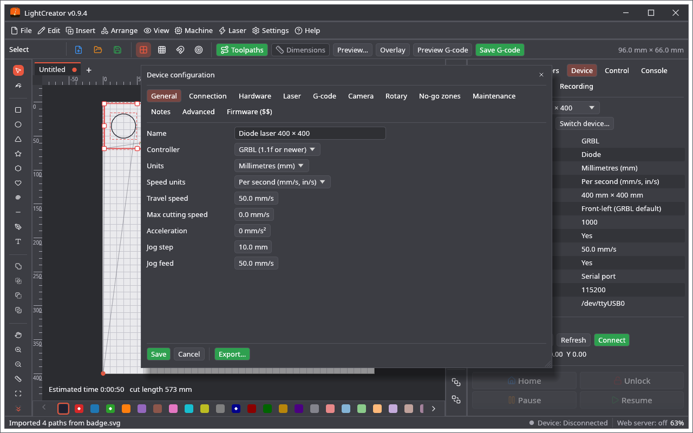
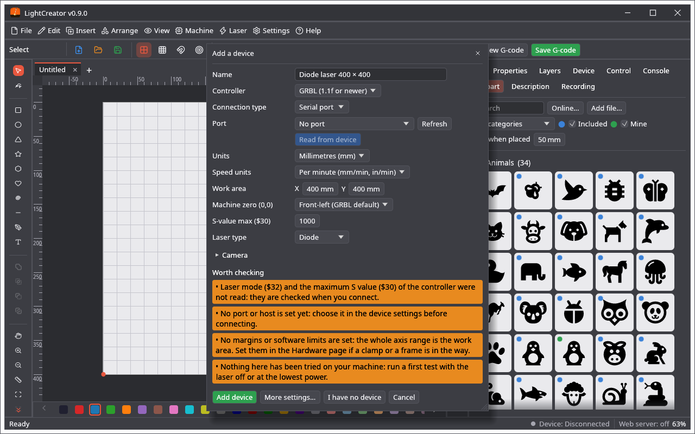
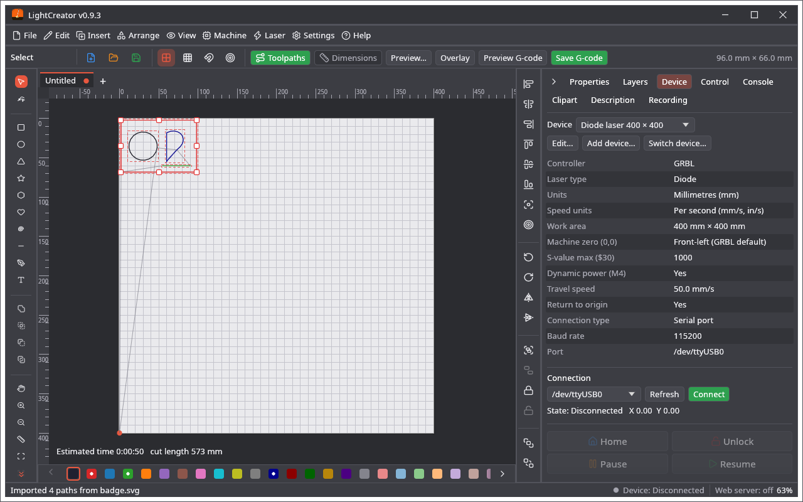
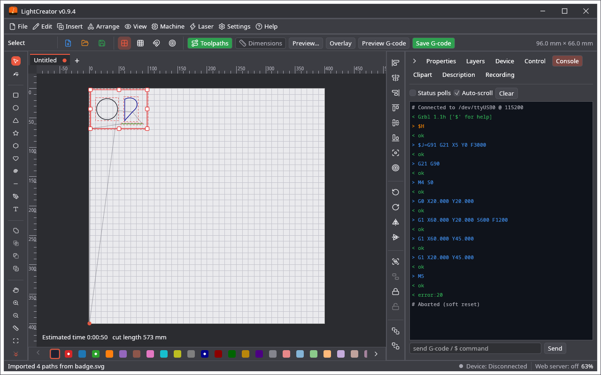
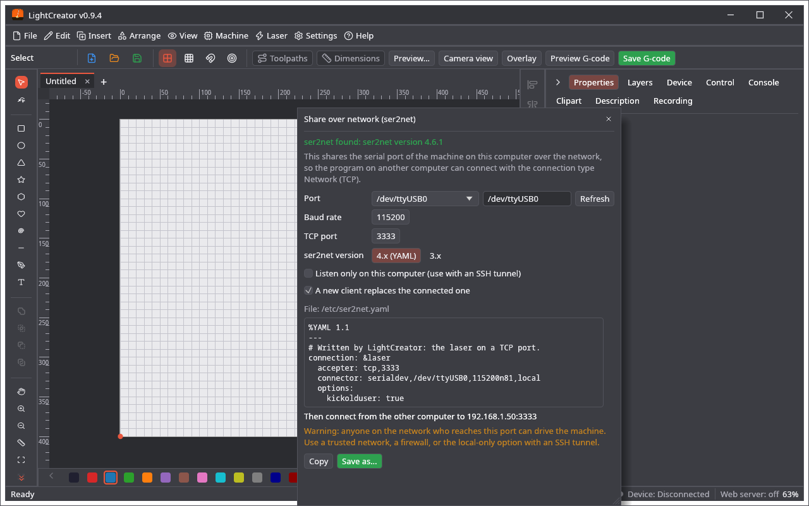
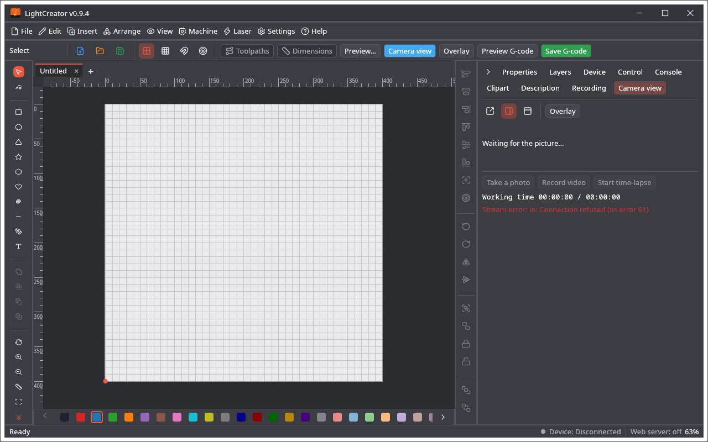
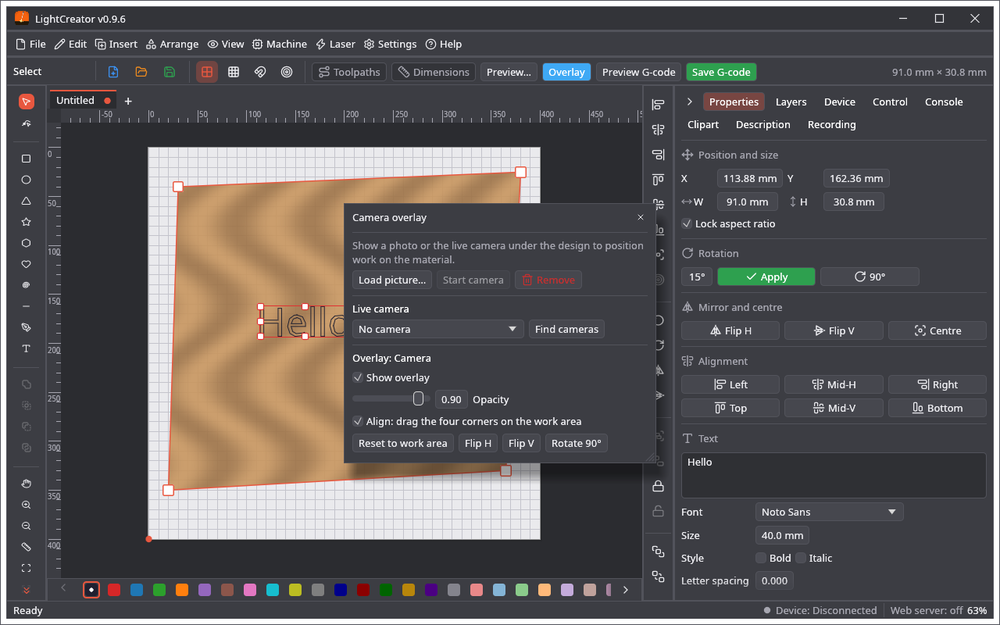

🌐 [English](Devices-and-Controllers) · [Polski](Urzadzenia-i-sterowniki) · **简体中文** · [한국어](Devices-and-Controllers-KO)

> ⚠️ 本页由英文版机器翻译而成，可能有不准确之处。如有疑问，请以[英文版](Devices-and-Controllers)为准。欢迎提出修改建议。

# 设备与控制器

> 已确认 LightCreator 能正常工作的机器，以及如何添加你的机器：[TESTS_ON_DEVICES.md](https://github.com/michalsarna/LightCreator/blob/main/TESTS_ON_DEVICES.md)。





## 轴、工作区和作业前检查
* **机器零点**（**Machine zero**）可以位于四个角中的任意一个；**反转轴**（**Invert axes**）可反转 X 和/或 Y，**面板方向**（**Panel orientation**）（原始、向左旋转、向右旋转）按面板在你面前的摆放方向旋转工作区（工作区会旋转显示，G-code 也会相应映射）。所有内容都经过同一个从设计到机器的坐标变换，因此点动箭头、零点标记、框选、G-code、HPGL 和 DXF 都保持一致。
* **边距**（**Margins**）是沿边缘机器无法使用的条带（夹具、框架）；它们在画布上以斜线阴影显示。**软限位**（**Software limits**）是可用区域内一个可选的自定义矩形（以橙色勾勒）。点动按钮会在允许区域的边缘停止；位于区域外的激光头始终可以移回区域内。
* **作业前检查：**开始、框选、保存 G-code 和文件导出都会先检查作业。位于可用区域或软限位之外的对象或刀具路径（包括过扫描）是 **错误**（**error**）：不会发送、框选或导出任何内容，窗口会提供 *选择对象*（*Select objects*）。以 0 % 功率烧刻的图层，或包含不产生刀具路径的对象的图层，是可以确认继续的 **警告**（**warnings**）。G-code 生成器不再静默地裁剪坐标。
* **连接后**会读取一次 GRBL 控制器（`$$`）。如果激光模式（`$32`）关闭，会弹出窗口警告激光可能在快速移动时发射，并在确认后提供 *启用激光模式 ($32=1)*（*Enable laser mode ($32=1)*）；如果控制器的 `$30` 与配置文件的 S 最大值不同，你可以选择 *使用控制器中的值*（*Use the value from the controller*）。

## 设备的 G-code 设置
* **速度：**在空移速度旁边有 *最大切割速度*（*Max cutting speed*）和 *加速度*（*Acceleration*）（0 = 未知）。设置了加速度时，时间估算会像控制器一样规划移动：每次移动都会加速和减速，转角处以 GRBL 的拐角偏差（junction deviation）允许的速度通过（尖角和之字形填充会花更长时间），并且一次只知道接下来的 15 次移动（Smoothieware 为 31 次），因此一长串细小的快速移动会被拖慢；G-code 查看器也以同样的方式为文件计时；切割速度上限为最大值；速度超过最大值的图层会在作业前收到警告，图层面板会建议一个等于制动距离的过扫描值。
* **方言**（**Dialect**）：根据控制器自动选择，或选择 GRBL（`M3`）、GRBL 动态（`M4`）、GRBL-M3（1.1e 或更早）、Marlin、Snapmaker（Marlin）、Smoothieware、LinuxCNC（M67）或 **自定义命令**（**Own commands**）（一个用于开启激光的命令，带有 `{power}` 或 `{percent}`，以及一个用于关闭激光的命令）。GRBL-M3、Snapmaker、LinuxCNC 和自定义命令会在每次移动前关闭激光，因为这些控制器不会自行关闭。Smoothieware 也是一种控制器（像 GRBL 一样流式传输，点动和设置像 Marlin），它将 S 写为满功率的分数（请将 *S 值最大值*（*S-value max*）设为 1）；其细节是根据文档做出的假设，尚未在硬件上试验过。
* **高级页面**（**Advanced page**）（带有警告）：自定义作业开头（替换单位、绝对模式、平面和激光模式行）、自定义作业结尾（替换结尾的 `M2`；在此之前激光总会被关闭，激光头总会被送回原点）以及辅助吹气命令。为空 = 使用内置内容；控制字符和过长的文本会被拒绝；*恢复默认值*（*Restore defaults*）会清空它们。
* **每个图层的功率模式：**与设备一样，恒定（`M3`）或动态（`M4`）；G-code 会在图层之间插入切换命令（仅 GRBL 方言）。
* **圆弧（G2 / G3）：**默认关闭。开启时，轮廓和环会在 *圆弧容差*（*Arc tolerance*）范围内拟合为圆弧；扫描线和图像仍然是直线。*曲线容差*（*Curve tolerance*）设置贝塞尔曲线和文字展平的精细程度（默认 0.05 mm）。并非所有固件都能很好地处理圆弧（Marlin 需要 ARC_SUPPORT），因此请在激光关闭的情况下测试。

## 连接行为和控制器的设置
* **流式传输**（**Streaming**）：*计算缓冲区*（*Count the buffer*）（默认，快速：控制器缓冲区中有多行）或 *简单*（*Simple*）（一次一行，等待其 `ok`；较慢，用于应答不正确的固件）。正在运行的作业如果等待应答达 10 秒且机器静止不动，会在控制台和一个窗口中报告（*继续等待*（*Keep waiting*）/ *停止作业*（*Stop the job*））；不会自行继续或发送任何内容。
* **USB 绑定：**端口字段可以填写端口名称或 `VID:PID`；*绑定到此端口*（*Bind to this port*）会记住所选端口的 USB ID，因此即使端口名称改变也能再次找到它。*自动重新连接*（*Connect again automatically*）会在连接断开后每隔几秒重试，直到你按下断开连接（Disconnect）。
* **连接后：**可选择让机器回零（`$H`、`G28`）和/或清除报警（`$X`、`M999`；这会跳过回零，因此仅在确定激光头处于安全位置时使用）。如果固件报告它在构建时启用了单轴回零（`$I` 中的选项 `H`），**控制**（**Control**）标签页中会出现 **X 回零**（**Home X**）/ **Y 回零**（**Home Y**）。
* **固件 ($$) 页面**（**Firmware ($$) page**）（GRBL）：读取所有设置及其含义、单位和典型值；关键设置（`$30`、`$31`、`$32`、`$130`–`$132`）会高亮显示。数值会经过检查（范围、掩码、0/1），只有在确认后才会写入，然后再读回。*备份到文件*（*Back up to a file*）写入带有日期和固件 `$I` 的 `$n=value` 行；*从文件恢复*（*Restore from a file*）会检查每一行，显示差异，确认后写入并比对应答；*出厂设置 ($RST=$)*（*Factory settings ($RST=$)*）需要确认并输入 `RESET`。对于 Marlin，该页面显示 `M503` 的报告。

## 校准

**机器 → 校准…**（**Machine → Calibration…**）会打开一个包含两项机器检查的窗口。它需要连接（否则显示 **请先连接机器（设备标签页）**（**Connect to the machine first (Device tab)**））以及控制器的设置，如果尚不知道设置，**读取设置 ($$)**（**Read the settings ($$)**）会读取它们。

* **每毫米步数：**选择轴（X、Y 或 Z）和一个 **距离**（**Distance**），在激光头所在位置做个标记（或在那里放一个百分表），按 **将 X 移动该距离**（**Move X by the distance**），测量激光头实际移动的距离并在 **实测值**（**Measured**）下输入。窗口会显示新值（**新值：$100 = …（原为 …）**（**New value: $100 = … (was …)**）；Y 为 `$101`，Z 为 `$102`），**写入 $100**（**Write $100**）会在确认后将其写入控制器。
* **轴的垂直度：**标记或切割一个矩形，输入其 **宽度**（**Width**）和 **高度**（**Height**），并测量其两条对角线：**对角线 A**（**Diagonal A**）从左前角到右后角，**对角线 B**（**Diagonal B**）从右前角到左后角。对角线相等表示轴是垂直的；否则窗口会显示轴偏离垂直多少度、Y 轴一端在整个高度上偏移了多少，以及 Y 轴向哪个方向倾斜。

## 从某行开始

**机器 → 从某行开始…**（**Machine → Start from line…**）从中间某处开始作业，例如在一次停止之后。窗口会显示你所选 **行**（**Line**）（在所有行中）附近的程序，以及程序在该处所处的状态；**从这里开始**（**Start from here**）会先将机器置于该状态（单位、速度、位置），然后从该行开始发送程序。如果程序无法从该行开始，窗口会说明原因。它需要连接且没有正在运行的作业。请确保自第一次尝试以来工件没有移动过。

## 激光头
**激光**（**Laser**）页面列出机器的激光头（至少一个）。激光头有名称、刀具编号 `T`、颜色、激光类型（二极管 Diode、CO2、光纤 Fiber）、波长和光功率（0 = 该类型的常用值）、S 值最大值、框选功率和速度、**对焦功率**（**focus power**）、**光斑**（**beam spot**）以及 **指示光偏移**（**pointer offset**）。CO2 和光纤激光头还保存 PWM 值（频率、最大频率、脉冲宽度及其范围）：它们与配置文件一起保存，并作为宏的变量提供，但 **不会发送到控制器**。
* **多个激光头：**每个图层都有一个 *激光头*（*Laser head*）。G-code 按图层所用激光头的 S 最大值缩放功率，并在使用其他激光头的图层之前写入 `T<n>`（编号必须与你控制器中的映射相符；程序不对 GRBL 如何处理 `T` 做任何假设）。只有一个激光头的作业会与以前完全相同地写入。
* **光斑：**当填充间距小于图层所用激光头的光斑时，图层面板会提示相邻的线会重叠。
* **对焦模式：***对焦*（*Focus*）（控制标签页）会开启一束微弱的恒定光束（`M3 S…`，用 `M5` 结束），用于调整高度。红色的 *对焦光束已开启*（*FOCUS BEAM ON*）按钮会将其关闭；在作业开始、按停止、连接断开以及程序关闭时，它也会自动关闭。它需要连接、对焦功率大于 0 且没有正在运行的作业。
* **指示光偏移：**设置了偏移后，**控制** 标签页会提供 **与指示光对齐**（**Align to the pointer**）（仅限本次会话，不保存）：框选会按偏移量反向移动，使红点落在光束将要落下的位置。**用指示光空运行**（**Dry run with the pointer**）会按偏移量平移后运行作业路径，并将每个 `S` 设为 0。作业和点动永远不会被平移。平移后的路径会先根据允许区域进行检查。

## 钩子、宏和禁入区
* **钩子**（**Hooks**）（高级页面，在警告之后）：在作业的四个位置写入自定义 G-code：*图层开始*（*Layer start*）、*图层结束*（*Layer end*）、*对象开始*（*Object start*）、*对象结束*（*Object end*），每个都有一个开关。顺序为图层开始，然后每个对象的开始和结束，然后图层结束；这些行带有 `; hook …` 注释。`{variables}` 会被填入：`{job_name}`（文件名）、`{date}` 和 `{time}`（UTC）、`{layer_name}`、`{layer_index}`、`{total_layers}`、`{workpiece_name}`、`{workpiece_index}`、`{total_workpieces}`、`{machine_name}`、`{max_speed}`、`{work_width}`、`{work_height}`、`{tool_number}`，以及激光头的 `{wavelength}`、`{optical_power}`、`{pwm_freq}`、`{pwm_max_freq}`、`{pulse_width}`、`{pulse_min}`、`{pulse_max}`。未知变量、未闭合的花括号、控制字符或超过 100 个字符的行都无法保存。使用对象钩子时，图层会逐个对象烧刻（每遍一次）；不使用时则没有任何变化。
* **文件最开头和最末尾，以及文件格式（高级页面）：***文件最开头*（*Very start of the file*）（在所有内容之前：一个 `%`、程序编号、控制器的文件头）和 *文件最末尾*（*Very end of the file*）（在结尾的 `M2` 之后）；花括号中的词会在生成文件时被替换：通用变量（`{project_name}`、`{project_path}`、`{date}`、`{time}`、`{machine_name}`、路径的包围框 `{min_x}` … `{max_y}` 以及 `{width}` `{height}`）以及设备和作业的变量（`{job_name}`、`{max_speed}`、`{work_width}`、…）。未知名称会以红色显示，在修正之前不会生成作业。**自定义文件格式**（**Own file format**）是对已完成程序的最后一道处理，用于以自己的方式读取 G-code 的控制器；所有选项默认关闭，此时文件与以前相同：*整数后加小数点*（*Decimal point after whole numbers*）（`X1` 变为 `X1.`）、*开头和结尾加 %*（*% at the start and end*）、*暂停字*（*Dwell word*）（以秒为单位的 `G4 P`、以毫秒为单位的 `G4 P` 或以秒为单位的 `G4 X`）、*行号*（*Line numbers*）（N10、N20、… 带步长）以及 *删除注释*（*Remove comments*）。只有在你更改这些设置后，它们才会被写入项目。如果在插件 *G-code tools* 的后处理器中也开启了相同的功能，行号会被生成两次：请关闭其中一个。
* **宏**（**Macros**）：命名的自定义 G-code 脚本（**高级**（**Advanced**）页面），在已连接且没有作业运行时，通过 **控制** 标签页中的按钮运行。每行一条命令；注释位于 `;` 之后或括号中；`@include(name)` 插入另一个宏（循环引用和超过 8 层的嵌套会被拒绝）；可以使用机器的变量。每次会话中第一次运行时会要求确认。这些行在发送前会像其他所有行一样被清理。
* **禁入区**（**No-go zones**）（*禁入区* 页面）：设计坐标中的矩形和圆形，每个都有一个开关。它们在工作区上以红色绘制（*视图 → 显示禁入区*（*View → Show no-go zones*），会被记住）。**激光关闭时的移动会自动绕开已启用的禁入区**，与其保持 1 mm 距离，并走最短的绕行路线（G-code 在该处有 `; round a no-go zone` 注释）。触及已启用禁入区的烧刻，或无法绕行的移动（起点或终点在禁入区内，或被禁入区围住），在作业检查中都是错误，会阻止开始、框选和导出；消息会指出该禁入区和图层。触及边缘也算。在形状上右键单击会出现 **添加为禁入区**（**Add as no-go zone**）：每个形状都会成为一个禁入区（圆形的形状成为圆形，否则为包围它的矩形），并从绘图中移除。设备有禁入区时，侧面板中会有一个 **禁入区** 标签页，其中包含相同的行。MillCreator 和 PenCreator 中也有同样的禁入区（以及同样的页面）。

## Z 轴和旋转附件
* **Z 轴**（**Z axis**）（*硬件*（*Hardware*）页面）：勾选 *机器有 Z 轴*（*The machine has a Z axis*），设置其行程，如有需要还可设置方向。图层随后会有 *Z 高度*（*Z height*）和 *每遍 Z*（*Z per pass*）（两者均为 0 = 不移动 Z）：G-code 会在每遍之前移到该高度（`G0 Z…`），并按 *每遍 Z* 步进。作业检查会拒绝超出行程的高度，设备标签页有在行程范围内停止的 Z 上 / 下按钮，Z 会从状态报告中读取。没有该轴时，这些内容都不会写入。
* **旋转**（**Rotary**）（*旋转* 页面）：卡盘（电机带动工件旋转）或滚轮（工件放在滚轮上，由滚轮带动旋转）。该模型刻意保持简单，因此请在你的机器上检查：
  * 工件周长 `C = π × workpiece diameter`；设计的高度不得超过该值（作业检查）；
  * *替代 Y*（*Replaces Y*）模式：Y 仍然是表面上的毫米数，控制器需要 `$101 = microsteps per turn / (π × drive diameter)`，其中驱动直径对于卡盘是工件，对于滚轮是滚轮（工件表面的移动与滚轮表面相同）。该页面会显示该值，并可在确认后通过固件编辑器写入；
  * *真正的 A 轴*（*True A axis*）模式：以度为单位的 `A` 取代 `Y`，`A = Y × 360 / (π × drive diameter)`。它需要带有第四轴的固件；GRBL 1.1 只有三个轴，因此在那里该选项被禁用并使用 Y。A 轴上不写入圆弧；
  * 图层被标记为 *旋转*（*rotary*）；旋转图层和平面图层不能出现在同一个作业中；画布会标出周长重复的位置；
  * **预览**（**Preview**）会显示工件上的作业：**圆柱 (3D)**（**Cylinder (3D)**）是一个直径等于工件直径的圆柱，烧刻的线条缠绕在其表面（显示近侧；上下拖动可使其转动，左右拖动可使其摆动，滚轮用于缩放，适配按钮会将其转回原位），**平面**（**Flat**）则像以前一样显示展开的表面。
* **带 Z 的禁入区：**有 Z 轴时，禁入区可以限定在一个高度范围内（就像立在工作台上的盒子或圆柱）；在该范围之外高度的移动不受限制。未设置 Z 的图层被视为位于所有高度。

## 设备配置文件
启动界面（与 MillCreator 和 PenCreator 中相同）的上方是设备列表，带有 **添加设备…**（**Add device…**）、**编辑…**（**Edit…**）、**复制**（**Duplicate**）、**导入…**（**Import…**），第二行是 **我没有设备**（**I have no device**）（**导出…**（**Export…**）和 **删除**（**Delete**）在 **编辑…** 的窗口中），其下方是 **新建**（**New**）、**打开…**（**Open…**）、**查看 G-code 文件…**（**View G-code file…**）以及最近的文件。所选设备就是项目所针对的设备：**新建** 和 **打开…** 会用它开始项目，如果没有任何设备，它们会创建并使用 Dummy（参见下文的 *没有设备*）。所选的配置文件会被记住。配置文件包含控制器、激光类型（二极管或 CO2）、单位（mm 或英寸；几何数据始终以 mm 存储）、速度单位（每秒或每分钟，自动换算；G-code 在 `G21` 之后始终使用 mm/min 进给）、每个图层的默认速度、工作区、机器零点、S 值最大值、空移速度、波特率、端口、点动步长和进给、框选功率以及摄像头对齐。配置窗口（**机器 → 设备设置…**（**Machine → Device settings…**），或启动窗口和 **设备**（**Device**）标签页中的 **编辑…**）是一个可调整大小的窗口，左侧是页面列表：**常规**（**General**）（名称、控制器、单位、速度）、**硬件**（**Hardware**）（工作区、边距、软限位、Z 轴、机器零点、反转轴、面板方向）、**激光**（**Laser**）（激光头）、**G-code**、**连接**（**Connection**）（串口或 TCP；仅适用于有实时连接的控制器）、**摄像头**（**Camera**）、**旋转**（**Rotary**）、**禁入区**（**No-go zones**）、**维护**（**Maintenance**）、**备注**（**Notes**）、**高级**（**Advanced**）（自定义 G-code、钩子、宏）和 **固件 ($$)**（**Firmware ($$)**）（仅 GRBL 和 Marlin）。早期版本保存的配置文件会按原样读取；激光设置位于激光头列表中（目前为一个）。项目始终有一个设备：在启动界面上选择的设备，或 Dummy。

**添加设备。**没有任何预定义内容（没有现成的配置文件，没有向导）。启动界面上的 *添加设备…* 会打开 **一个窗口**，其中包含设备窗口的基本设置：名称、控制器、连接（类型、端口以及一个蓝色的 *从设备读取*（*Read from device*）按钮）、单位、速度单位、工作区（X 和 Y 在同一行）、机器零点、S 值最大值、激光类型，以及可选的摄像头，并附有一份值得检查的事项列表。设备会获得默认材料以及几个适合其激光类型的起始材料。*更多设置…*（*More settings…*）会打开完整的设备窗口，并带上已输入的内容。配置文件可以 **复制**、**导出** 和 **导入**（一个带有格式版本的 JSON 文件；导入时会进行严格验证，较新的格式会被拒绝，串口永远不会从文件中读取）。

**没有设备。***我没有设备*（在启动界面和添加设备窗口中）会一次性创建一个名为 **Dummy** 的简单设备（使用程序默认的工作区、速度和设置，没有连接，带有起始材料），并在启动界面上选中它；随后 **新建** 或 **打开…** 会用它开始项目，这样就可以在没有机器的情况下准备项目。如果在完全没有设备时按下 **新建** 或 **打开…**，会创建并使用 Dummy。Dummy 是一个普通的配置文件：它会留在列表中，可以编辑，项目会以它作为机器进行保存。之后在真实设备上打开该项目时，如果工作区或控制器不同，会显示关于机器设置不同的常规警告。

**维护。**每个设备都会记录总工作时间以及你自己的计数器（例如“已清洁镜片”），并可设置限值。时间从作业真正运行的那一刻开始计算；提醒在每次会话中以及在启动界面上显示一次，计数器可以在确认后重置。副本和导入的设备从零开始。

**备注。**每个设备都有带预览的 Markdown 备注（一个小型内置渲染器；仅支持 http / https 链接）。来自模板的备注是只读的。

## 控制器
| 控制器 | 支持情况 |
|---|---|
| **GRBL** | 通过串口或 TCP 流式传输：连接、点动、回零、解锁、暂停 / 继续、停止、框选、进度；*从设备读取* 会填入工作区、S 最大值、空移速度和激光模式 |
| **Marlin** | 同上（激光功能、行内功率）；读取进给速度 |
| **GRBL-M3（1.1e 或更早）** | 没有激光模式的 GRBL：仅使用 `M3`，并在每次移动前关闭激光（`S0`） |
| **GRBL-LPC**（Gerbil、X-Controller、ManaSE）、**Gerbil-STM** | 运行在其他主板上的 GRBL 1.1；Gerbil 主板的 S 最大值不同（1000 或 2048），因此请从设备中读取 |
| **Snapmaker（Marlin）** | Marlin，在烧刻前以 `M3 P<percent> S<0–255>` 设置功率，在移动前使用 `M5`；尚未在真机上试验 |
| **LinuxCNC（文件）** | 开始时会为 LinuxCNC 保存一个 G-code 文件：功率通过模拟输出 0 输出（`M67 E0 Q`，0 到 S 最大值，需由你的 HAL 将其连接到激光器），从不使用 `M4`，以 `M2` 结束；尚未在真机上试验 |
| **自定义 G-code**（**Own G-code**） | 像 GRBL 一样流式传输，使用你自己的激光开启和关闭命令（设备的 G-code 页面） |
| **Ruida**、**Trocen** | 导出 HPGL / DXF，每种颜色对应一支笔或一个图层，在厂商软件（例如 RDWorks）中打开。填充会变成排线；栅格图像会被跳过。尚未实现直接的二进制协议 |

**GRBL 版本。**在设备连接页面的 *GRBL 版本*（*GRBL version*）中选择主板的版本：**1.1 或更新**（**1.1 or newer**）（默认；也适用于 grblHAL 和 FluidNC）、**1.0**、**0.9**、**0.8** 或 **0.7 或更早**（**0.7 or older**）。GRBL 0.8、0.9 和 1.0 以 `<Idle,MPos:…,WPos:…>` 的形式报告位置，并且没有 `$J=` 点动命令，因此程序使用普通的 `G91` / `G1` 移动进行点动；这样的点动不能中途取消，会一直运行到其步长结束。GRBL 0.7 完全没有实时命令：没有状态报告（因此没有位置）、没有暂停、继续、回零或解锁，停止只会丢弃尚未发送的行，而主板会完成它已经收到的内容；该固件还会截断超过 49 个字符的行。1.1 之前的主板没有 `M4` 动态功率：请为它们使用 G-code 方言 GRBL（`M3`）。

## 设备标签页和控制栏
* **工作区上方的工具栏** 包含新建、打开和保存、网格开关、视图（**刀具路径**（**Toolpaths**）、**预览…**（**Preview…**）、设备有摄像头时的 **摄像头视图**（**Camera view**）、**叠加**（**Overlay**）），然后是 **预览 G-code**（**Preview G-code**）和 **保存 G-code**（**Save G-code**），最右侧是所选内容的尺寸。
* **设备标签页** 用于选择设备（带有 **编辑…**、**添加设备…** 和 **切换设备…**（**Switch device…**）），显示其主要设置，并包含连接部分：端口（带有 **刷新**（**Refresh**））、**连接**（**Connect**）（绿色）/ **断开连接**（**Disconnect**）、状态和位置，然后是排成 2 × 2 的 **回零**（**Home**）、**解锁**（**Unlock**）、**暂停**（**Pause**）和 **继续**（**Resume**）（蓝色、红色、橙色和绿色图标），以及一个宽大的红色 **STOP** 按钮（仅在机器工作时可用）。对于没有实时连接的 Ruida 和 Trocen，它改为提供 **导出 PLT / DXF…**（**Export PLT / DXF…**）。
* **控制标签页**（**Control tab**）（与 MillCreator 和 PenCreator 中相同）顶部有相同的四个按钮，**START**（连接激光器时可用；Ruida 和 Trocen 改为导出文件）及其下方宽大的 **STOP**，然后是 **轮廓**（**Outline**）（左边那个：激光沿包围所有形状的线移动，就像橡皮筋一样）和 **轮廓框**（**Outline frame**）（包围它们的矩形框，与 **机器 → 框选**（**Machine → Frame**）相同），两者都以框选功率运行；它们需要连接，并在作业期间不可用。下方是两个作业选项、位置、点动的步长和速度以及八个点动箭头（四个对角方向会同时将 X 和 Y 移动一步；橙色方块用于取消点动；使用 GRBL 时，**按住移动**（**Hold to move**）会在按住按钮期间持续移动；开启 **键盘**（**Keyboard**）后，方向键会点动 X 和 Y，Page Up / Page Down 会点动 Z 一步，而不是移动所选形状），然后是 **起始位置**（**Start from**）、**框选功率**（**Frame power**）（0 % 时框选过程中激光保持关闭；1–2 % 时二极管激光器上会显示一个暗淡的光点）和 **实时激光位置**（**Live laser Position**）、对焦光束、固件支持时的 **X 回零** / **Y 回零**、**宏**（**Macros**）以及指示光。工作零点不在这里设置：作业从机器零点开始计算。
* **作业选项**（控制标签页；仅限本次会话，不保存）：**一次一个元素**（**One element at a time**）会将每个元素（一个编组，即使跨越多个图层，或不属于任何编组的形状）连同其所有图层和所有遍数完整烧刻完毕后，再烧刻下一个，最近的元素优先（关闭时：一个图层接一个图层，一遍接一遍）；**仅选中内容**（**Selection only**）只烧刻在保存 G-code 或开始作业时工作区上被选中的形状（未选中任何内容：没有可烧刻的内容）。它们可以一起使用，也可以单独使用，并会改变 G-code、预览和时间估算。
* **实时激光位置**（控制标签页；设备的一个开关，默认关闭，随配置文件保存；未连接时为灰色）：在工作区上以红点显示激光头。在机器静止时开启，它会先 **回零**，以便知道位置；在作业、框选或点动期间开启，它只显示红点，红点每秒移动一次。这些功能尚未在真机上试验过。
* **起始位置**（控制标签页；设备的一项设置，随配置文件保存）：**原点（机器零点）**（**Home (machine zero)**）为默认值，按设计在工作区上的位置烧刻，从机器零点开始计算。**激光当前位置**（**Current position of the laser**）会将设计（实际烧刻内容）的左上角放在激光头当前所在的位置；作业、框选和空运行都使用该位置，作业前检查会根据工作区检查移动后的设计，并且作业会在其开始的位置结束（开启 **返回原点**（**Return to origin**）时），而不是在机器零点结束。它需要连接和已知的位置；没有这些时，以及对于导出的文件，设计保持原位。预览显示设计在工作区上的放置位置。这些功能尚未在真机上试验过。



## 控制台
控制台（Console）标签页显示发送给控制器以及从控制器接收的所有内容；状态轮询默认隐藏。在其输入框中输入的 **你自己的命令** 有单独的颜色。在输入框中，**Up** 和 **Down** 键会在你从该输入框发送过的命令中切换，且仅限这些命令；你正在输入的内容会在末尾恢复。**设置 → 视图选项… → G-code 控制台**（**Settings → View options… → G-code console**）用于设置字号和颜色。


## TCP 和 ser2net
设备可以通过网络连接，例如连接到 Raspberry Pi 上的 `ser2net`。将 **连接类型**（**Connection type**）设置为 **网络（TCP，例如 ser2net）**（**Network (TCP, e.g. ser2net)**），并输入 **主机**（**Host**）和 **TCP 端口**（**TCP port**）；波特率在 ser2net 中配置。
```yaml
connection: &laser
  accepter: tcp,3333
  connector: serialdev,/dev/ttyUSB0,115200n81,local
```
在 Linux 上，**机器 → 通过网络共享 (ser2net)…**（**Machine → Share over network (ser2net)…**）会为你完成这些工作：它选择端口、波特率和 TCP 端口，写入 ser2net 4.x（YAML）或 3.x 配置，显示地址，并可以复制、保存或安装配置以及重启服务（通过 `pkexec` 请求管理员权限，并备份旧文件）。仅限本地的选项适用于 SSH 隧道；否则该端口对网络开放。


## 摄像头
为设备设置摄像头地址（**摄像头**（**Camera**）页面：通过 http / https 的 MJPEG 流或 JPEG 快照，或者通过 rtsp、udp、rtp 或 rtmp 的流），工作区上方的工具栏就会出现 **摄像头视图**（**Camera view**）按钮（以及 **视图 → 摄像头视图**（**View → Camera view**））。视图顶部的三个图标用于选择显示方式：**单独窗口**（**Separate window**）（操作系统的一个窗口，可以移出程序窗口）、**侧边标签页**（**Side tab**）（侧面板的一个标签页）或 **工作区中的标签页**（**Tab in the work area**）（绘图旁边的一个标签页，可以像其他标签页一样拖到另一个窗格）。画面可以旋转 90° / 180° / 270°（设备设置）、缩放（左下角的缩放栏或鼠标滚轮，最高 8 倍）、拖动，并可用缩放栏的 **重置视图**（**Reset view**）或双击恢复为完整画面；地址不会被显示。摄像头视图的 **叠加**（**Overlay**）按钮会在视图打开期间用实时画面作为设计下方的叠加层，再按一次则停止。


**摄像头叠加对齐：**照片或实时摄像头画面位于设计下方，通过四个可拖动的角进行对齐（透视校正），并可设置不透明度、翻转和旋转。图片、其四个角和不透明度都保存 **在项目文件中**（作为其中的一部分），因此无论谁打开该文件，叠加层都会恢复；校准信息也会随设备一起保存。可以通过 **视图 → 叠加来源…**（**View → Overlay from…**）或工作区上方工具栏中的 **叠加** 按钮打开它，该按钮始终可用：未显示叠加层时它会打开同一个窗口，显示叠加层时则将其关闭。**视图 → 显示摄像头叠加层**（**View → Show camera overlay**）显示或隐藏现有的叠加层（没有叠加层时为灰色）。该窗口（**摄像头叠加**（**Camera overlay**））包含 **加载图片…**（**Load picture…**）（来自文件的照片）和 **移除**（**Remove**）、本机的 **实时摄像头**（**Live camera**）（**查找摄像头**（**Find cameras**）、**启动摄像头**（**Start camera**）、**冻结画面**（**Freeze frame**）；仅在支持摄像头的构建中提供）、**显示叠加层**（**Show overlay**）、**不透明度**（**Opacity**）、**对齐：在工作区上拖动四个角**（**Align: drag the four corners on the work area**）、**重置为工作区**（**Reset to work area**）、**水平翻转**（**Flip H**）、**垂直翻转**（**Flip V**）、**旋转 90°**（**Rotate 90°**）以及下方的 **参考点**（**Reference points**）。每个打开的绘图都有自己的叠加层。


**工作时间：**在每种模式下，摄像头视图都会在画面下方显示正在运行的作业已工作的时间和估算时间（`00:04:12 / 00:13:00`）；作业结束后，最后的工作时间会保留。

**摄像头视图每次都以相同的方式打开：**显示方式（单独窗口、侧边标签页或工作区中的标签页）、缩放比例以及其窗口的位置和大小都会随设备一起保存。

**多个摄像头。**一个设备可以有任意数量的摄像头（*摄像头* 页面）：每个摄像头都有名称、开关、来源（http、https、rtsp、udp、rtp 或 rtmp 地址，或在支持摄像头的构建中本机的摄像头）、旋转以及一个 *活动*（*active*）标记；活动摄像头提供实时画面。只有在地址有效时才能开启摄像头。每个摄像头都有 **画面设置**（**picture settings**）（亮度、对比度、白平衡、降噪，本地摄像头还可以优先使用未压缩的 YUYV 格式）和 **手动镜头校正**（**manual lens correction**）（径向 k1–k3 和切向 p1、p2 系数，手动输入；全部为 0 表示不校正）。早期版本中只有单个摄像头 URL 的配置文件会变为一个摄像头。新添加的摄像头会自动勾选：名称前的勾选框用于开启摄像头，同一时间只有一个摄像头处于开启状态（勾选另一个会关闭第一个）。摄像头的 **测试**（**Test**）按钮会在一个小窗口中打开其画面，并按正在编辑的旋转、画面设置和镜头校正显示，不保存任何内容。

**通过参考点对齐。**在叠加窗口中，*参考点*（*Reference points*）保存若干对点：画面中的一个点（像素）以及它在工作区中的位置（mm）。有 3 个点时进行仿射拟合，有 4 个或更多点时进行完整的透视拟合（最小二乘法）；*按点对齐*（*Align by the points*）会移动叠加层的四个角以匹配这些点，*从当前角生成点*（*Points from the current corners*）会将旧的四角对齐转换为点。这些点随摄像头一起保存。

不支持：自动镜头校准（ChArUco 标定板、标记或点阵）；它需要一个庞大的计算机视觉依赖，因此系数需手动输入。

### 摄像头：RTSP、照片、视频和延时摄影

* **RTSP 流**（`rtsp://` 或 `rtsps://`，当摄像头需要时在地址中包含用户名和密码）可以作为摄像头地址使用。流由 **ffmpeg** 解码，它作为一个单独的程序运行：程序会先在本程序旁边查找（安装包自带一个），然后在 macOS 应用的资源中查找，最后在 PATH 中查找。没有它时摄像头视图会给出提示；中断的流会每隔几秒重新打开。带密码的地址可以在计算机的进程列表中看到：请使用只有查看权限的摄像头账户。
* **其他流：**`udp://` 和 `rtp://`（来自编码器的 MPEG-TS 或 RTP，也支持组播；`udp://@:5000` 在一个端口上监听）以及 `rtmp://` 也以同样的方式由 ffmpeg 读取。20 秒内没有任何数据的流会被视为已断开并重新打开。安装包中精简版的 ffmpeg 不支持 TLS 地址（`rtsps://`、`rtmps://`）。
* **摄像头选项**（位于由 ffmpeg 读取的流的地址下方，默认关闭）：**RTSP 使用 UDP**（**Use UDP for RTSP**）（仅适用于 `rtsp://` / `rtsps://` 地址；延迟比 TCP 低，但在网络不佳时画面可能会出现破损；关闭时：TCP）和 **低延迟**（**Low latency**）（更快获得最新画面，不进行缓冲；画面可能会卡顿）。更改这些选项后流会重新打开。
* **视频格式**（**Video format**）（在摄像头视图中）：**自动**（**Automatic**）（推荐）会将 IP 摄像头的流按原样复制到 **MP4** 文件中。不会重新解码或编码任何内容，因此处理器几乎没有负担，画质与摄像头相同。复制的是摄像头发送的原始流：程序的旋转和画面设置不会应用到其中。逐张输出画面的摄像头（MJPEG 地址、本机摄像头）会录制为 **AVI**（Motion-JPEG）。**MP4** 要求使用复制方式（不是流的摄像头会录制为 AVI，按钮下方的一行文字会说明这一点）；**AVI** 始终写入 Motion-JPEG 画面。
* 在录制标签页的摄像头面板中：**拍照**（**Take a photo**）（JPEG）、**录制视频**（**Record video**）（使用下方的 **视频格式**；**停止录制**（**Stop recording**）结束录制，旁边的一行文字会计秒）以及 **延时摄影**（**Time-lapse**）：**每**（**Every**）N 秒，或 **每个图层之后**（**After each layer**）（在作业的下一个图层开始时以及作业结束时各拍一张；需要由程序用开始（Start）将作业发送到激光器），用 **开始延时摄影**（**Start time-lapse**）开始，用 **停止延时摄影**（**Stop time-lapse**）结束。
* 侧面板的 **录制标签页**（**Recording tab**）为设备的每个摄像头提供一个面板，以摄像头的名称命名。每个摄像头独立录制，并保存其自己的设置：**拍照**、**录制视频**、**延时摄影**（方式及其开始和停止）、**视频格式**、**文件夹**（**Folder**），以及其 **摄像头视图** 的打开方式。正在录制但不是视图所显示的摄像头会读取它自己的画面。有多个摄像头时，文件名中会包含摄像头名称（`box-Side_camera-photo-0001.jpg`），所有文件都放在同一个文件夹中。摄像头视图画面下方只显示它所显示的摄像头的按钮：拍照、视频、开始和停止延时摄影。
* **将激光头移开拍照**（**录制**（**Recording**）标签页 → **延时摄影时移开拍照**（**Time-lapse photos aside**）→ **每次拍照时移开激光头**（**Move the head aside for each photo**））：在作业期间，延时摄影的每张照片都会等到作业可以停下时再拍。激光器会在下一行停下。光束关闭，激光头移到 **位置**（**Place**）（机器坐标；**使用当前位置**（**Use the current position**）取激光头当前所在的位置），程序等待 **拍照前等待**（**Wait before the photo**）时间（让机器停止晃动、让视频流跟上），并拍摄一张在该等待之后得到的画面。然后激光头回到停下的位置，光束恢复原来的状态，作业继续。它适用于 GRBL 和 Smoothieware，它们会报告机器何时静止；Marlin、Ruida 和 Trocen 不会为拍照而停下。
* **拆分长线**（**Split long lines**）（同一部分）：长的直线切割会被拆分为 2 到 256 条较短的线发送，每条至少为所设置的长度。这样作业可以更快地停下，以便拍照或暂停，进度也会更均匀地推进。路径保持不变；快速移动和圆弧保持完整。
* **文件保存位置。**默认保存到 **项目文件旁边** 的 `camera` 文件夹中。如果该文件夹已经存在（来自之前的会话），则改为创建第一个可用的 `camera00`、`camera01`…，并在本次运行的剩余时间内一直使用该文件夹。文件名以项目名称开头：`box-photo-0001.jpg`、`box-video-0001.mp4`（或 `.avi`），延时摄影会有自己的文件夹（`box-timelapse-0001`），其中为 `box-frame-00001.jpg` 或 `box-layer-00001.jpg`。从未保存过的项目没有文件夹：其文件会保存到共享数据文件夹的 `camera` 文件夹中，文件名前不带名称。按钮下方的 **文件夹** 显示下一个文件的保存位置；**选择文件夹…**（**Choose the folder…**）改为为所有内容设置一个文件夹（对所有程序保持有效）。
* 关闭摄像头视图后，录制仍会继续。

## macOS：“No route to host”

macOS 会阻止程序访问本地网络，直到它们被允许，新构建或更新的程序可能需要再次获得允许。如果无法访问你网络中的控制器或摄像头，且消息显示 *No route to host*，请打开 **系统设置 → 隐私与安全性 → 本地网络**（**System Settings → Privacy & Security → Local Network**）并开启该程序（如果你从终端启动它：则开启终端）。如果它已经开启，请先关闭再开启，然后重新启动程序。
