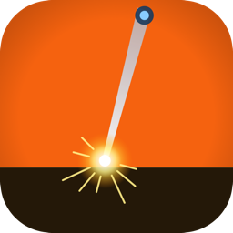
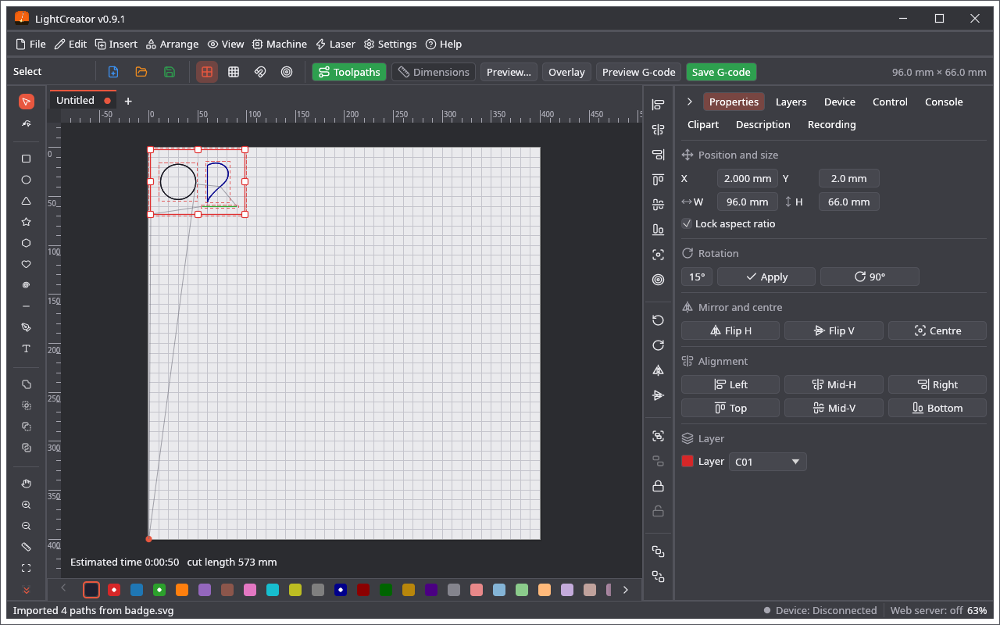

🌐 [English](Home) · [Polski](Home-PL) · [简体中文](Home-ZH) · **한국어**

> ⚠️ 이 페이지는 영어판을 기계 번역한 것으로, 부정확한 부분이 있을 수 있습니다. 의심스러우면 [영어판](Home)을 기준으로 하십시오. 수정 제안을 환영합니다.

# LightCreator

Rust로 작성된 CNC 레이저 조각기 및 절단기용 오픈 소스 프로그램입니다. macOS, Windows, Linux에서 디자인하고, 절단과 조각을 배치하고, 툴패스를 미리 본 다음 기계로 전송합니다.

## 어디서부터 시작할까요

| 하고 싶은 일 | 이동할 페이지 |
|---|---|
| 프로그램 설치 | [설치](Installation-KO) |
| 첫 번째 작업 굽기 | [빠른 시작](Quick-Start-KO) |
| 메뉴 항목과 그 기능 찾기 | [메뉴](Menus-KO) |
| 그리기, 편집, 가져오기 | [디자인 도구](Design-Tools-KO) |
| 그림을 스타일 있는 선으로 그리기(점묘, 구불구불한 선, 해칭…) | [스타일 트레이스](Style-Trace-KO) |
| 작업 영역 정리: 창 영역, 탭, 창 | [창 영역과 탭](Panes-and-Tabs-KO) |
| 속도, 출력, 채우기, 이미지 설정 | [절단과 레이어](Cuts-and-Layers-KO) |
| 레이저 또는 카메라 연결 | [장치와 컨트롤러](Devices-and-Controllers-KO) |
| 미리 만들어진 그림 사용 | [클립아트 갤러리](Clipart-Gallery-KO) |
| 단축키 찾기 | [키보드 단축키](Keyboard-Shortcuts-KO) |
| 설정 파일 찾기 | [설정과 파일](Settings-and-Files-KO) |
| 코드에 대해 읽기 | [아키텍처](Architecture-KO) |
| GRBL 코드나 오류 찾기 | [GRBL 코드](GRBL-Codes-KO) |
| 레이저 없이 테스트 | [GRBL 시뮬레이터](GRBL-Simulator-KO) |
| 무엇이 테스트되었는지 알기 | [안전과 제한 사항](Safety-and-Limitations-KO) |

## 테스트된 장치

이 프로그램은 다음 기계에서 시험되었으며 정상적으로 동작합니다.

| 장치 | 종류 | 컨트롤러 |
|---|---|---|
| Sculpfun S9 | 다이오드 레이저 조각기 겸 절단기 | GRBL |

다른 기계에서도 동작하나요? [이슈](https://github.com/michalsarna/LightCreator/issues)로 알려 주시면 목록에 추가합니다.
기계를 추가하는 방법이 담긴 목록: [TESTS_ON_DEVICES.md](https://github.com/michalsarna/LightCreator/blob/main/TESTS_ON_DEVICES.md).

## 한눈에 보기

* **디자인:** 도형, 베지어 노드 편집, 텍스트, 불리언 연산, 오프셋, 모서리 둥글리기, 그룹화, 잠금; SVG / Illustrator / PDF / EPS / VectorCraft / DXF 및 비트맵 가져오기, 이미지 트레이싱, 배열, 경로 위의 텍스트, 트리밍, 일련번호 텍스트, QR 코드, 네스팅.
* **조각:** 선, 채우기, 오프셋 채우기, 그리고 여섯 가지 디더링 방식과 그레이스케일 출력을 지원하는 래스터 이미지; 64개의 절단 레이어; 시간 예측이 포함된 미리 보기.
* **장치:** 기계별 프로필; 시리얼 또는 TCP(ser2net)를 통한 GRBL 및 Marlin; PLT / DXF 내보내기를 통한 Ruida 및 Trocen.
* **도우미:** 사진, 동영상, 타임랩스를 지원하는 카메라 보기(MJPEG, RTSP, UDP, RTP, RTMP), 프로젝트에 저장되는 네 모서리 정렬 기능이 있는 카메라 오버레이, 편집 가능한 텍스트로서의 G-code, 온라인 검색이 가능한 310개 그림의 클립아트 갤러리.
* **작업 영역:** 최대 세 개의 창 영역에 배치되는 도면, 미리 보기, G-code, 카메라 탭; 탭은 별도의 창으로 열 수 있습니다.
* **인터페이스:** 38개 언어(English, Polski, Deutsch, Italiano, Suomi, 简体中文, हिन्दी, 그 밖의 유럽 언어 23개와 日本語, 한국어, 繁體中文, Türkçe, Tiếng Việt, Bahasa Indonesia, Српски, Bosanski)와 18가지 색 구성표.

> ⚠️ **안전:** 레이저는 위험합니다. G-code는 낮은 출력으로 테스트하고, 보안경을 착용하며, 동작 중인 기계를 절대 방치하지 마십시오. [안전과 제한 사항](Safety-and-Limitations-KO)을 참고하십시오.

최신 릴리스: **v0.9.10** · [릴리스](https://github.com/michalsarna/LightCreator/releases) · [이슈](https://github.com/michalsarna/LightCreator/issues) · 라이선스: [MIT](https://github.com/michalsarna/LightCreator/blob/main/LICENSE) 또는 [Apache-2.0](https://github.com/michalsarna/LightCreator/blob/main/LICENSE-APACHE) 중 선택
