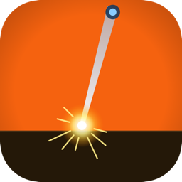
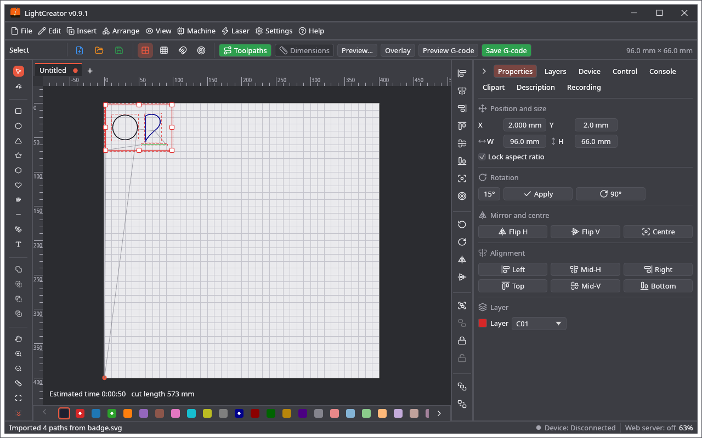

🌐 [English](Home) · [Polski](Home-PL) · **简体中文** · [한국어](Home-KO)

> ⚠️ 本页由英文版机器翻译而成，可能有不准确之处。如有疑问，请以[英文版](Home)为准。欢迎提出修改建议。

# LightCreator

一款用 Rust 编写的开源程序，面向 CNC 激光雕刻机和切割机。在 macOS、Windows 和 Linux 上进行设计、排布切割与雕刻、预览刀具路径，并将其发送到机器。

## 从哪里开始

| 我想要… | 前往 |
|---|---|
| 安装程序 | [安装](Installation-ZH) |
| 完成第一次烧刻 | [快速入门](Quick-Start-ZH) |
| 查找某个菜单项及其作用 | [菜单](Menus-ZH) |
| 绘制、编辑和导入 | [设计工具](Design-Tools-ZH) |
| 以某种风格将图片绘制为线条（点画、波浪线、排线…） | [风格描摹](Style-Trace-ZH) |
| 布置工作区：窗格、标签页、窗口 | [窗格与标签页](Panes-and-Tabs-ZH) |
| 设置速度、功率、填充、图像 | [切割与图层](Cuts-and-Layers-ZH) |
| 连接激光器或摄像头 | [设备与控制器](Devices-and-Controllers-ZH) |
| 使用现成的图片 | [剪贴画库](Clipart-Gallery-ZH) |
| 查找某个按键 | [键盘快捷键](Keyboard-Shortcuts-ZH) |
| 找到设置文件 | [设置与文件](Settings-and-Files-ZH) |
| 了解代码 | [架构](Architecture-ZH) |
| 查询 GRBL 代码或错误 | [GRBL 代码](GRBL-Codes-ZH) |
| 不用激光器进行测试 | [GRBL 模拟器](GRBL-Simulator-ZH) |
| 了解哪些内容经过测试 | [安全与限制](Safety-and-Limitations-ZH) |

## 已测试的设备

本程序已在以下机器上试用并能正常工作：

| 设备 | 类型 | 控制器 |
|---|---|---|
| Sculpfun S9 | 二极管激光雕刻切割机 | GRBL |

它能在其他机器上运行？请在 [issue](https://github.com/michalsarna/LightCreator/issues) 中告诉我，它就会被加入列表。
包含如何添加机器说明的列表：[TESTS_ON_DEVICES.md](https://github.com/michalsarna/LightCreator/blob/main/TESTS_ON_DEVICES.md)。

## 概览

* **设计：**形状、贝塞尔节点编辑、文字、布尔运算、偏移、圆角、编组、锁定；SVG / Illustrator / PDF / EPS / VectorCraft / DXF 和位图导入、图像描摹、阵列、路径文字、修剪、序列文字、二维码和排样（nesting）。
* **雕刻：**线条、填充、偏移填充以及栅格图像，支持六种抖动方法和灰度功率；64 个切割图层；带时间估算的预览。
* **设备：**按机器保存的配置文件；通过串口或 TCP（ser2net）连接 GRBL 和 Marlin；通过 PLT / DXF 导出支持 Ruida 和 Trocen。
* **辅助功能：**摄像头视图，支持照片、视频和延时摄影（MJPEG、RTSP、UDP、RTP、RTMP），摄像头叠加层带四角对齐并保存在项目中，G-code 作为可编辑文本，包含 310 张图片的剪贴画库并支持在线搜索。
* **工作区：**绘图、预览、G-code 和摄像头的标签页，最多分布在三个窗格中；标签页可以在独立窗口中打开。
* **界面：**38 种语言（English、Polski、Deutsch、Italiano、Suomi、简体中文、हिन्दी、另外 23 种欧洲语言以及 日本語、한국어、繁體中文、Türkçe、Tiếng Việt、Bahasa Indonesia、Српски、Bosanski）和 18 种配色方案。

> ⚠️ **安全：**激光是危险的。请以低功率测试 G-code，佩戴护目镜，切勿让运行中的机器无人看管。参见 [安全与限制](Safety-and-Limitations-ZH)。

最新版本：**v0.9.10** · [Releases](https://github.com/michalsarna/LightCreator/releases) · [Issues](https://github.com/michalsarna/LightCreator/issues) · 许可证：[MIT](https://github.com/michalsarna/LightCreator/blob/main/LICENSE) 或 [Apache-2.0](https://github.com/michalsarna/LightCreator/blob/main/LICENSE-APACHE)，任选其一
