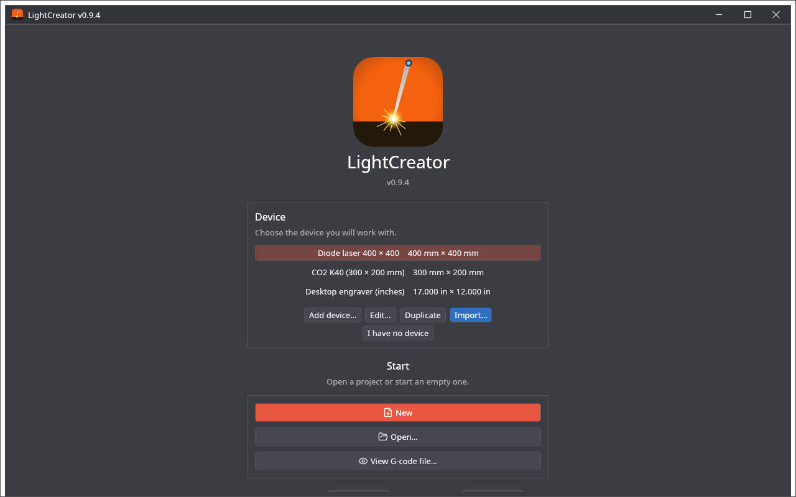
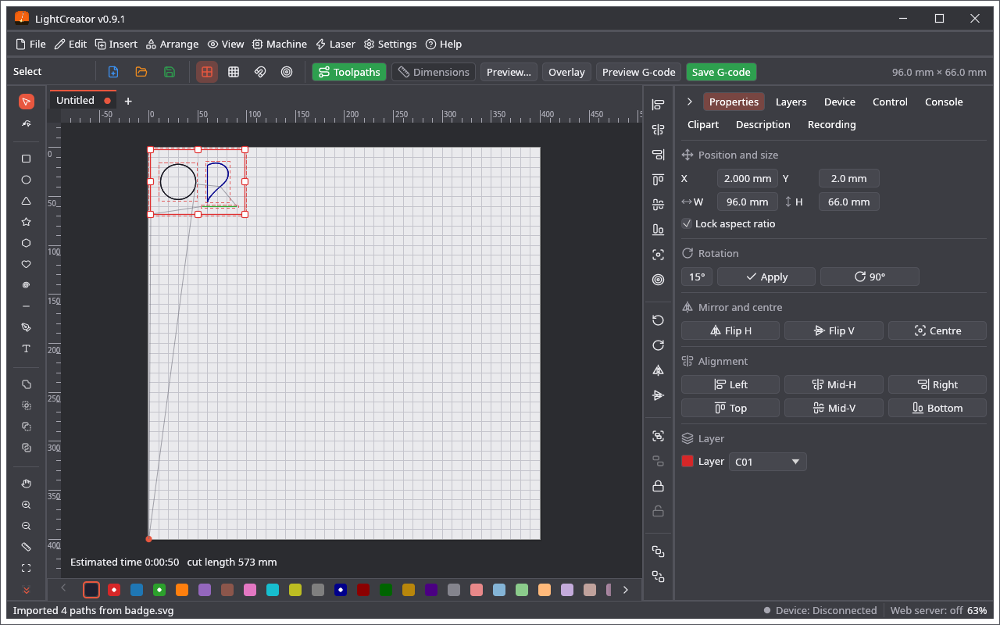
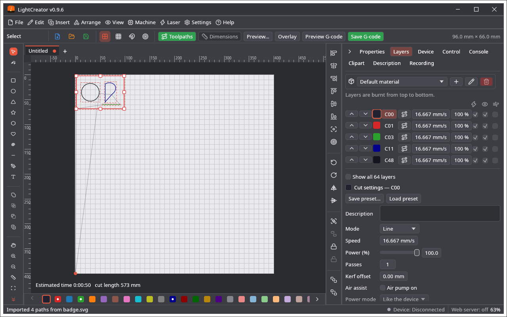
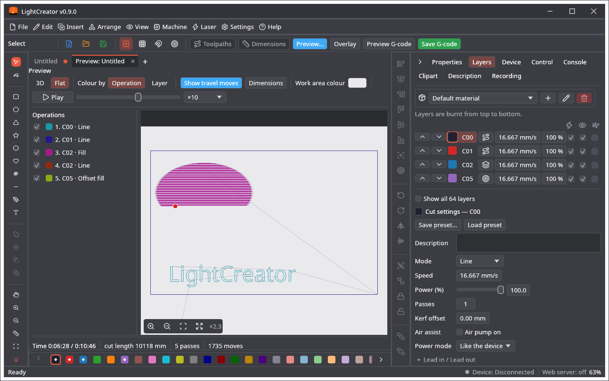

🌐 [English](Quick-Start) · [Polski](Szybki-start) · [简体中文](Quick-Start-ZH) · **한국어**

> ⚠️ 이 페이지는 영어판을 기계 번역한 것으로, 부정확한 부분이 있을 수 있습니다. 의심스러우면 [영어판](Quick-Start)을 기준으로 하십시오. 수정 제안을 환영합니다.

# 빠른 시작

시작 창부터 완성된 작업물까지, 첫 번째 작업을 단계별로 안내합니다. 아래의 모든 레이블은 프로그램에 표시되는 그대로이며, 메뉴는 [메뉴](Menus-KO) 페이지에서 항목별로 설명합니다.

> ⚠️ 첫 테스트는 자투리 재료에 낮은 출력으로 실행하고, 보안경을 착용하며, 기계 곁을 떠나지 마십시오. [안전과 제한 사항](Safety-and-Limitations-KO)을 참고하십시오.

## 1. 프로그램을 시작하고 장치 선택하기

LightCreator를 설치하고 실행합니다([설치](Installation-KO)). **시작 창**은 두 부분으로 되어 있습니다.

* **장치**(Device) ("작업할 장치를 선택하십시오."(Choose the device you will work with.)): **장치 추가…**(Add device…), **편집…**(Edit…), **복제**(Duplicate), **가져오기…**(Import…), **장치가 없습니다**(I have no device)가 있는 장치 목록입니다.
* **시작**(Start) ("프로젝트를 열거나 빈 프로젝트를 시작하십시오."(Open a project or start an empty one.)): **새로 만들기**(New), **열기…**(Open…), **G-code 파일 보기…**(View G-code file…)와 최근에 연 파일들입니다. 그 아래에서 **언어**(Language)와 **색 구성표**(Colour scheme)를 선택합니다.

처음에는 목록이 비어 있습니다. **장치 추가…**를 누르십시오. 한 개의 창에서 기본 사항을 묻습니다.

* **이름**(Name), **컨트롤러**(Controller) (GRBL, Marlin, Smoothieware, Ruida, Trocen)와 **연결 유형**(Connection type): 시리얼 **포트**(Port) (포트를 다시 찾는 **새로 고침**(Refresh) 포함) 또는 네트워크 **호스트**(Host)와 **TCP 포트**(TCP port).
* **장치에서 읽기**(Read from device) (파란색): 기계가 연결되어 있으면 컨트롤러에서 작업 영역과 속도를 읽어 옵니다.
* **단위**(Units), **속도 단위**(Speed units), **작업 영역**(Work area) (X와 Y), **기계 원점 (0,0)**(Machine zero (0,0)) (기계의 원점이 있는 모서리), **S값 최대 ($30)**(S-value max ($30)), **레이저 종류**(Laser type), 그리고 있다면 **카메라**(Camera).
* **확인할 사항**(Worth checking): 창에서 알 수 없었던 항목의 목록입니다(예: 레이저 모드와 `$30`을 아직 읽지 않음).

**장치 추가**(Add device)는 장치를 목록에 넣고 선택합니다. **추가 설정…**(More settings…)은 입력한 내용으로 전체 장치 창을 엽니다. **장치가 없습니다**는 기계 없이 프로젝트를 준비할 수 있도록 **Dummy**라는 기본 장치를 만듭니다.

장치를 선택하고 **새로 만들기**를 누릅니다. (장치가 하나도 없으면 **새로 만들기**와 **열기…**가 Dummy를 만들어 사용합니다.) 편집기가 열리고 탭에 빈 도면이 나타납니다. 장치는 나중에 **기계 → 장치 설정…**(Machine → Device settings…)에서 확인하거나 변경할 수 있고, **기계 → 장치 전환…**(Machine → Switch device…)으로 다른 장치를 선택할 수 있습니다. 모든 설정은 [장치와 컨트롤러](Devices-and-Controllers-KO)에 있습니다.

### 프로젝트 설정

**새로 만들기** 후에 **프로젝트 설정**(Project setup) 창(**파일 → 프로젝트 설정…**(File → Project setup…)으로도 열 수 있음)이 재료에 대해 묻습니다. **블록**(Block) (너비, 높이, 두께; **작업 영역이 곧 재료**(Work area is the material)를 선택하면 작업 영역이 재료 크기와 같아집니다) 또는 **원통 (로터리)**(Cylinder (rotary)) (지름과 길이; 적용하면 장치의 로터리 부착 장치가 켜집니다)를 선택할 수 있습니다. 블록은 **양면 작업**(Two-sided job)이 될 수 있습니다. 이 경우 A면과 B면이 두 개의 작업 영역이 되고, 작업 영역 위에 **A면 / B면**(Side A / Side B) 전환 스위치가 나타납니다. 재료를 **뒤집는 기준선**(Turned over round)을 선택하십시오. **H** (가로 축: 뒤와 앞이 바뀜) 또는 **V** (세로 축: 왼쪽과 오른쪽이 바뀜)입니다. 그리고 **정렬 표시**(Alignment marks)를 추가할지 선택합니다. 정렬 표시는 재료 바로 바깥의 네 모서리 표시로, 마지막 레이어(64)에 놓이며 A면보다 먼저 재료 아래의 판에 새겨져, 뒤집은 재료를 같은 자리에 다시 놓을 수 있게 해 줍니다. B면은 재료를 뒤집은 뒤 놓인 모습 그대로 그려지고 그려진 대로 새겨집니다(작업은 항상 화면에 표시된 면입니다). 각 면에는 다른 면이 뒤집힌 상태로 흐린 점선 **고스트**(ghost)로 표시되며, 이것은 선택할 수 없습니다(**다른 면의 고스트**(Ghosts of the other side)). 재료는 기계 원점의 모서리에 가장자리에서 3 mm 안쪽으로 놓입니다(작업 영역에 점선 윤곽으로 표시). **미리 보기**(Preview)에도 같은 **A면 / B면** 스위치가 있습니다. 창 아래쪽에 녹색 **적용**(Apply)과 파란색 **건너뛰기**(Skip)가 있습니다. 새 프로젝트에서 **건너뛰기**를 누르거나 창을 닫으면 프로젝트는 장치의 작업 영역 크기의 단면 프로젝트로 남습니다.

## 2. 도형을 그리거나 디자인 가져오기

* **그리기:** 왼쪽이나 **삽입**(Insert) 메뉴에서 도구를 고릅니다. 예를 들어 **사각형 (R)**(Rectangle (R))을 고르고 작업 영역에서 드래그합니다(Shift를 누르면 정사각형이 됩니다). **텍스트 (T)**(Text (T)): 클릭하고 입력합니다. 크기와 위치는 오른쪽의 **속성**(Properties) 탭에서 입력할 수 있습니다.
* **가져오기:** **파일 → 가져오기 → SVG 가져오기…**(File → Import → Import SVG…) (Ctrl+I)는 SVG 파일의 도형을 추가하며, 파일의 각 색상은 각각의 레이어로 들어갑니다. 같은 하위 메뉴에서 그림, Illustrator / PDF / EPS / VectorCraft, DXF, LightBurn, UGS 파일도 읽을 수 있습니다. 파일을 창으로 끌어다 놓을 수도 있습니다.
* **미리 만들어진 그림:** **클립아트**(Clipart) 탭입니다. [클립아트 갤러리](Clipart-Gallery-KO)를 참고하십시오.

클릭하거나 영역을 둘러싸서 선택하고, 드래그하거나 화살표 키로 이동합니다(1 mm, Shift: 10 mm). **배치**(Arrange) 메뉴와 작업 영역 옆의 좁은 바로 정렬, 가운데 맞춤, 회전, 그룹화를 할 수 있습니다. [디자인 도구](Design-Tools-KO)를 참고하십시오.

## 3. 도형을 레이어에 넣고 레이어 설정하기

도형의 색은 그 도형의 **레이어**이며, 레이어가 어떻게 새길지를 정합니다.

* 작업 영역 아래의 색상 줄이 **레이어 바**(layer bar)입니다. 도형을 선택하고 색을 클릭하면 도형이 그 레이어로 이동합니다. 아무것도 선택하지 않은 상태에서 클릭하면 새 도형이 들어갈 레이어가 선택됩니다.
* 색(또는 **레이어**(Layers) 탭의 레이어)을 **더블 클릭**하면 **레이어 옵션**(Layer options)이 열립니다: **이름**(Name), **색**(Colour), **출력 (이 레이어 새기기)**(Output (burn this layer)), **표시**(Visible), 그리고 **모드**(Mode) (**선**(Line)은 윤곽을 따라가고, **채우기**(Fill)는 내부를 스캔하며, **채우기 + 선**(Fill + Line), **오프셋 채우기**(Offset fill)), **속도**(Speed), **출력 (%)**(Power (%)), **패스 수**(Passes), 채우기 선의 **간격**(Interval) 등이 있습니다. 새 레이어는 출력 100 %, 1000 mm/min으로 시작합니다.
* **레이어** 탭은 사용 중인 레이어를 새기는 순서대로 나열합니다(**64개 레이어 모두 표시**(Show all 64 layers)를 누르면 나머지도 보입니다). 순서를 바꾸려면 레이어를 위나 아래로 옮기십시오. 탭 제목에는 레이어가 설정값을 가져오는 **재료**(material)가 표시됩니다. 거기서 다른 재료를 선택하거나 **레이저 → 재료…**(Laser → Materials…)에서 재료를 관리할 수 있습니다.

모든 설정은 [절단과 레이어](Cuts-and-Layers-KO)에 있습니다.

## 4. 새기기 전에 작업 확인하기

* **툴패스**(Toolpaths) (작업 영역 위의 바; 켜져 있으면 녹색)는 도면 위에 경로를 직접 그립니다.
* 같은 바의 **미리 보기…**(Preview…) 또는 **레이저 → 미리 보기 창…**(Laser → Preview window…) (Ctrl+Shift+P)은 **미리 보기** 탭을 엽니다. 모든 작업이 각자의 색으로 표시되고(**색 기준**(Colour by) **작업**(Operation) 또는 **레이어**(Layer)), **이동 경로 표시**(Show travel moves), 슬라이더와 속도(**15초에 맞춤**(Fit 15 s), **실시간**(Real time), ×10, ×50, ×200)가 있는 **재생**(Play), 각각 스위치가 있는 **작업**(Operations) 목록, 그리고 합계(시간, 절단 길이, 패스 수, 이동 수)가 있습니다.

* **G-code 미리 보기**(Preview G-code) (바에서 **G-code 저장**(Save G-code) 옆)는 프로그램을 만들어 아무것도 저장하지 않고 탭(**G-code 미리 보기: name.gcode**(Preview G-code: name.gcode))에 텍스트로 보여 줍니다. 단어에 색이 입혀지고 텍스트를 편집할 수 있습니다. 탭의 **G-code 저장**은 파일에 기록하고, **다시 만들기**(Make again)는 프로젝트에서 다시 만들며(편집한 내용이 있으면 먼저 **편집 내용을 버릴까요?**(Lose the edits?)라고 묻습니다), **분석**(Analyse)은 툴패스를 보여 줍니다. 편집하지 않은 동안에는 프로젝트를 저장하거나, 메모(**설명**(Description) 탭의 메모로, 파일에 `; Note:` 주석으로 들어갑니다)를 바꾸거나, 장치를 바꾸거나, 포스트프로세서를 전환하면 텍스트가 자동으로 다시 만들어집니다.

탭은 최대 세 개의 창 영역으로 끌어다 놓을 수 있어(**보기 → 분할 보기: 나란히**(View → Split view: side by side)) 도면과 미리 보기를 나란히 둘 수 있습니다. [창 영역과 탭](Panes-and-Tabs-KO)을 참고하십시오.

## 5. G-code를 저장하거나 작업을 기계로 보내기

**기계 없이 (또는 메모리 카드나 다른 프로그램용으로):** 바의 **G-code 저장**, **파일 → 내보내기 → G-code 내보내기…**(File → Export → Export G-code…) 또는 **레이저 → G-code 내보내기…**(Laser → Export G-code…) (Ctrl+E)를 사용합니다. 먼저 작업을 검사한 뒤(작업 영역 밖의 객체는 오류, 출력 0 %인 레이어는 경고), [플러그인](Plugins-KO)에서 켠 포스트프로세서를 거쳐 파일을 기록합니다. Ruida와 Trocen에서는 **파일 → 내보내기 → PLT / DXF 내보내기…**(File → Export → Export PLT / DXF…)를 사용하고 컨트롤러 자체 소프트웨어에서 파일을 여십시오. [GRBL 시뮬레이터](GRBL-Simulator-KO)는 레이저 없이 작업을 실행합니다.

**레이저가 연결된 경우 (GRBL, Marlin, Smoothieware):**

1. **장치**(Device) 탭에서 **연결**(Connect) (녹색)을 누릅니다. 연결 후 GRBL을 한 번 읽습니다. 레이저 모드(`$32`)가 꺼져 있으면 창이 경고하고 켜 주겠다고 제안합니다.
2. **제어**(Control) 탭에서 **프레임 출력**(Frame power)을 설정합니다(0 %면 프레이밍 중 레이저가 꺼져 있고, 1–2 %면 다이오드 레이저에서 희미한 점이 보입니다).
3. **윤곽**(Outline) (레이저가 모든 도형을 감싸는 선을 따라감) 또는 **윤곽 프레임**(Outline frame) (도형을 둘러싼 상자; **기계 → 프레임**(Machine → Frame)도 같음)으로 작업이 새겨질 위치를 확인합니다. 그 위치에 재료를 놓으십시오.
4. **START**는 작업을 검사하고 전송합니다. 실행 중에는 **일시 정지**(Pause)와 **재개**(Resume)로 멈추고 이어 가며, 넓은 빨간색 **STOP**으로 종료합니다. **기계 → 작업 시작**(Machine → Start job)은 START와 같고, **기계 → 줄부터 시작…**(Machine → Start from line…)은 프로그램의 특정 줄부터 작업을 이어 갑니다.
5. **콘솔**(Console) 탭은 컨트롤러로 보내고 받은 모든 내용을 보여 줍니다.

버튼 아래의 작업 옵션(**한 번에 한 요소씩**(One element at a time), **선택 항목만**(Selection only))과 작업 시작 위치(**시작 위치**(Start from))는 [장치와 컨트롤러](Devices-and-Controllers-KO#장치-탭과-제어-바)에서 설명합니다.

## 6. 카메라 (장치에 카메라가 있는 경우)

장치 설정(**카메라**(Camera) 페이지)에 카메라 주소가 있으면 바에 **카메라 보기**(Camera view)가 나타납니다. **사진 찍기**(Take a photo), **동영상 녹화**(Record video), 타임랩스가 있는 실시간 화면입니다. 바의 **오버레이**(Overlay)는 사진이나 카메라 화면을 디자인 아래에 깔아 재료 위에 작업을 배치할 수 있게 합니다. 오버레이가 표시되지 않은 상태에서는 **카메라 오버레이**(Camera overlay) 창(**보기 → 오버레이 가져오기…**(View → Overlay from…)와 같음)이 열리며, 여기서 그림을 불러오거나 카메라를 시작하고 네 모서리를 끌어 위치를 맞춥니다. 오버레이는 프로젝트 파일에 저장됩니다. [장치와 컨트롤러](Devices-and-Controllers-KO#카메라)를 참고하십시오.

## 7. 프로젝트 저장하기

**파일 → 저장**(File → Save) (Ctrl+S)은 도면, 레이어, 재료, 메모, 오버레이 그림이 담긴 `.cre` 프로젝트를 기록합니다. 자동 저장(**설정 → 프로그램 옵션…**(Settings → Program options…))은 그 사이의 작업을 안전하게 지켜 줍니다. [설정과 파일](Settings-and-Files-KO)을 참고하십시오.

내장된 **빠른 안내서**(Quick guide) (F1)는 프로그램 안의 옵션을 설명하며 검색 기능이 있습니다.
