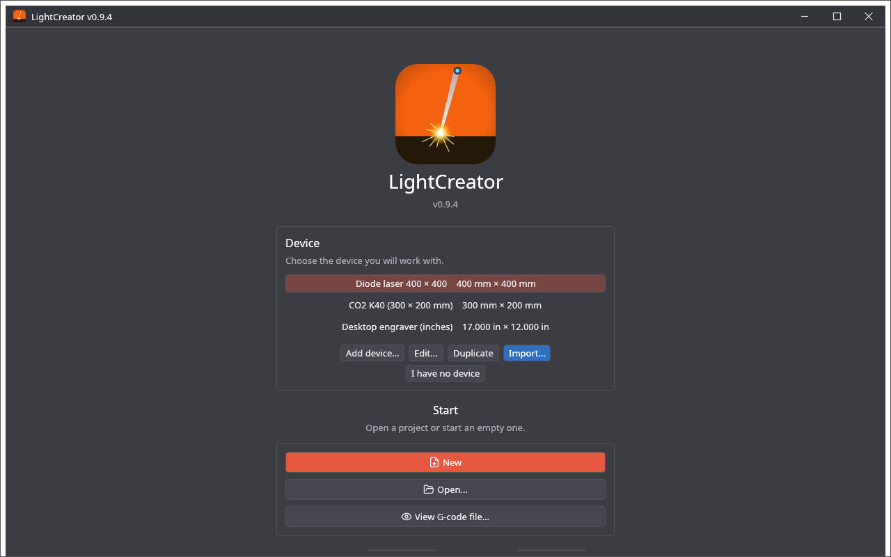
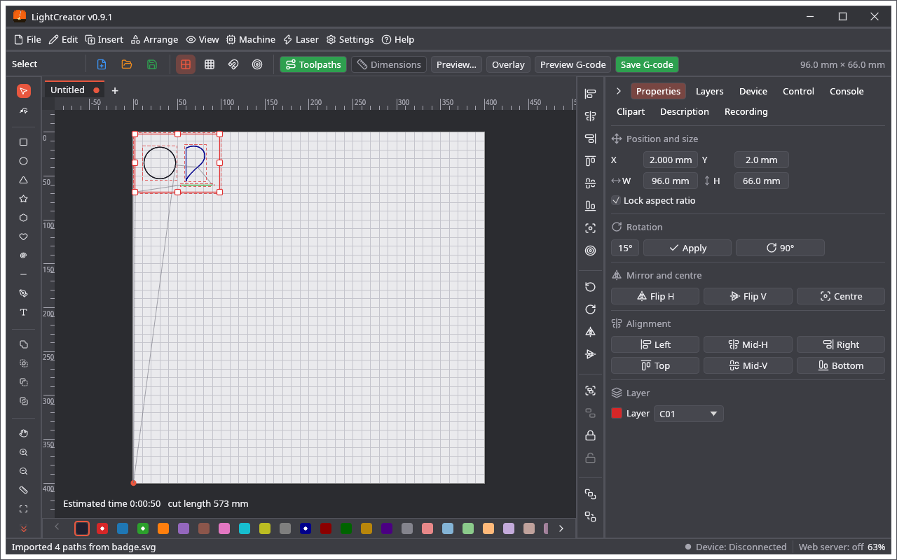
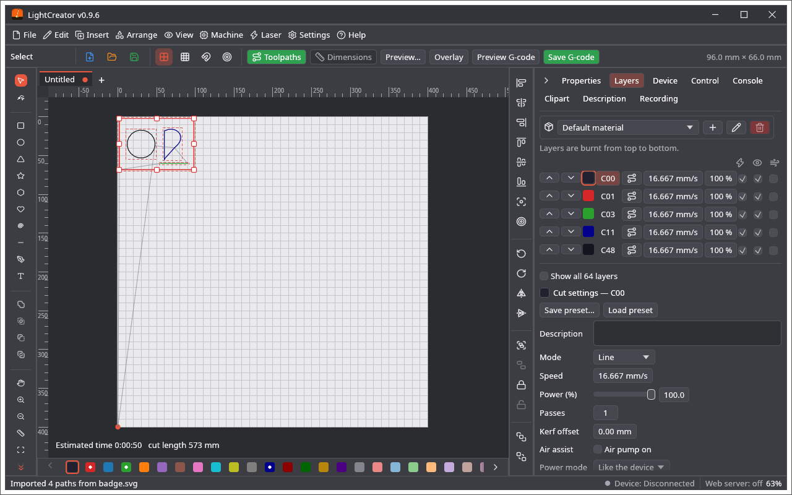
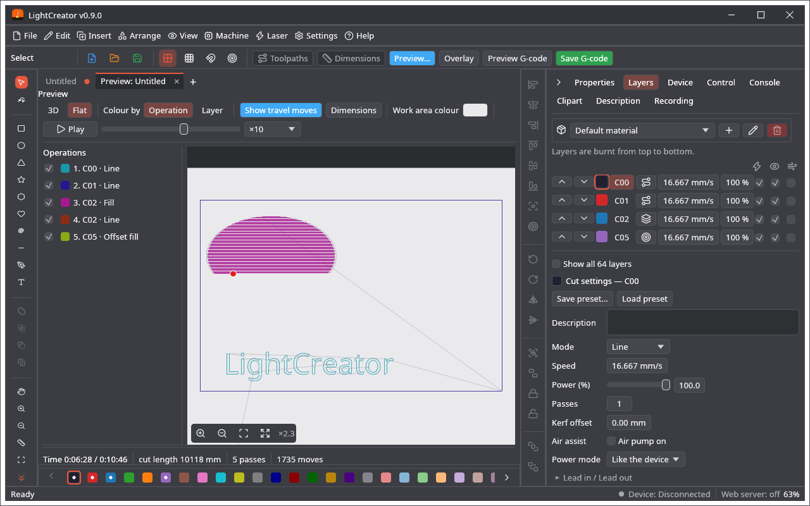

🌐 [English](Quick-Start) · [Polski](Szybki-start) · **简体中文** · [한국어](Quick-Start-KO)

> ⚠️ 本页由英文版机器翻译而成，可能有不准确之处。如有疑问，请以[英文版](Quick-Start)为准。欢迎提出修改建议。

# 快速入门

你的第一项工作，一步一步来：从启动窗口到烧刻完成的成品。下文中的每个标签都是程序中显示的标签；各个菜单在 [菜单](Menus-ZH) 页面中逐项说明。

> ⚠️ 第一次测试请在废料上以低功率进行，佩戴护目镜，并守在机器旁。参见 [安全与限制](Safety-and-Limitations-ZH)。

## 1. 启动程序并选择设备

安装并启动 LightCreator（[安装](Installation-ZH)）。**启动窗口**（**start window**）分为两部分。

* **设备**（**Device**）（“选择你要使用的设备。”）：你的设备列表，带有 **添加设备…**（**Add device…**）、**编辑…**（**Edit…**）、**复制**（**Duplicate**）、**导入…**（**Import…**）和 **我没有设备**（**I have no device**）。
* **开始**（**Start**）（“打开项目或新建一个空项目。”）：**新建**（**New**）、**打开…**（**Open…**）、**查看 G-code 文件…**（**View G-code file…**）以及你最近打开的文件。在其下方可以选择 **语言**（**Language**）和 **配色方案**（**Colour scheme**）。

第一次使用时列表是空的。按 **添加设备…**。一个窗口会询问基本信息：

* **名称**（**Name**）、**控制器**（**Controller**）（GRBL、Marlin、Smoothieware、Ruida、Trocen）和 **连接类型**（**Connection type**）：串口 **端口**（**Port**）（用 **刷新**（**Refresh**）重新查找端口），或网络 **主机**（**Host**）和 **TCP 端口**（**TCP port**）。
* **从设备读取**（**Read from device**）（蓝色）：在机器已连接的情况下，从控制器读取工作区和速度。
* **单位**（**Units**）、**速度单位**（**Speed units**）、**工作区**（**Work area**）（X 和 Y）、**机器零点 (0,0)**（**Machine zero (0,0)**）（机器零点所在的角）、**S 值最大值 ($30)**（**S-value max ($30)**）、**激光类型**（**Laser type**），以及（如果有的话）**摄像头**（**Camera**）。
* **值得检查**（**Worth checking**）：该窗口无法得知的内容列表（例如尚未读取激光模式和 `$30`）。

**添加设备**（**Add device**）会将设备放入列表并选中它。**更多设置…**（**More settings…**）会打开完整的设备窗口，并带上你已输入的内容。**我没有设备** 会创建一个名为 **Dummy** 的简单设备，用于在没有机器的情况下准备项目。

选中设备并按 **新建**。（如果根本没有设备，**新建** 和 **打开…** 会创建并使用 Dummy。）编辑器打开，标签页中是一个空白绘图。之后你可以在 **机器 → 设备设置…**（**Machine → Device settings…**）中检查或更改设备，并通过 **机器 → 切换设备…**（**Machine → Switch device…**）选择其他设备。所有设置都在 [设备与控制器](Devices-and-Controllers-ZH) 页面中。

### 项目设置

按 **新建** 后，**项目设置**（**Project setup**）窗口（也可通过 **文件 → 项目设置…**（**File → Project setup…**）打开）会询问材料的情况：**块料**（**Block**）（其宽度、高度和厚度；**工作区即材料**（**Work area is the material**）会使工作区与材料一样大）或 **圆柱（旋转）**（**Cylinder (rotary)**）（其直径和长度；应用后会打开设备的旋转附件）。块料可以是 **双面作业**（**Two-sided job**）：A 面和 B 面成为两个工作区，工作区上方有 **A 面 / B 面**（**Side A / Side B**）切换开关。选择材料 **翻转所绕的轴**（**Turned over round**）：**H**（水平轴：前后互换）或 **V**（垂直轴：左右互换），以及是否添加 **对齐标记**（**Alignment marks**）：材料外侧紧挨着的四个角标记，位于最后一个图层（64）上，在 A 面之前烧刻在材料下方的垫板上，用于把翻转后的材料放回同一位置。B 面按材料翻转后的摆放方式绘制，并按绘制的样子烧刻（作业始终是当前显示的那一面）；每一面都会以淡色虚线 **幽灵**（**ghosts**）显示翻转后的另一面，这些幽灵无法被选中（**另一面的幽灵**（**Ghosts of the other side**））。材料位于机器零点所在的角，距边缘 3 mm（工作区上的虚线轮廓）。**预览**（**Preview**）也有同样的 **A 面 / B 面** 切换开关。绿色的 **应用**（**Apply**）和蓝色的 **跳过**（**Skip**）位于窗口底部。对新项目按 **跳过**（或关闭该窗口）会使其保持单面，大小与设备的工作区相同。

## 2. 绘制形状或导入设计

* **绘制：**在左侧或 **插入**（**Insert**）菜单中选择一个工具，例如 **矩形 (R)**（**Rectangle (R)**），然后在工作区上拖动（按住 Shift 保持正方形）。**文字 (T)**（**Text (T)**）：点击后输入。尺寸和位置可以在右侧的 **属性**（**Properties**）标签页中输入。
* **导入：****文件 → 导入 → 导入 SVG…**（**File → Import → Import SVG…**）（Ctrl+I）会添加 SVG 文件中的形状；文件中的每种颜色都会进入一个图层。同一子菜单还可以读取图片、Illustrator / PDF / EPS / VectorCraft、DXF、LightBurn 和 UGS 文件。也可以把文件拖到窗口上。
* **现成图片：****剪贴画**（**Clipart**）标签页，参见 [剪贴画库](Clipart-Gallery-ZH)。

用点击或框选进行选择，通过拖动或方向键移动（1 mm，按住 Shift：10 mm）。**排列**（**Arrange**）菜单以及工作区旁边的窄工具栏可以对齐、居中、旋转和编组。参见 [设计工具](Design-Tools-ZH)。

## 3. 将形状放到图层上并设置图层

形状的颜色就是它的 **图层**（**layer**），图层决定了它如何被烧刻。

* 工作区下方的一排颜色是 **图层栏**（**layer bar**）。选中形状后点击一种颜色：它们就会移到该图层。未选中任何内容时，点击会选择新形状所在的图层。
* **双击** 某种颜色（或 **图层**（**Layers**）标签页中的某个图层）可打开 **图层选项**（**Layer options**）：**名称**（**Name**）、**颜色**（**Colour**）、**输出（烧刻此图层）**（**Output (burn this layer)**）、**可见**（**Visible**），然后是 **模式**（**Mode**）（**线条**（**Line**）沿轮廓走，**填充**（**Fill**）扫描内部，**填充 + 线条**（**Fill + Line**），**偏移填充**（**Offset fill**））、**速度**（**Speed**）、**功率 (%)**（**Power (%)**）、**遍数**（**Passes**）、填充线的 **间距**（**Interval**）等。新图层以 100 % 功率和 1000 mm/min 开始。
* **图层** 标签页按烧刻顺序列出正在使用的图层（**显示全部 64 个图层**（**Show all 64 layers**）会显示其余图层）；上下移动它们可以改变顺序。其标题显示这些图层所使用设置对应的 **材料**（**material**）；可以在那里选择另一种材料，或在 **激光 → 材料…**（**Laser → Materials…**）中管理材料。

所有设置都在 [切割与图层](Cuts-and-Layers-ZH) 页面中。

## 4. 烧刻前查看作业

* **刀具路径**（**Toolpaths**）（工作区上方的工具栏；开启时为绿色）直接在绘图上绘制路径。
* 同一工具栏上的 **预览…**（**Preview…**），或 **激光 → 预览窗口…**（**Laser → Preview window…**）（Ctrl+Shift+P），会打开 **预览**（**Preview**）标签页：每个操作都有自己的颜色（**着色依据**（**Colour by**）**操作**（**Operation**）或 **图层**（**Layer**））、**显示空移**（**Show travel moves**）、带滑块和速度的 **播放**（**Play**）（**适配 15 秒**（**Fit 15 s**）、**实时**（**Real time**）、×10、×50、×200）、带有各自开关的 **操作**（**Operations**）列表，以及汇总：时间、切割长度、遍数和移动次数。

* **预览 G-code**（**Preview G-code**）（在工具栏上 **保存 G-code**（**Save G-code**）旁边）生成程序并在标签页 **预览 G-code: name.gcode**（**Preview G-code: name.gcode**）中以文本形式显示，不保存任何内容。代码中的词会着色，文本可以编辑。标签页中的 **保存 G-code** 将其写入文件，**重新生成**（**Make again**）会根据项目重新生成（如有编辑会先询问：**放弃编辑？**（**Lose the edits?**）），**分析**（**Analyse**）显示其刀具路径。只要你没有编辑过它，在你保存项目、修改其备注（**描述**（**Description**）标签页，备注会以 `; Note:` 注释写入文件）、更换设备或切换后处理器时，文本都会自动重新生成。

标签页可以拖入最多三个窗格（**视图 → 拆分视图：并排**（**View → Split view: side by side**）），使绘图和预览并排显示。参见 [窗格与标签页](Panes-and-Tabs-ZH)。

## 5. 保存 G-code，或将作业发送到机器

**没有机器时（或用于存储卡或其他程序）：**使用工具栏上的 **保存 G-code**、**文件 → 导出 → 导出 G-code…**（**File → Export → Export G-code…**）或 **激光 → 导出 G-code…**（**Laser → Export G-code…**）（Ctrl+E）。程序会先检查作业（超出工作区的对象是错误；功率为 0 % 的图层是警告），然后写入文件，并经过你在 [插件](Plugins-ZH) 中启用的后处理器。对于 Ruida 和 Trocen，请使用 **文件 → 导出 → 导出 PLT / DXF…**（**File → Export → Export PLT / DXF…**），并在控制器自带的软件中打开该文件。[GRBL 模拟器](GRBL-Simulator-ZH) 可以在没有激光器的情况下运行作业。

**连接了激光器时（GRBL、Marlin、Smoothieware）：**

1. 在 **设备**（**Device**）标签页中按 **连接**（**Connect**）（绿色）。连接后会读取一次 GRBL：如果激光模式（`$32`）关闭，会弹出窗口提醒你，并提供开启选项。
2. 在 **控制**（**Control**）标签页中设置 **框选功率**（**Frame power**）（0 % 时框选过程中激光保持关闭；1–2 % 时二极管激光器上会显示一个暗淡的光点）。
3. **轮廓**（**Outline**）（激光沿包围所有形状的线移动）或 **轮廓框**（**Outline frame**）（包围它们的矩形框；也可用 **机器 → 框选**（**Machine → Frame**））显示作业将要烧刻的位置。把材料放到那里。
4. **START** 检查作业并发送。运行过程中，**暂停**（**Pause**）和 **继续**（**Resume**）用于暂停和继续，宽大的红色 **STOP** 结束作业。**机器 → 开始作业**（**Machine → Start job**）与 START 作用相同；**机器 → 从某行开始…**（**Machine → Start from line…**）从程序的某一行继续作业。
5. **控制台**（**Console**）标签页显示发送给控制器以及从控制器接收的所有内容。

按钮下方的作业选项（**一次一个元素**（**One element at a time**）、**仅选中内容**（**Selection only**））以及作业从哪里开始（**起始位置**（**Start from**））在 [设备与控制器](Devices-and-Controllers-ZH) 中有说明。

## 6. 摄像头（如果设备有的话）

在设备设置中（**摄像头**（**Camera**）页面）填写摄像头地址后，工具栏会显示 **摄像头视图**（**Camera view**）：实时画面，带有 **拍照**（**Take a photo**）、**录制视频**（**Record video**）和延时摄影。**叠加**（**Overlay**）（在工具栏上）将照片或摄像头画面放在设计下方，以便你在材料上摆放作品：在未显示叠加层时，它会打开 **摄像头叠加**（**Camera overlay**）窗口（与 **视图 → 叠加来源…**（**View → Overlay from…**）相同），你可以在其中加载图片或启动摄像头，并将其四个角拖到正确位置。叠加层会保存在项目文件中。参见 [设备与控制器](Devices-and-Controllers-ZH)。

## 7. 保存项目

**文件 → 保存**（**File → Save**）（Ctrl+S）写入一个 `.cre` 项目，其中包含绘图、图层、材料、备注和叠加图片。自动保存（**设置 → 程序选项…**（**Settings → Program options…**））会在两次保存之间保护你的工作。参见 [设置与文件](Settings-and-Files-ZH)。

内置的 **快速指南**（**Quick guide**）（F1）介绍了程序中的各个选项，并带有搜索功能。
