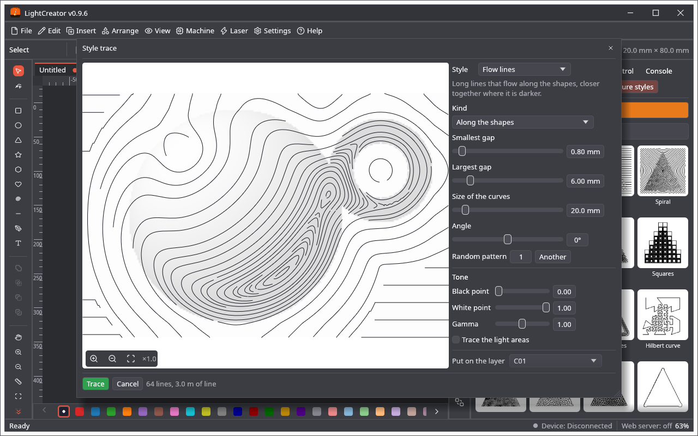

🌐 [English](Style-Trace) · [Polski](Obrys-w-stylu) · **简体中文** · [한국어](Style-Trace-KO)

> ⚠️ 本页由英文版机器翻译而成，可能有不准确之处。如有疑问，请以[英文版](Style-Trace)为准。欢迎提出修改建议。

# 风格描摹

**排列 → 风格描摹…**（**Arrange → Style trace…**）以 21 种风格之一将所选图片重新绘制为线条，可直接用于烧刻：波浪线、螺旋线、波纹、半色调圆、排线、点画、一笔画、流线、素描等。它也位于图片的右键菜单中，以及 **属性**（**Properties**）的 **图像**（**Image**）部分中。它在 LightCreator、MillCreator、PenCreator 和 BaseCreator 中的工作方式相同。

## 分步说明

1. 选择一张图片，然后选择 **风格描摹…**（**Style trace…**）。
2. 选择 **风格**（**Style**）；其下方的一行文字说明它绘制的内容。有些风格有 **种类**（**Kind**）选项（例如点画可选择点、短划线或三角形）。
3. 调整该风格的设置。预览会准确显示将被放到绘图上的线条；预览在后台计算，因此窗口永远不会卡住（旧的线条会以灰色保留，直到新的线条准备好）。按钮下方的一行文字说明线条的数量及其总长度。
4. **色调**（**Tone**）：**黑场**（**Black point**）和 **白场**（**White point**）截去最暗和最亮的灰度，**伽马**（**Gamma**）提亮（大于 1）或压暗中间调，**描摹亮区**（**Trace the light areas**）将暗和亮互换。
5. **放到图层**（**Put on the layer**）：程序会选择第一个 **线条**（**Line**）模式的空图层（设置为 **填充**（**Fill**）的图层会被跳过）；描摹会将该图层设置为 **线条**，因此这些线条会按线条烧刻。图片自身所在的图层仍然是 **图像**（**Image**）图层，因此你可以同时烧刻图片和线条，或关闭其中之一。你也可以从列表中选择其他图层。
6. **之后删除图像**（**Delete the image afterwards**）会在生成线条后删除图片。
7. **描摹**（**Trace**）将线条作为一个形状放到绘图上，位于图片所在的位置（随图片一起移动、旋转和缩放）。**编辑 → 撤销**（**Edit → Undo**）可将其撤回。

使用随机性的风格（点画、流线、素描、涂鸦、方块、针线、Truchet 拼贴）有一个 **随机图案**（**Random pattern**）编号：相同的编号每次都会生成相同的线条，**换一个**（**Another**）会尝试另一个编号。

## 风格

| 风格 | 绘制的内容 | 设置 |
|---|---|---|
| **波浪线**（**Squiggle**） | 成行的线条，在图片较暗的地方波动得更快、更高。 | **线条间距**（**Spacing of the lines**）、**波高**（**Wave height**）、**每毫米波数**（**Waves per mm**）、**角度**（**Angle**）；种类：从边到边的行，或 **在白色处抬笔**（**Lift the pen over white**）。 |
| **锯齿**（**Sawtooth**） | 与波浪线相同的行，但为锯齿形。 | 同波浪线。 |
| **弹簧**（**Springs**） | 像拉伸弹簧一样的成行线圈，越暗的地方线圈越大。 | 同波浪线。 |
| **螺旋线**（**Spiral**） | 从中心出发的一条螺旋线，在阴影处摆动更大（其他程序中的 *Frequency lines*）。 | **圈间距**（**Spacing of the turns**）、**波高**、**每毫米波数**；种类：波形或锯齿形。 |
| **波纹**（**Waves**） | 被暗度抬起的线条行，像从侧面看到的地形；前面的行会遮住后面的内容。 | **线条间距**、**波纹高度**（**Height of the waves**）；种类：隐藏后面的内容，或完整绘制每一行。 |
| **半色调圆**（**Halftone circles**） | 圆的网格，圆的大小随色调变化，就像印刷照片中一样。 | **单元格大小**（**Cell size**）、**最大圆**（**Largest circle**）、**环间距**（**Spacing of the rings**）、**角度**；种类：圆、环（用环填充）或螺旋线。 |
| **蚀刻**（**Etching**） | 分层排线，就像旧式版画一样：每深一级色调就增加一个方向的线条。 | **线条间距**、**色调级数**（**Tone levels**）（1 到 6）、**角度**；种类：直线或波浪线。 |
| **方块**（**Squares**） | 一个套一个的方块网格，越暗的地方方块越多。 | **单元格大小**、**每个单元格最多方块数**（**Most squares in a cell**）、**抖动**（**Shake**）（随机旋转）、**角度**。 |
| **针线**（**Needles**） | 网格上的短笔画，越暗的地方越长。 | **单元格大小**、**笔画长度**（**Stroke length**）、**角度**；种类：沿形状、按角度或随机。 |
| **Truchet 拼贴**（**Truchet tiles**） | 随机旋转的四分之一圆拼贴，越暗的地方圆弧越多。 | **拼贴大小**（**Tile size**）、**每块拼贴最多圆弧数**（**Most arcs in a tile**）。 |
| **等高线**（**Contour lines**） | 亮度相等的线，就像地图上的等高线。 | **平滑**（**Smoothing**）、**色调级数**（2 到 40）。 |
| **希尔伯特曲线**（**Hilbert curve**） | 一条空间填充曲线，越暗的地方转折越细密。 | **最小步长**（**Smallest step**）、**色调级数**；种类：一条线，或 **在白色处抬笔**。 |
| **点画**（**Stippling**） | 按色调分布的点（加权 Voronoi 点画）：阴影处密集，亮处稀疏。 | **点数**（**Number of dots**）、**点大小**（**Dot size**）；种类：点、按色调变化的圆、短划线或三角形。 |
| **一笔画 (TSP)**（**One line (TSP)**） | 将点画的点连接成一条不自交的线，绘制时不抬笔。 | **点数**（最多 15 000）。 |
| **三角形和单元**（**Triangles and cells**） | 在按色调分布的点上生成三角形网格（Delaunay），或围绕各点的单元网格（Voronoi）。 | **点数**；种类：三角形或单元。 |
| **线稿**（**Line art**） | 只有图片的边缘，以线条表示。 | **最小细节**（**Smallest detail**）、**边缘灵敏度**（**Edge sensitivity**）、**最短线条**（**Shortest line**）；种类：边缘，或边缘加暗区。 |
| **流线**（**Flow lines**） | 沿形状流动的长线条，越暗的地方越密。 | **最小间隙**（**Smallest gap**）（在最暗的部分）、**最大间隙**（**Largest gap**）（在最亮的部分）、**曲线大小**（**Size of the curves**）、**角度**；种类：沿形状或随机流场。 |
| **素描**（**Sketch**） | 在图片最暗处排布的许多短直笔画，就像铅笔素描一样。 | **笔画长度**、**笔画数量**（**Number of strokes**）、**单笔墨量**（**Ink of one stroke**）（一笔带走多少暗度）；种类：独立笔画或连成链的笔画。 |
| **涂鸦**（**Scribble**） | 一条游走的环线，把暗的部分涂满。 | **环大小**（**Loop size**）、**线条长度**（**Length of the line**）（米）、**单遍墨量**（**Ink of one pass**）。 |
| **V 形雕刻**（**V-carve**） | 按角度排列的线条，每条线的宽度取决于沿线图片的暗度：亮处细，阴影处宽，就像 V 形铣刀切得越深就越宽。每条线被切分为若干段，每段的亮度决定其宽度；每条线都是一个闭合轮廓。变体：**平滑**（**Smooth**）（通过各段的平滑曲线）或 **棱角**（**Angular**）（各段之间为直线）。 | **线条宽度**（**Width of the lines**）（也是最宽的线）、**段长度**（**Length of the pieces**）、**最细线条**（**Thinnest line**）（白色处所占宽度的比例；0：该处没有线）、**角度**。 |
| **几何多边形**（**Geometric polygons**） | 将图片的暗色形状分割为多边形（三角形和四边形），图片有边缘的地方多边形更多，多边形之间以及轮廓周围留有间隙：一幅几何（低多边形，low poly）图像，可用作墙面装饰或镂空模板。轮廓跟随形状，多边形被裁剪到轮廓内。也可通过 **排列 → 几何多边形…**（**Arrange → Geometric polygons…**）打开。变体：**三角形和四边形**（**Triangles and quadrangles**）、**三角形**（**Triangles**）；更换 **种子**（**seed**）会得到不同的多边形；色调设置（黑场）决定什么是暗色形状。 | **多边形间隙**（**Gap between the polygons**）（0：每条边为一条线）、**多边形数量**（**Number of polygons**）、**跟随边缘**（**Follow the edges**）（0：均匀，1：仅按边缘）。 |

## 须知

* 设置以图片的毫米为单位，因此更大的图片会得到更多的线条，而不是更粗的线条。请使线条间距大于笔、激光光斑或铣刀的宽度。
* 点是一个小的闭合圆，因此它会像其他线条一样被绘制、烧刻或雕刻。
* **一笔画 (TSP)**、**螺旋线** 和 **希尔伯特曲线** 以一次长距离移动绘制；其他风格会按一定顺序排列，使线条之间的移动尽量短。
* 非常精细的设置会产生大量的点：当绘图会变慢时，按钮下方的一行文字会发出警告，结果最多为两百万个点。
* 当风格需要更高的对比度时，请先调整图片（**排列 → 调整图像…**（**Arrange → Adjust image…**）：亮度、对比度、色阶）。

另请参见：[设计工具](Design-Tools-ZH)、[菜单](Menus-ZH)。

## 图片风格面板

选中一张图片时，侧面板中会有一个 **图片风格**（**Picture styles**）标签页（选中图片时会自动打开，没有选中图片时会消失）。其顶部有一个与面板同宽的橙色按钮，用于打开 **编辑图像…**（**Edit image…**）（照片编辑器），其下方另有一个按钮用于打开 **描摹图像…**（**Trace image…**）；再往下，与图库一样，是每种风格的小图（以该风格绘制的一个三角形）。单击其中一个会打开 **风格描摹**，并已选好该风格。
