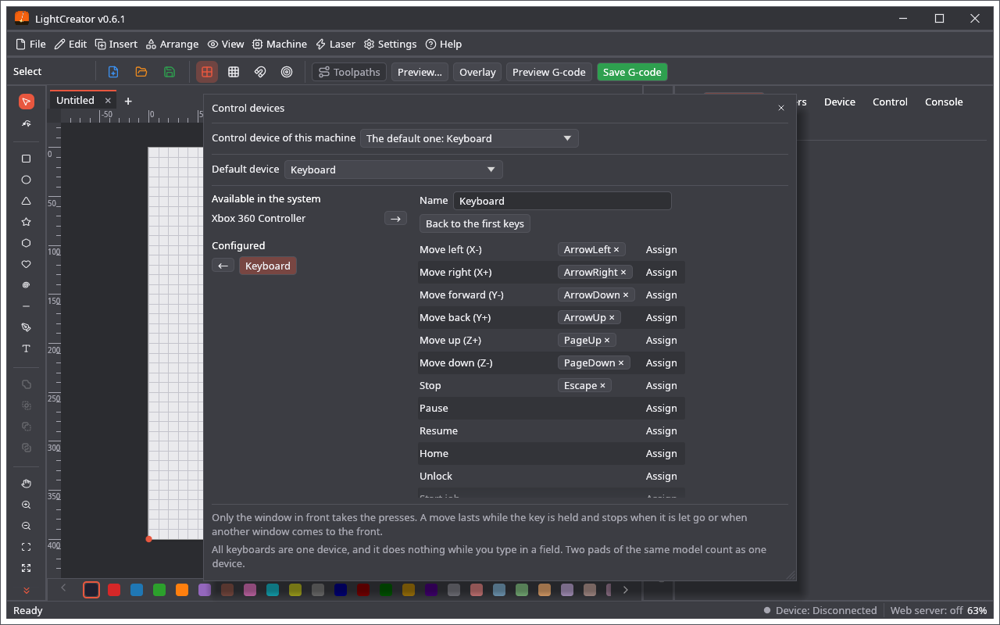

# Urządzenia sterujące

Maszyną można sterować padem USB albo klawiaturą. **Maszyna → Urządzenia sterujące ▸** ma dwie pozycje: **Ustawienia urządzeń sterujących…** otwiera okno urządzeń i ich klawiszy, a **Urządzenie sterujące tej maszyny…** wybiera urządzenie otwartej maszyny.

## Urządzenia

Okno ma dwie listy. **Dostępne w systemie** pokazuje klawiaturę i podłączone pady, które nie są jeszcze ustawione, a **Skonfigurowane** te, które są. Strzałka przenosi urządzenie z jednej listy na drugą. Urządzenie przeniesione z powrotem zachowuje klawisze na wypadek ponownego dodania.

* Wszystkie klawiatury komputera to jedno urządzenie, bo system nie mówi oknu, która została naciśnięta.
* Każdy model pada to urządzenie z własnymi klawiszami; dwa pady tego samego modelu liczą się jako jedno.
* **Domyślne urządzenie** wybiera to, którego używają wszystkie maszyny i programy, o ile maszyna nie ma własnego, albo **Brak domyślnego urządzenia**. Pierwsze skonfigurowane urządzenie staje się domyślne.

Urządzenia i wybór domyślnego są wspólne dla LightCreatora, MillCreatora i PenCreatora. Zmiana w jednym programie dociera do pozostałych w ciągu sekundy.

## Klawisze

**Przypisz** przy akcji czeka na naciśnięcie na wybranym urządzeniu. Klawisz lub przycisk robi jedną rzecz: przypisanie go do innej akcji zabiera go poprzedniej. Gałka działa jak dwa przyciski, po jednym na kierunek. **×** na klawiszu usuwa go, a **Przywróć pierwotne klawisze** zaczyna od nowa. **Ostatnio naciśnięty** pokazuje, co wysyła urządzenie, co pomaga przy padzie z przyciskami bez nazw.

Nowe urządzenie ma tylko ruchy i Stop. Nic, co coś włącza, nie ma klawisza, dopóki go nie przypiszesz. Urządzenie przechowuje klawisze wszystkich trzech programów; tutaj widać to, co potrafi LightCreator:

Ruch w X i Y (i w Z, gdy urządzenie je ma), Stop, Pauza, Wznów, Bazuj, Odblokuj, Rozpocznij zadanie, Obrys, **Powietrze wł. / wył.** (polecenia powietrza z urządzenia) oraz **Słaba wiązka, gdy wciśnięty** (wiązka do ogniskowania z urządzenia; gaśnie po puszczeniu klawisza).

## Urządzenie maszyny

**Urządzenie sterujące tej maszyny…** wybiera urządzenie otwartej maszyny. Jedno urządzenie może obsługiwać wiele maszyn. Maszyna bez własnego urządzenia albo z usuniętym używa domyślnego. Bez domyślnego nic się nie dzieje.

## Jak to działa

* Naciśnięcia odbiera tylko okno na wierzchu i przekazuje je maszynie w nim otwartej.
* Ruch trwa, dopóki klawisz jest wciśnięty (GRBL 1.1); przy starszym sterowniku każde naciśnięcie to jeden krok. Kończy się po puszczeniu klawisza, gdy na wierzch wyjdzie inne okno, gdy pad zniknie albo przy zmianie maszyny.
* Podczas zadania działają tylko Stop, Pauza i Wznów.
* Gdy okno ustawień jest otwarte, maszyna nie reaguje: wybierasz wtedy klawisze.
* Klawiatura nic nie robi podczas pisania w polu ani z wciśniętym Ctrl, Cmd lub Alt. Przy podłączonej maszynie jej klawisze idą do maszyny, nie do edytora: przy pierwotnych klawiszach strzałki nie przesuwają zaznaczonego kształtu aż do rozłączenia.
* Urządzenie nie zastępuje wyłącznika awaryjnego. Trzymaj rękę blisko prawdziwego.

## Kopia zapasowa

Urządzenia, ich klawisze i wybór domyślnego są w kopii zapasowej każdego z trzech programów (`control_devices` w `app.ron`), a wybór dla maszyny zapisuje się z maszyną. Przywracanie zastępuje definicje we wszystkich trzech programach, bo są wspólne; starsza kopia bez nich ich nie rusza. Na dysku są w `control_devices.json` we wspólnym folderze danych.
