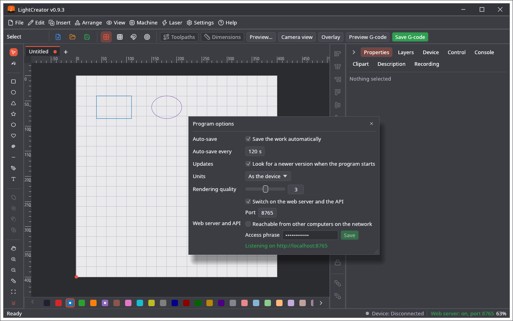

🌐 [English](Web-Server-and-API) · [Polski](Serwer-WWW-i-API) · [简体中文](Web-Server-and-API-ZH) · **한국어**

> ⚠️ 이 페이지는 영어판을 기계 번역한 것으로, 부정확한 부분이 있을 수 있습니다. 의심스러우면 [영어판](Web-Server-and-API)을 기준으로 하십시오. 수정 제안을 환영합니다.

# 웹 서버와 API

**설정 → 프로그램 옵션… → 웹 서버와 API**(Settings → Program options… → Web server and API)는 LightCreator에 내장된 작은 웹 서버를 켭니다. **기본값은 꺼짐**입니다. 이 서버는 기계의 상태, 프로젝트, 카메라를 브라우저(휴대폰 포함)에 보여 주고, 다른 프로그램을 위한 API를 제공합니다.

**모든 요청에는 접근 문구가 필요합니다**(같은 옵션에서 옆의 *저장*(Save) 버튼으로 설정; 처음 값은 `LightCreator`이므로 다른 컴퓨터의 접근을 허용하기 전에 바꾸십시오). 브라우저가 문구를 묻습니다(사용자 이름은 아무것이나, 문구는 비밀번호 칸에). 프로그램은 이를 HTTP Basic 인증으로 보냅니다. 예: `curl -u any:LightCreator http://localhost:8765/api/status`. 잘못된 문구에는 잠시 기다린 뒤 401로 응답합니다. **암호화는 없으므로** 네트워크를 엿들을 수 있는 사람은 누구나 문구와 데이터를 읽을 수 있으며, 문구는 `app.ron`에 base64로 보관됩니다(한눈에 읽을 수는 없지만, base64는 인코딩일 뿐 암호화가 아닙니다). 기본적으로 서버는 이 컴퓨터에서만 수신합니다(`http://localhost:8765`). *네트워크의 다른 컴퓨터에서 접근 가능*(Reachable from other computers on the network)을 켜면 모든 인터페이스에서 수신하므로, 네트워크에 있는 누구나 기계를 보고 정지시키거나 움직일 수 있습니다. 신뢰하는 네트워크에서만 사용하고, 절대 인터넷에 포트를 열지 마십시오.

같은 서버가 MillCreator, PenCreator, BaseCreator에도 있으며, 모두 한 컴퓨터에서 실행할 수 있도록 각자 다른 포트를 사용합니다: **8765** LightCreator, **8766** MillCreator, **8767** PenCreator, **8768** BaseCreator (BaseCreator는 프로젝트만 보여 줌).

## 웹 페이지
`http://localhost:<port>/`에는 장치, 그 상태, 위치, 예상 시간 대비 작업 진행 시간, 진행률 바가 있는 바와 **테마**(Theme) 목록이 있습니다. 페이지는 프로그램의 색 구성표로 시작합니다(18개 구성표 모두 제공; 선택은 브라우저에 보관됨).

컴퓨터에서는 페이지가 두 열로 표시됩니다. 왼쪽 3분의 2에는 **카메라**(목록으로 활성 카메라를 고르며, 이는 장치의 활성 카메라를 바꿉니다; 카메라가 없으면 X 표시가 된 큰 카메라가 표시됨), 오른쪽 3분의 1에는 **제어 패널**(STOP, 원점 복귀(Home), 조그 취소(Cancel jog), 장치의 조그 단계만큼 한 단계씩 움직이는 8개의 조그 화살표), 그 아래에는 **프로젝트**가 그림으로 표시됩니다. 그림을 더블 클릭하면(또는 전체 화면 버튼을 누르면) 창 전체로 확대되며, 확대, 축소, 이동, 보기 재설정 버튼이 있습니다. 마우스 휠, 드래그, 두 손가락 핀치도 동작하며, Esc로 닫습니다.

카메라 화면은 프로그램에서처럼 회전됩니다. 장치 설정의 *카메라 회전*(Camera rotation)이 기본값이며(시계 방향 0°, 90°, 180°, 270°), 화면 위의 목록에서 다른 회전을 선택할 수 있고, 브라우저가 카메라별로 이를 기억합니다. `GET /api/cameras`는 각 카메라의 `rotation`과 `rotated` (스냅숏에 이미 적용된 회전량)를 제공합니다.

휴대폰에서는 페이지가 한 열입니다: 상태, 카메라, 프로젝트, 그리고 맨 아래에 제어 패널.

## API
별도로 언급하지 않는 한 모든 응답은 JSON입니다. 명령에는 `POST`가 필요합니다.

| 요청 | 기능 |
|---|---|
| `GET /api/status` | 프로그램, 장치(이름, 컨트롤러, 연결 여부, 상태, X, Y), 작업(실행 여부, 완료 / 전체 줄 수, 경과 및 예상 초), 프로젝트(파일 이름, 리비전, 설명) |
| `GET /api/project.svg` | 프로젝트를 SVG로 |
| `GET /api/cameras` | 카메라: 인덱스, 이름, 사용 여부, 활성 여부, `rotation`, `rotated`, `url` (카메라 자체의 http / https 주소 또는 `null`), `snapshot` |
| `GET /api/camera.jpg` | 카메라 보기의 최신 화면을 JPEG로(프로그램에서 카메라 보기가 열려 있는 동안에만; 그렇지 않으면 503) |
| `POST /api/stop` | 실행 중인 작업을 정지(STOP과 같음) |
| `POST /api/home` | 원점 복귀, 연결되어 있고 실행 중인 작업이 없을 때만 |
| `POST /api/cancel-jog` | 조그 취소 |
| `POST /api/jog?dir=…` | 한 단계 조그: `up`, `down`, `left`, `right`, `up-left`, `up-right`, `down-left`, `down-right`; 연결되어 있고 실행 중인 작업이 없을 때만, 허용 영역 안에서 |
| `POST /api/camera/select?index=N` | 카메라 N을 활성 카메라로 설정 |

명령은 해당 버튼의 규칙을 따릅니다. 여기에 있는 기능은 아직 실제 하드웨어에서 시험하지 않았으며, 서버 자체는 테스트로 검증됩니다.
