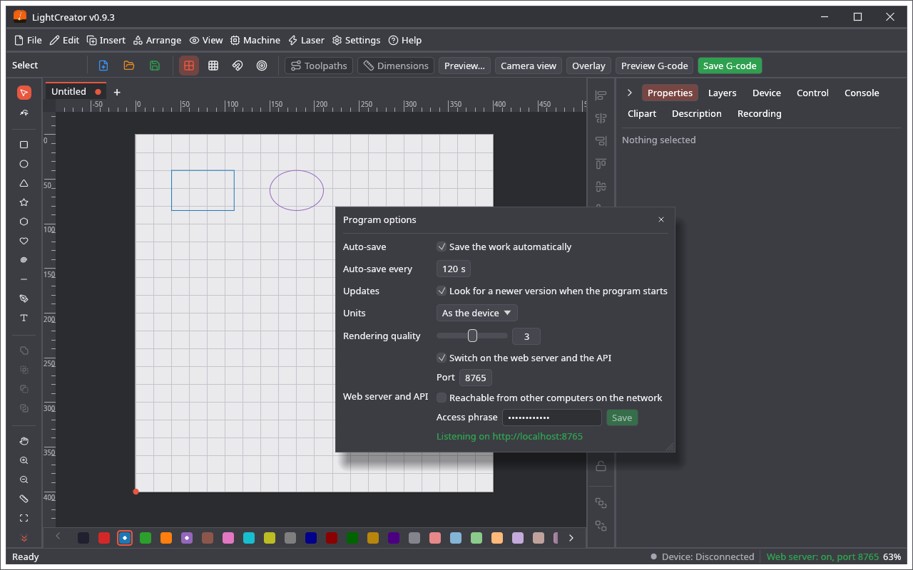

🌐 [English](Web-Server-and-API) · [Polski](Serwer-WWW-i-API) · **简体中文** · [한국어](Web-Server-and-API-KO)

> ⚠️ 本页由英文版机器翻译而成，可能有不准确之处。如有疑问，请以[英文版](Web-Server-and-API)为准。欢迎提出修改建议。

# Web 服务器与 API

**设置 → 程序选项… → Web 服务器和 API**（**Settings → Program options… → Web server and API**）会开启 LightCreator 内置的一个小型 Web 服务器。它 **默认关闭**。它可以在浏览器中（包括手机上）显示机器的状态、项目和摄像头，并为其他程序提供 API。

**每个请求都需要访问口令**（在同一选项中设置，旁边有 *保存*（*Save*）按钮；初始值为 `LightCreator`，在允许其他计算机访问之前请修改它）。浏览器会要求输入口令（用户名任意，口令填在密码字段中）；程序以 HTTP Basic 认证方式发送它，例如 `curl -u any:LightCreator http://localhost:8765/api/status`。口令错误时会在短暂等待后返回 401。**没有加密**，因此任何能够监听网络的人都可以读取口令和数据，并且口令以 base64 形式保存在 `app.ron` 中（无法一眼看出，但 base64 是一种编码，而不是加密）。默认情况下，服务器只在本机上监听（`http://localhost:8765`）。*可从网络中的其他计算机访问*（*Reachable from other computers on the network*）会使其在所有网络接口上监听：这时网络中的任何人都可以查看机器，并停止或移动它。只在你信任的网络中使用此功能，并且永远不要将该端口开放到互联网。

MillCreator、PenCreator 和 BaseCreator 中也有同样的服务器，各自使用自己的端口，以便它们都能在同一台计算机上运行：**8765** LightCreator、**8766** MillCreator、**8767** PenCreator、**8768** BaseCreator（BaseCreator 只显示项目）。

## 网页
`http://localhost:<port>/` 有一个显示设备、其状态、位置、作业已工作时间与估算时间以及进度条的栏，还有一个 **主题**（**Theme**）列表：页面一开始使用程序的配色方案（提供全部 18 种方案；你的选择会保存在浏览器中）。

在计算机上，页面分为两栏：左侧三分之二是 **摄像头**（一个列表用于选择活动摄像头，这会更改设备的活动摄像头；没有摄像头时显示一个大的划掉的摄像头图标），右侧三分之一是 **控制面板**（STOP、回零（Home）、取消点动（Cancel jog）以及八个点动箭头，每次移动设备点动步长的一步），其下方是以图片形式显示的 **项目**。双击图片（或按全屏按钮）可将其放大到整个窗口，并带有放大、缩小、移动和重置视图的按钮；鼠标滚轮、拖动和双指捏合也可以使用，按 Esc 关闭。

摄像头画面会像在程序中一样旋转：设备设置中的 *摄像头旋转*（*Camera rotation*）为默认值（顺时针 0°、90°、180°、270°），画面上方的列表允许你选择其他旋转角度，浏览器会为每个摄像头记住该选择。`GET /api/cameras` 提供每个摄像头的 `rotation` 和 `rotated`（快照已经包含的旋转量）。

在手机上，页面为单栏：状态、摄像头、项目，底部是控制面板。

## API
除非另有说明，所有响应都是 JSON。命令需要使用 `POST`。

| 请求 | 作用 |
|---|---|
| `GET /api/status` | 程序、设备（名称、控制器、是否已连接、状态、X、Y）、作业（是否运行中、已完成 / 总行数、已用和估算秒数）以及项目（文件名、修订版本、描述） |
| `GET /api/project.svg` | 以 SVG 形式返回项目 |
| `GET /api/cameras` | 摄像头列表：索引、名称、是否启用、是否活动、`rotation`、`rotated`、`url`（摄像头自己的 http / https 地址，或 `null`）以及 `snapshot` |
| `GET /api/camera.jpg` | 以 JPEG 形式返回摄像头视图的最新画面（仅在程序中打开了摄像头视图时可用；否则返回 503） |
| `POST /api/stop` | 停止正在运行的作业（与 STOP 相同） |
| `POST /api/home` | 回零，仅在已连接且没有作业运行时可用 |
| `POST /api/cancel-jog` | 取消点动 |
| `POST /api/jog?dir=…` | 点动一步：`up`、`down`、`left`、`right`、`up-left`、`up-right`、`down-left`、`down-right`；仅在已连接且没有作业运行时可用，并限于允许区域内 |
| `POST /api/camera/select?index=N` | 将摄像头 N 设为活动摄像头 |

这些命令遵循其所对应按钮的规则。这里的功能尚未在真实硬件上试验过；服务器本身有测试覆盖。
